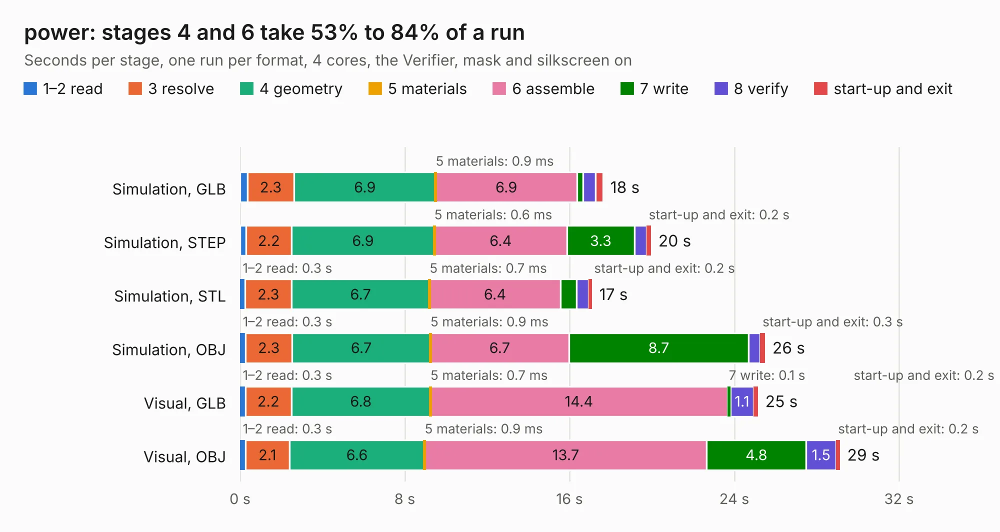

# 2052. power

Board 2,052 of the 3,122 of [Corpus Testing](../Corpus-Testing.md), on [Corpus Page 19](../CorpusTestingPages/Corpus-Testing-19.md#2052-power).

| Mode and format | 1–2 read | 3 resolve | 4 geometry | 5 materials | 6 assemble | 7 write | 8 verify | start-up and exit | Total |
|---|---:|---:|---:|---:|---:|---:|---:|---:|---:|
| Simulation, GLB | 0.4 | 2.3 | 6.9 | 0.9&nbsp;ms | 6.9 | 0.3 | 0.6 | 0.4 | 17.6 |
| Simulation, STEP | 0.3 | 2.2 | 6.9 | 0.6&nbsp;ms | 6.4 | 3.3 | 0.6 | 0.2 | 20.0 |
| Simulation, STL | 0.3 | 2.3 | 6.7 | 0.7&nbsp;ms | 6.4 | 0.8 | 0.6 | 0.2 | 17.1 |
| Simulation, OBJ | 0.3 | 2.3 | 6.7 | 0.9&nbsp;ms | 6.7 | 8.7 | 0.5 | 0.3 | 25.5 |
| Visual, GLB | 0.3 | 2.2 | 6.8 | 0.7&nbsp;ms | 14.4 | 0.1 | 1.1 | 0.2 | 25.2 |
| Visual, OBJ | 0.3 | 2.1 | 6.6 | 0.9&nbsp;ms | 13.7 | 4.8 | 1.5 | 0.2 | 29.1 |

<table align="center"><tr><td valign="top">

| Board | Repo: [olin-electric-motorsports/olin-electric-motorsports](https://github.com/olin-electric-motorsports/olin-electric-motorsports) Board: `power.kicad_pcb` |
|---|---|
| Folder | vehicle / mkvi / hardware / segment / power |
| Complexity | 310&nbsp;/&nbsp;1000 (size&nbsp;180, features&nbsp;130) |
| KESE&nbsp;features | through vias, slotted holes, rounded, trapezoid or chamfered pads, arc tracks, filled zones, curved board outline, stack-up, dielectric εr and tanδ, copper finish, mask and silkscreen colours |
| Tested | 9th November 2026 |
| Copper&nbsp;layers | 4 |
| File&nbsp;format | KiCad 7 (20221018) |
| Parts,&nbsp;tracks,&nbsp;vias | 4, 172, 813 |
| Triangles,&nbsp;simulation | 2,224,840 in 74 parts |
| Verifier | PASS in all six runs |

</td><td valign="top">

<table>
<tr><th>File type</th><th>File size</th><th>Peak memory used</th></tr>
<tr><th colspan="3" align="left">Simulation</th></tr>
<tr><td>GLB</td><td align="right">71&nbsp;MB</td><td align="right">869&nbsp;MB</td></tr>
<tr><td>STEP</td><td align="right">166&nbsp;MB</td><td align="right">944&nbsp;MB</td></tr>
<tr><td>STL</td><td align="right">111&nbsp;MB</td><td align="right">873&nbsp;MB</td></tr>
<tr><td>OBJ</td><td align="right">236&nbsp;MB</td><td align="right">1.5&nbsp;GB</td></tr>
<tr><th colspan="3" align="left">Visual</th></tr>
<tr><td>GLB</td><td align="right">40&nbsp;MB</td><td align="right">826&nbsp;MB</td></tr>
<tr><td>OBJ</td><td align="right">127&nbsp;MB</td><td align="right">876&nbsp;MB</td></tr>
</table>

</td></tr></table>

| Previous | Next |
|:---|---:|
| [2051. carrier-fix](b2051b_olin-electric-motorsports_carrier-fix.md) | [2053. thermistors](b2053b_olin-electric-motorsports_thermistors.md) |
