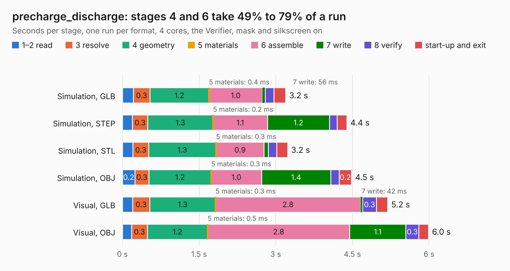

# 2056. precharge_discharge

Board 2,056 of the 3,119 of [Corpus Testing](../Corpus-Testing.md), on [Corpus Page 20](../CorpusTestingPages/Corpus-Testing-20.md#2056-precharge_discharge).

| Mode and format | 1–2 read | 3 resolve | 4 geometry | 5 materials | 6 assemble | 7 write | 8 verify | start-up and exit | Total |
|---|---:|---:|---:|---:|---:|---:|---:|---:|---:|
| Simulation, GLB | 0.2 | 0.3 | 1.2 | 0.4&nbsp;ms | 1.0 | 56&nbsp;ms | 0.2 | 0.2 | 3.2 |
| Simulation, STEP | 0.2 | 0.3 | 1.3 | 0.2&nbsp;ms | 1.1 | 1.2 | 0.1 | 0.2 | 4.4 |
| Simulation, STL | 0.2 | 0.3 | 1.3 | 0.3&nbsp;ms | 0.9 | 82&nbsp;ms | 0.2 | 0.2 | 3.2 |
| Simulation, OBJ | 0.2 | 0.3 | 1.2 | 0.3&nbsp;ms | 1.0 | 1.4 | 0.2 | 0.2 | 4.5 |
| Visual, GLB | 0.2 | 0.3 | 1.3 | 0.3&nbsp;ms | 2.8 | 42&nbsp;ms | 0.3 | 0.2 | 5.2 |
| Visual, OBJ | 0.2 | 0.3 | 1.2 | 0.5&nbsp;ms | 2.8 | 1.1 | 0.3 | 0.2 | 6.0 |

<table align="center"><tr><td valign="top">

| Board | Repo: [olin-electric-motorsports/olin-electric-motorsports](https://github.com/olin-electric-motorsports/olin-electric-motorsports) Board: `precharge_discharge.kicad_pcb` |
|---|---|
| Folder | vehicle / mkvi / hardware / service-section / precharge_discharge |
| Complexity | 228&nbsp;/&nbsp;1000 (size&nbsp;148, features&nbsp;80) |
| KESE&nbsp;features | through vias, rounded, trapezoid or chamfered pads, filled zones, stack-up, dielectric εr and tanδ, mask and silkscreen colours |
| Tested | 9th November 2026 |
| Copper&nbsp;layers | 2 |
| File&nbsp;format | KiCad 7 (20221018) |
| Parts,&nbsp;tracks,&nbsp;vias | 34, 215, 22 |
| Triangles,&nbsp;simulation | 320,336 in 95 parts |
| Verifier | PASS in all six runs |

</td><td valign="top">

<table>
<tr><th>File type</th><th>File size</th><th>Peak memory used</th></tr>
<tr><th colspan="3" align="left">Simulation</th></tr>
<tr><td>GLB</td><td align="right">11&nbsp;MB</td><td align="right">241&nbsp;MB</td></tr>
<tr><td>STEP</td><td align="right">53&nbsp;MB</td><td align="right">271&nbsp;MB</td></tr>
<tr><td>STL</td><td align="right">16&nbsp;MB</td><td align="right">256&nbsp;MB</td></tr>
<tr><td>OBJ</td><td align="right">33&nbsp;MB</td><td align="right">274&nbsp;MB</td></tr>
<tr><th colspan="3" align="left">Visual</th></tr>
<tr><td>GLB</td><td align="right">8.4&nbsp;MB</td><td align="right">264&nbsp;MB</td></tr>
<tr><td>OBJ</td><td align="right">24&nbsp;MB</td><td align="right">260&nbsp;MB</td></tr>
</table>

</td></tr></table>

| Previous | Next |
|:---|---:|
| [2055. motherboard](b2055b_olin-electric-motorsports_motherboard.md) | [2057. tsal-ail](b2057b_olin-electric-motorsports_tsal-ail.md) |
