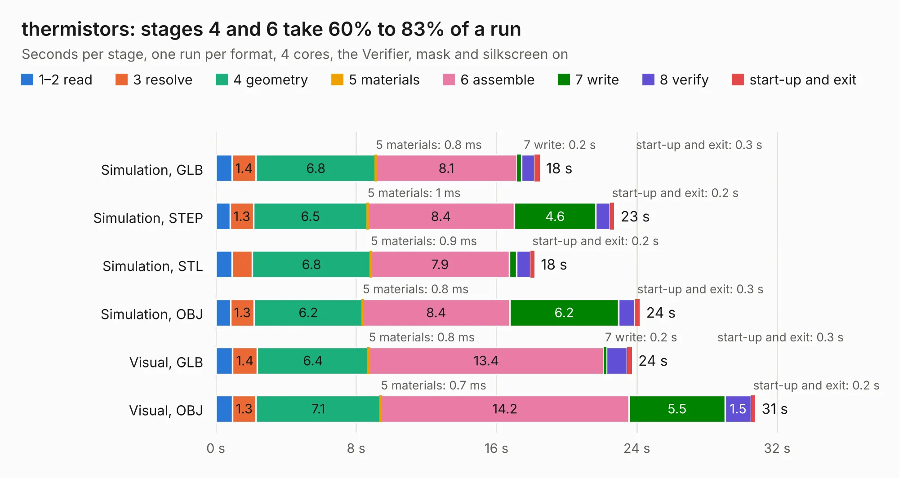

# 2056. thermistors

Board 2,056 of the 3,127 of [Corpus Testing](../Corpus-Testing.md), on [Corpus Page 20](../CorpusTestingPages/Corpus-Testing-20.md#2056-thermistors).

| Mode and format | 1–2 read | 3 resolve | 4 geometry | 5 materials | 6 assemble | 7 write | 8 verify | start-up and exit | Total |
|---|---:|---:|---:|---:|---:|---:|---:|---:|---:|
| Simulation, GLB | 0.9 | 1.4 | 6.8 | 0.8&nbsp;ms | 8.1 | 0.2 | 0.8 | 0.3 | 18.5 |
| Simulation, STEP | 0.8 | 1.3 | 6.5 | 1&nbsp;ms | 8.4 | 4.6 | 0.8 | 0.2 | 22.7 |
| Simulation, STL | 0.9 | 1.2 | 6.8 | 0.9&nbsp;ms | 7.9 | 0.4 | 0.8 | 0.2 | 18.2 |
| Simulation, OBJ | 0.8 | 1.3 | 6.2 | 0.8&nbsp;ms | 8.4 | 6.2 | 0.9 | 0.3 | 24.2 |
| Visual, GLB | 1.0 | 1.4 | 6.4 | 0.8&nbsp;ms | 13.4 | 0.2 | 1.2 | 0.3 | 23.7 |
| Visual, OBJ | 1.0 | 1.3 | 7.1 | 0.7&nbsp;ms | 14.2 | 5.5 | 1.5 | 0.2 | 30.7 |

<table align="center"><tr><td valign="top">

| Board | Repo: [olin-electric-motorsports/olin-electric-motorsports](https://github.com/olin-electric-motorsports/olin-electric-motorsports) Board: `thermistors.kicad_pcb` |
|---|---|
| Folder | vehicle / mkvi / hardware / segment / thermistors |
| Complexity | 308&nbsp;/&nbsp;1000 (size&nbsp;193, features&nbsp;115) |
| KESE&nbsp;features | through vias, slotted holes, rounded, trapezoid or chamfered pads, filled zones, curved board outline, stack-up, dielectric εr and tanδ, copper finish, mask and silkscreen colours |
| Tested | 9th November 2026 |
| Copper&nbsp;layers | 2 |
| File&nbsp;format | KiCad 7 (20221018) |
| Parts,&nbsp;tracks,&nbsp;vias | 101, 1,418, 279 |
| Triangles,&nbsp;simulation | 1,342,680 in 215 parts |
| Verifier | PASS in all six runs |

</td><td valign="top">

<table>
<tr><th>File type</th><th>File size</th><th>Peak memory used</th></tr>
<tr><th colspan="3" align="left">Simulation</th></tr>
<tr><td>GLB</td><td align="right">47&nbsp;MB</td><td align="right">611&nbsp;MB</td></tr>
<tr><td>STEP</td><td align="right">234&nbsp;MB</td><td align="right">740&nbsp;MB</td></tr>
<tr><td>STL</td><td align="right">67&nbsp;MB</td><td align="right">632&nbsp;MB</td></tr>
<tr><td>OBJ</td><td align="right">140&nbsp;MB</td><td align="right">960&nbsp;MB</td></tr>
<tr><th colspan="3" align="left">Visual</th></tr>
<tr><td>GLB</td><td align="right">37&nbsp;MB</td><td align="right">840&nbsp;MB</td></tr>
<tr><td>OBJ</td><td align="right">111&nbsp;MB</td><td align="right">817&nbsp;MB</td></tr>
</table>

</td></tr></table>

| Previous | Next |
|:---|---:|
| [2055. power](b2055b_olin-electric-motorsports_power.md) | [2057. sensing_carrier](b2057b_olin-electric-motorsports_sensing-carrier.md) |
