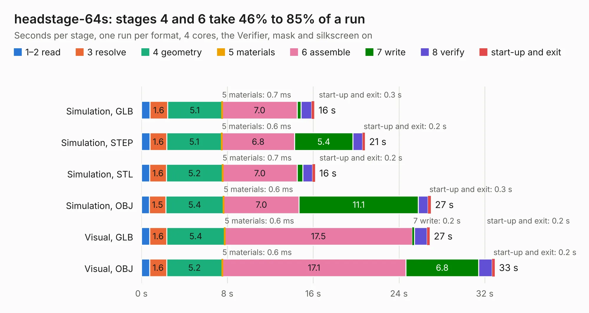

# 2056. headstage-64s

Board 2,056 of the 3,103 of [Corpus Testing](../Corpus-Testing.md), on [Corpus Page 20](../CorpusTestingPages/Corpus-Testing-20.md#2056-headstage-64s).

| Mode and format | 1–2 read | 3 resolve | 4 geometry | 5 materials | 6 assemble | 7 write | 8 verify | start-up and exit | Total |
|---|---:|---:|---:|---:|---:|---:|---:|---:|---:|
| Simulation, GLB | 0.8 | 1.6 | 5.1 | 0.7&nbsp;ms | 7.0 | 0.3 | 1.0 | 0.3 | 16.1 |
| Simulation, STEP | 0.8 | 1.6 | 5.1 | 0.6&nbsp;ms | 6.8 | 5.4 | 0.9 | 0.2 | 20.8 |
| Simulation, STL | 0.8 | 1.6 | 5.2 | 0.7&nbsp;ms | 7.0 | 0.5 | 0.9 | 0.2 | 16.2 |
| Simulation, OBJ | 0.7 | 1.5 | 5.4 | 0.6&nbsp;ms | 7.0 | 11.1 | 0.9 | 0.3 | 27.0 |
| Visual, GLB | 0.8 | 1.6 | 5.4 | 0.6&nbsp;ms | 17.5 | 0.2 | 1.2 | 0.2 | 26.9 |
| Visual, OBJ | 0.8 | 1.6 | 5.2 | 0.6&nbsp;ms | 17.1 | 6.8 | 1.3 | 0.2 | 32.9 |

<table align="center"><tr><td valign="top">

| Board | Repo: [open-ephys/onix-headstage-64s](https://github.com/open-ephys/onix-headstage-64s) Board: `headstage-64s.kicad_pcb` |
|---|---|
| Folder | pcb |
| Complexity | 429&nbsp;/&nbsp;1000 (size&nbsp;284, features&nbsp;145) |
| KESE&nbsp;features | through vias, custom pads, rounded, trapezoid or chamfered pads, arc tracks, filled zones, copper drawings, curved board outline, stack-up, dielectric εr and tanδ, copper finish, mask and silkscreen colours |
| Tested | 9th November 2026 |
| Copper&nbsp;layers | 6 |
| File&nbsp;format | KiCad 6 (20211014) |
| Parts,&nbsp;tracks,&nbsp;vias | 112, 1,718, 241 |
| Triangles,&nbsp;simulation | 2,043,882 in 217 parts |
| Verifier | PASS in all six runs |

</td><td valign="top">

<table>
<tr><th>File type</th><th>File size</th><th>Peak memory used</th></tr>
<tr><th colspan="3" align="left">Simulation</th></tr>
<tr><td>GLB</td><td align="right">71&nbsp;MB</td><td align="right">834&nbsp;MB</td></tr>
<tr><td>STEP</td><td align="right">359&nbsp;MB</td><td align="right">930&nbsp;MB</td></tr>
<tr><td>STL</td><td align="right">102&nbsp;MB</td><td align="right">874&nbsp;MB</td></tr>
<tr><td>OBJ</td><td align="right">220&nbsp;MB</td><td align="right">1.4&nbsp;GB</td></tr>
<tr><th colspan="3" align="left">Visual</th></tr>
<tr><td>GLB</td><td align="right">45&nbsp;MB</td><td align="right">967&nbsp;MB</td></tr>
<tr><td>OBJ</td><td align="right">142&nbsp;MB</td><td align="right">990&nbsp;MB</td></tr>
</table>

</td></tr></table>

| Previous | Next |
|:---|---:|
| [2055. headstage-16stim](b2055b_onix-headstage-16stim_headstage-16stim.md) | [2057. headstage-neuropix1e](b2057b_onix-headstage-neuropix1e_pcb-hirose_headstage-neuropix1e.md) |
