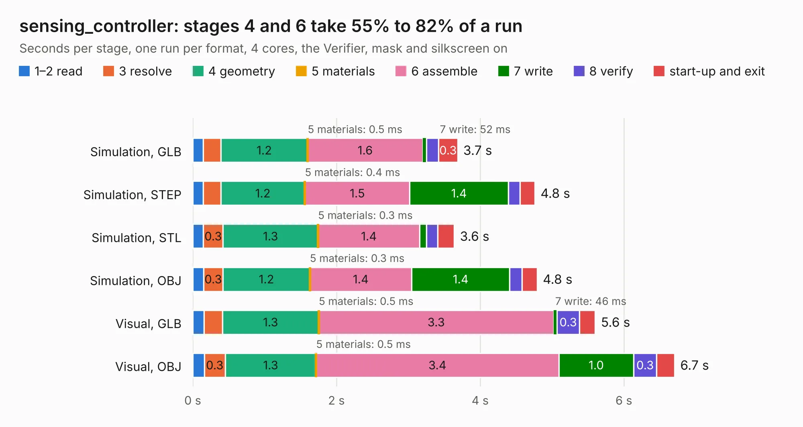

# 2057. sensing_controller

Board 2,057 of the 3,125 of [Corpus Testing](../Corpus-Testing.md), on [Corpus Page 20](../CorpusTestingPages/Corpus-Testing-20.md#2057-sensing_controller).

| Mode and format | 1–2 read | 3 resolve | 4 geometry | 5 materials | 6 assemble | 7 write | 8 verify | start-up and exit | Total |
|---|---:|---:|---:|---:|---:|---:|---:|---:|---:|
| Simulation, GLB | 0.1 | 0.2 | 1.2 | 0.5&nbsp;ms | 1.6 | 52&nbsp;ms | 0.2 | 0.3 | 3.7 |
| Simulation, STEP | 0.1 | 0.2 | 1.2 | 0.4&nbsp;ms | 1.5 | 1.4 | 0.2 | 0.2 | 4.8 |
| Simulation, STL | 0.1 | 0.3 | 1.3 | 0.3&nbsp;ms | 1.4 | 93&nbsp;ms | 0.2 | 0.2 | 3.6 |
| Simulation, OBJ | 0.1 | 0.3 | 1.2 | 0.3&nbsp;ms | 1.4 | 1.4 | 0.2 | 0.2 | 4.8 |
| Visual, GLB | 0.2 | 0.3 | 1.3 | 0.5&nbsp;ms | 3.3 | 46&nbsp;ms | 0.3 | 0.2 | 5.6 |
| Visual, OBJ | 0.2 | 0.3 | 1.3 | 0.5&nbsp;ms | 3.4 | 1.0 | 0.3 | 0.3 | 6.7 |

<table align="center"><tr><td valign="top">

| Board | Repo: [olin-electric-motorsports/olin-electric-motorsports](https://github.com/olin-electric-motorsports/olin-electric-motorsports) Board: `sensing_controller.kicad_pcb` |
|---|---|
| Folder | vehicle / mkvi / hardware / sensing |
| Complexity | 282&nbsp;/&nbsp;1000 (size&nbsp;192, features&nbsp;90) |
| KESE&nbsp;features | through vias, rounded, trapezoid or chamfered pads, filled zones, curved board outline, stack-up, dielectric εr and tanδ, mask and silkscreen colours |
| Tested | 9th November 2026 |
| Copper&nbsp;layers | 2 |
| File&nbsp;format | KiCad 6 (20211014) |
| Parts,&nbsp;tracks,&nbsp;vias | 33, 285, 33 |
| Triangles,&nbsp;simulation | 263,910 in 122 parts |
| Verifier | PASS in all six runs |

</td><td valign="top">

<table>
<tr><th>File type</th><th>File size</th><th>Peak memory used</th></tr>
<tr><th colspan="3" align="left">Simulation</th></tr>
<tr><td>GLB</td><td align="right">9.5&nbsp;MB</td><td align="right">246&nbsp;MB</td></tr>
<tr><td>STEP</td><td align="right">50&nbsp;MB</td><td align="right">271&nbsp;MB</td></tr>
<tr><td>STL</td><td align="right">13&nbsp;MB</td><td align="right">243&nbsp;MB</td></tr>
<tr><td>OBJ</td><td align="right">27&nbsp;MB</td><td align="right">248&nbsp;MB</td></tr>
<tr><th colspan="3" align="left">Visual</th></tr>
<tr><td>GLB</td><td align="right">7.4&nbsp;MB</td><td align="right">265&nbsp;MB</td></tr>
<tr><td>OBJ</td><td align="right">21&nbsp;MB</td><td align="right">264&nbsp;MB</td></tr>
</table>

</td></tr></table>

| Previous | Next |
|:---|---:|
| [2056. sensing_carrier](b2056b_olin-electric-motorsports_sensing-carrier.md) | [2058. AIRs](b2058b_olin-electric-motorsports_AIRs.md) |
