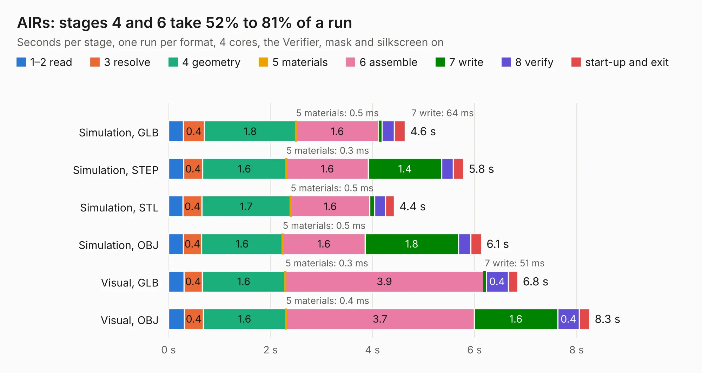

# 2058. AIRs

Board 2,058 of the 3,124 of [Corpus Testing](../Corpus-Testing.md), on [Corpus Page 20](../CorpusTestingPages/Corpus-Testing-20.md#2058-airs).

| Mode and format | 1–2 read | 3 resolve | 4 geometry | 5 materials | 6 assemble | 7 write | 8 verify | start-up and exit | Total |
|---|---:|---:|---:|---:|---:|---:|---:|---:|---:|
| Simulation, GLB | 0.3 | 0.4 | 1.8 | 0.5&nbsp;ms | 1.6 | 64&nbsp;ms | 0.2 | 0.2 | 4.6 |
| Simulation, STEP | 0.3 | 0.4 | 1.6 | 0.3&nbsp;ms | 1.6 | 1.4 | 0.2 | 0.2 | 5.8 |
| Simulation, STL | 0.3 | 0.4 | 1.7 | 0.5&nbsp;ms | 1.6 | 93&nbsp;ms | 0.2 | 0.2 | 4.4 |
| Simulation, OBJ | 0.3 | 0.4 | 1.6 | 0.5&nbsp;ms | 1.6 | 1.8 | 0.2 | 0.2 | 6.1 |
| Visual, GLB | 0.3 | 0.4 | 1.6 | 0.3&nbsp;ms | 3.9 | 51&nbsp;ms | 0.4 | 0.2 | 6.8 |
| Visual, OBJ | 0.3 | 0.4 | 1.6 | 0.4&nbsp;ms | 3.7 | 1.6 | 0.4 | 0.2 | 8.3 |

<table align="center"><tr><td valign="top">

| Board | Repo: [olin-electric-motorsports/olin-electric-motorsports](https://github.com/olin-electric-motorsports/olin-electric-motorsports) Board: `AIRs.kicad_pcb` |
|---|---|
| Folder | vehicle / mkvi / hardware / service-section / air-control |
| Complexity | 335&nbsp;/&nbsp;1000 (size&nbsp;205, features&nbsp;130) |
| KESE&nbsp;features | through vias, rounded, trapezoid or chamfered pads, filled zones, curved board outline, stack-up, dielectric εr and tanδ, copper finish, mask and silkscreen colours, castellated pads |
| Tested | 9th November 2026 |
| Copper&nbsp;layers | 2 |
| File&nbsp;format | KiCad 7 (20221018) |
| Parts,&nbsp;tracks,&nbsp;vias | 59, 449, 42 |
| Triangles,&nbsp;simulation | 363,900 in 112 parts |
| Verifier | PASS in all six runs |

</td><td valign="top">

<table>
<tr><th>File type</th><th>File size</th><th>Peak memory used</th></tr>
<tr><th colspan="3" align="left">Simulation</th></tr>
<tr><td>GLB</td><td align="right">13&nbsp;MB</td><td align="right">275&nbsp;MB</td></tr>
<tr><td>STEP</td><td align="right">69&nbsp;MB</td><td align="right">321&nbsp;MB</td></tr>
<tr><td>STL</td><td align="right">18&nbsp;MB</td><td align="right">280&nbsp;MB</td></tr>
<tr><td>OBJ</td><td align="right">38&nbsp;MB</td><td align="right">302&nbsp;MB</td></tr>
<tr><th colspan="3" align="left">Visual</th></tr>
<tr><td>GLB</td><td align="right">12&nbsp;MB</td><td align="right">373&nbsp;MB</td></tr>
<tr><td>OBJ</td><td align="right">34&nbsp;MB</td><td align="right">372&nbsp;MB</td></tr>
</table>

</td></tr></table>

| Previous | Next |
|:---|---:|
| [2057. sensing_controller](b2057b_olin-electric-motorsports_sensing-controller.md) | [2059. imd_latch](b2059b_olin-electric-motorsports_imd-latch.md) |
