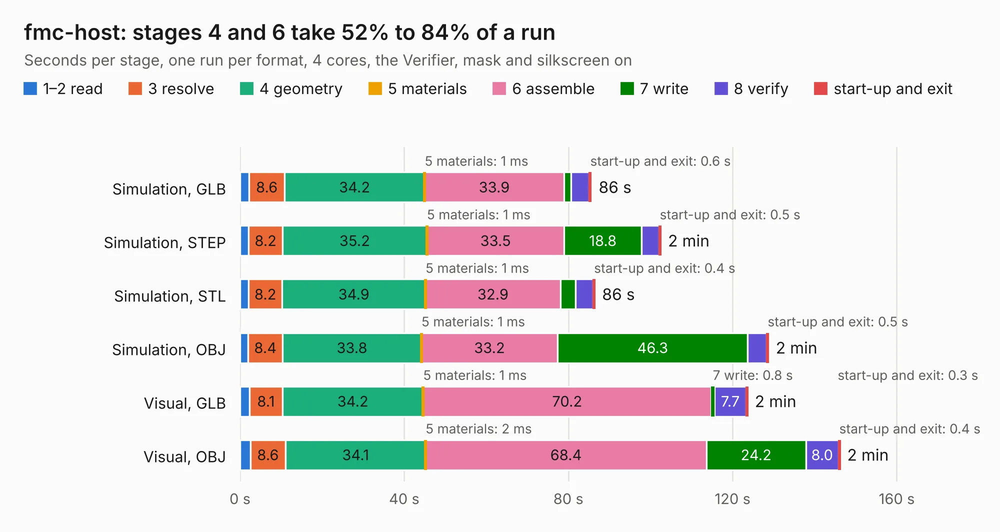

# 2060. fmc-host

Board 2,060 of the 3,109 of [Corpus Testing](../Corpus-Testing.md), on [Corpus Page 20](../CorpusTestingPages/Corpus-Testing-20.md#2060-fmc-host).

| Mode and format | 1–2 read | 3 resolve | 4 geometry | 5 materials | 6 assemble | 7 write | 8 verify | start-up and exit | Total |
|---|---:|---:|---:|---:|---:|---:|---:|---:|---:|
| Simulation, GLB | 2.2 | 8.6 | 34.2 | 1&nbsp;ms | 33.9 | 1.7 | 4.4 | 0.6 | 85.6 |
| Simulation, STEP | 2.1 | 8.2 | 35.2 | 1&nbsp;ms | 33.5 | 18.8 | 4.2 | 0.5 | 102.5 |
| Simulation, STL | 2.1 | 8.2 | 34.9 | 1&nbsp;ms | 32.9 | 3.6 | 4.4 | 0.4 | 86.5 |
| Simulation, OBJ | 2.0 | 8.4 | 33.8 | 1&nbsp;ms | 33.2 | 46.3 | 4.6 | 0.5 | 128.8 |
| Visual, GLB | 2.3 | 8.1 | 34.2 | 1&nbsp;ms | 70.2 | 0.8 | 7.7 | 0.3 | 123.7 |
| Visual, OBJ | 2.5 | 8.6 | 34.1 | 2&nbsp;ms | 68.4 | 24.2 | 8.0 | 0.4 | 146.2 |

<table align="center"><tr><td valign="top">

| Board | Repo: [open-ephys/onix-fmc-host](https://github.com/open-ephys/onix-fmc-host) Board: `fmc-host.kicad_pcb` |
|---|---|
| Folder | pcb |
| Complexity | 407&nbsp;/&nbsp;1000 (size&nbsp;307, features&nbsp;100) |
| KESE&nbsp;features | through vias, rounded, trapezoid or chamfered pads, arc tracks, filled zones, curved board outline, stack-up, dielectric εr and tanδ |
| Tested | 9th November 2026 |
| Copper&nbsp;layers | 6 |
| File&nbsp;format | KiCad 10 (20260206) |
| Parts,&nbsp;tracks,&nbsp;vias | 301, 3,369, 1,272 |
| Triangles,&nbsp;simulation | 8,782,710 in 473 parts |
| Verifier | PASS in all six runs |

</td><td valign="top">

<table>
<tr><th>File type</th><th>File size</th><th>Peak memory used</th></tr>
<tr><th colspan="3" align="left">Simulation</th></tr>
<tr><td>GLB</td><td align="right">295&nbsp;MB</td><td align="right">2.4&nbsp;GB</td></tr>
<tr><td>STEP</td><td align="right">1.2&nbsp;GB</td><td align="right">3.0&nbsp;GB</td></tr>
<tr><td>STL</td><td align="right">439&nbsp;MB</td><td align="right">2.5&nbsp;GB</td></tr>
<tr><td>OBJ</td><td align="right">953&nbsp;MB</td><td align="right">5.6&nbsp;GB</td></tr>
<tr><th colspan="3" align="left">Visual</th></tr>
<tr><td>GLB</td><td align="right">164&nbsp;MB</td><td align="right">2.6&nbsp;GB</td></tr>
<tr><td>OBJ</td><td align="right">535&nbsp;MB</td><td align="right">3.5&nbsp;GB</td></tr>
</table>

</td></tr></table>

| Previous | Next |
|:---|---:|
| [2059. bracket-led](b2059b_onix-fmc-host_mechanical-pcie-bracket-metal-bracket-led-pcb_bracket-led.md) | [2061. headstage-16stim](b2061b_onix-headstage-16stim_headstage-16stim.md) |
