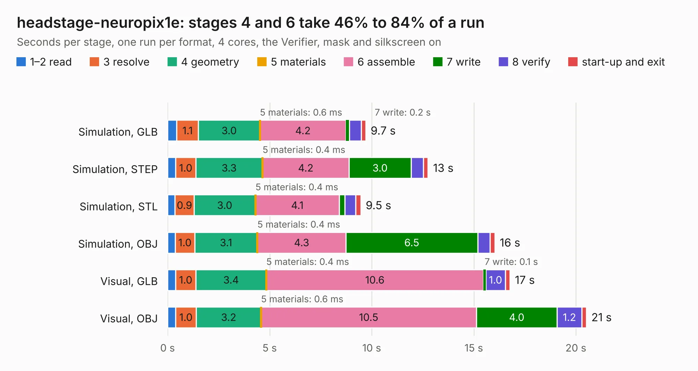

# 2060. headstage-neuropix1e

Board 2,060 of the 3,105 of [Corpus Testing](../Corpus-Testing.md), on [Corpus Page 20](../CorpusTestingPages/Corpus-Testing-20.md#2060-headstage-neuropix1e).

| Mode and format | 1–2 read | 3 resolve | 4 geometry | 5 materials | 6 assemble | 7 write | 8 verify | start-up and exit | Total |
|---|---:|---:|---:|---:|---:|---:|---:|---:|---:|
| Simulation, GLB | 0.4 | 1.1 | 3.0 | 0.6&nbsp;ms | 4.2 | 0.2 | 0.6 | 0.2 | 9.7 |
| Simulation, STEP | 0.4 | 1.0 | 3.3 | 0.4&nbsp;ms | 4.2 | 3.0 | 0.6 | 0.2 | 12.8 |
| Simulation, STL | 0.4 | 0.9 | 3.0 | 0.4&nbsp;ms | 4.1 | 0.3 | 0.5 | 0.2 | 9.5 |
| Simulation, OBJ | 0.4 | 1.0 | 3.1 | 0.4&nbsp;ms | 4.3 | 6.5 | 0.6 | 0.2 | 16.0 |
| Visual, GLB | 0.4 | 1.0 | 3.4 | 0.4&nbsp;ms | 10.6 | 0.1 | 1.0 | 0.2 | 16.8 |
| Visual, OBJ | 0.4 | 1.0 | 3.2 | 0.6&nbsp;ms | 10.5 | 4.0 | 1.2 | 0.2 | 20.5 |

<table align="center"><tr><td valign="top">

| Board | Repo: [open-ephys/onix-headstage-neuropix1e](https://github.com/open-ephys/onix-headstage-neuropix1e) Board: `headstage-neuropix1e.kicad_pcb` |
|---|---|
| Folder | pcb-te |
| Complexity | 377&nbsp;/&nbsp;1000 (size&nbsp;247, features&nbsp;130) |
| KESE&nbsp;features | through vias, custom pads, rounded, trapezoid or chamfered pads, arc tracks, filled zones, copper drawings, curved board outline, stack-up, dielectric εr and tanδ, mask and silkscreen colours |
| Tested | 9th November 2026 |
| Copper&nbsp;layers | 4 |
| File&nbsp;format | KiCad 7 (20221018) |
| Parts,&nbsp;tracks,&nbsp;vias | 72, 816, 191 |
| Triangles,&nbsp;simulation | 1,175,284 in 78 parts |
| Verifier | PASS in all six runs |

</td><td valign="top">

<table>
<tr><th>File type</th><th>File size</th><th>Peak memory used</th></tr>
<tr><th colspan="3" align="left">Simulation</th></tr>
<tr><td>GLB</td><td align="right">40&nbsp;MB</td><td align="right">546&nbsp;MB</td></tr>
<tr><td>STEP</td><td align="right">174&nbsp;MB</td><td align="right">607&nbsp;MB</td></tr>
<tr><td>STL</td><td align="right">59&nbsp;MB</td><td align="right">552&nbsp;MB</td></tr>
<tr><td>OBJ</td><td align="right">121&nbsp;MB</td><td align="right">832&nbsp;MB</td></tr>
<tr><th colspan="3" align="left">Visual</th></tr>
<tr><td>GLB</td><td align="right">26&nbsp;MB</td><td align="right">672&nbsp;MB</td></tr>
<tr><td>OBJ</td><td align="right">79&nbsp;MB</td><td align="right">666&nbsp;MB</td></tr>
</table>

</td></tr></table>

| Previous | Next |
|:---|---:|
| [2059. headstage-neuropix1e](b2059b_onix-headstage-neuropix1e_pcb-hirose_headstage-neuropix1e.md) | [2061. headstage-neuropix2e](b2061b_onix-headstage-neuropix2e_headstage-neuropix2e.md) |
