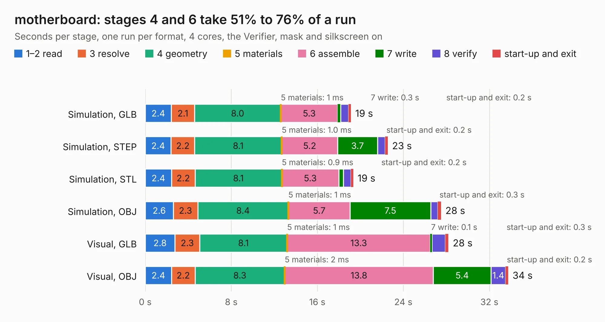

# 2064. motherboard

Board 2,064 of the 3,131 of [Corpus Testing](../Corpus-Testing.md), on [Corpus Page 20](../CorpusTestingPages/Corpus-Testing-20.md#2064-motherboard).

| Mode and format | 1–2 read | 3 resolve | 4 geometry | 5 materials | 6 assemble | 7 write | 8 verify | start-up and exit | Total |
|---|---:|---:|---:|---:|---:|---:|---:|---:|---:|
| Simulation, GLB | 2.4 | 2.1 | 8.0 | 1&nbsp;ms | 5.3 | 0.3 | 0.7 | 0.2 | 19.1 |
| Simulation, STEP | 2.4 | 2.2 | 8.1 | 1.0&nbsp;ms | 5.2 | 3.7 | 0.7 | 0.2 | 22.6 |
| Simulation, STL | 2.4 | 2.2 | 8.1 | 0.9&nbsp;ms | 5.3 | 0.4 | 0.7 | 0.2 | 19.3 |
| Simulation, OBJ | 2.6 | 2.3 | 8.4 | 1&nbsp;ms | 5.7 | 7.5 | 0.7 | 0.3 | 27.5 |
| Visual, GLB | 2.8 | 2.3 | 8.1 | 1&nbsp;ms | 13.3 | 0.1 | 1.3 | 0.3 | 28.2 |
| Visual, OBJ | 2.4 | 2.2 | 8.3 | 2&nbsp;ms | 13.8 | 5.4 | 1.4 | 0.2 | 33.8 |

<table align="center"><tr><td valign="top">

| Board | Repo: [olin-electric-motorsports/olin-electric-motorsports](https://github.com/olin-electric-motorsports/olin-electric-motorsports) Board: `motherboard.kicad_pcb` |
|---|---|
| Folder | vehicle / mkvi / hardware / service-section / motherboard |
| Complexity | 300&nbsp;/&nbsp;1000 (size&nbsp;180, features&nbsp;120) |
| KESE&nbsp;features | through vias, slotted holes, custom pads, rounded, trapezoid or chamfered pads, filled zones, stack-up, dielectric εr and tanδ, copper finish, mask and silkscreen colours |
| Tested | 9th November 2026 |
| Copper&nbsp;layers | 2 |
| File&nbsp;format | KiCad 7 (20221018) |
| Parts,&nbsp;tracks,&nbsp;vias | 69, 960, 103 |
| Triangles,&nbsp;simulation | 1,355,332 in 363 parts |
| Verifier | PASS in all six runs |

</td><td valign="top">

<table>
<tr><th>File type</th><th>File size</th><th>Peak memory used</th></tr>
<tr><th colspan="3" align="left">Simulation</th></tr>
<tr><td>GLB</td><td align="right">48&nbsp;MB</td><td align="right">619&nbsp;MB</td></tr>
<tr><td>STEP</td><td align="right">252&nbsp;MB</td><td align="right">686&nbsp;MB</td></tr>
<tr><td>STL</td><td align="right">68&nbsp;MB</td><td align="right">605&nbsp;MB</td></tr>
<tr><td>OBJ</td><td align="right">144&nbsp;MB</td><td align="right">999&nbsp;MB</td></tr>
<tr><th colspan="3" align="left">Visual</th></tr>
<tr><td>GLB</td><td align="right">33&nbsp;MB</td><td align="right">709&nbsp;MB</td></tr>
<tr><td>OBJ</td><td align="right">99&nbsp;MB</td><td align="right">804&nbsp;MB</td></tr>
</table>

</td></tr></table>

| Previous | Next |
|:---|---:|
| [2063. imd_latch](b2063b_olin-electric-motorsports_imd-latch.md) | [2065. precharge_discharge](b2065b_olin-electric-motorsports_precharge-discharge.md) |
