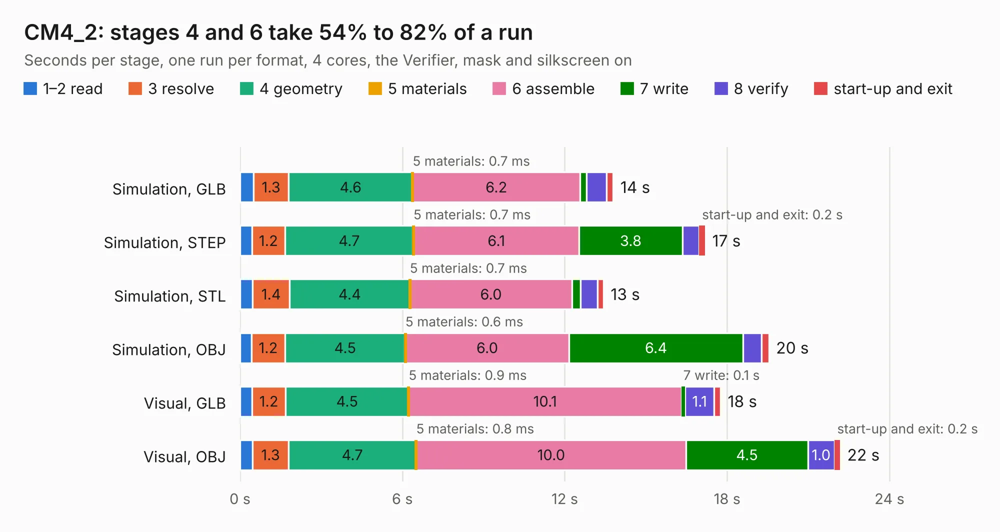

# 2065. CM4_2

Board 2,065 of the 3,129 of [Corpus Testing](../Corpus-Testing.md), on [Corpus Page 20](../CorpusTestingPages/Corpus-Testing-20.md#2065-cm4_2).

| Mode and format | 1–2 read | 3 resolve | 4 geometry | 5 materials | 6 assemble | 7 write | 8 verify | start-up and exit | Total |
|---|---:|---:|---:|---:|---:|---:|---:|---:|---:|
| Simulation, GLB | 0.5 | 1.3 | 4.6 | 0.7&nbsp;ms | 6.2 | 0.2 | 0.8 | 0.2 | 13.8 |
| Simulation, STEP | 0.4 | 1.2 | 4.7 | 0.7&nbsp;ms | 6.1 | 3.8 | 0.6 | 0.2 | 17.2 |
| Simulation, STL | 0.5 | 1.4 | 4.4 | 0.7&nbsp;ms | 6.0 | 0.3 | 0.6 | 0.2 | 13.4 |
| Simulation, OBJ | 0.4 | 1.2 | 4.5 | 0.6&nbsp;ms | 6.0 | 6.4 | 0.7 | 0.3 | 19.5 |
| Visual, GLB | 0.4 | 1.2 | 4.5 | 0.9&nbsp;ms | 10.1 | 0.1 | 1.1 | 0.2 | 17.8 |
| Visual, OBJ | 0.5 | 1.3 | 4.7 | 0.8&nbsp;ms | 10.0 | 4.5 | 1.0 | 0.2 | 22.2 |

<table align="center"><tr><td valign="top">

| Board | Repo: [olvint/CM4-NAS-MiniPCIE](https://github.com/olvint/CM4-NAS-MiniPCIE) Board: `CM4_2.kicad_pcb` |
|---|---|
| Complexity | 285&nbsp;/&nbsp;1000 (size&nbsp;185, features&nbsp;100) |
| KESE&nbsp;features | through vias, slotted holes, rounded, trapezoid or chamfered pads, filled zones, curved board outline, stack-up, dielectric εr and tanδ, mask and silkscreen colours |
| Tested | 9th November 2026 |
| Copper&nbsp;layers | 4 |
| File&nbsp;format | KiCad 6 (20201220) |
| Parts,&nbsp;tracks,&nbsp;vias | 19, 1,041, 132 |
| Triangles,&nbsp;simulation | 1,216,944 in 186 parts |
| Verifier | PASS in all six runs |

</td><td valign="top">

<table>
<tr><th>File type</th><th>File size</th><th>Peak memory used</th></tr>
<tr><th colspan="3" align="left">Simulation</th></tr>
<tr><td>GLB</td><td align="right">42&nbsp;MB</td><td align="right">527&nbsp;MB</td></tr>
<tr><td>STEP</td><td align="right">202&nbsp;MB</td><td align="right">628&nbsp;MB</td></tr>
<tr><td>STL</td><td align="right">61&nbsp;MB</td><td align="right">522&nbsp;MB</td></tr>
<tr><td>OBJ</td><td align="right">126&nbsp;MB</td><td align="right">888&nbsp;MB</td></tr>
<tr><th colspan="3" align="left">Visual</th></tr>
<tr><td>GLB</td><td align="right">29&nbsp;MB</td><td align="right">732&nbsp;MB</td></tr>
<tr><td>OBJ</td><td align="right">89&nbsp;MB</td><td align="right">656&nbsp;MB</td></tr>
</table>

</td></tr></table>

| Previous | Next |
|:---|---:|
| [2064. tsal-ail](b2064b_olin-electric-motorsports_tsal-ail.md) | [2066. acquisition-board](b2066b_acquisition-board_acquisition-board.md) |
