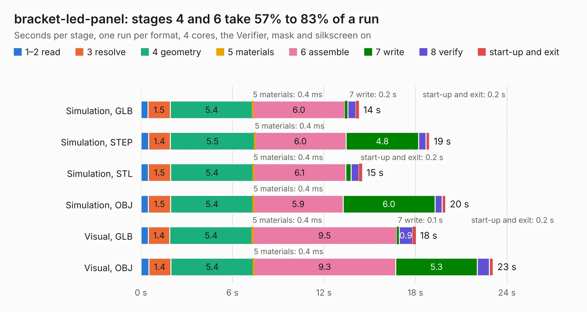

# 2065. bracket-led-panel

Board 2,065 of the 3,117 of [Corpus Testing](../Corpus-Testing.md), on [Corpus Page 20](../CorpusTestingPages/Corpus-Testing-20.md#2065-bracket-led-panel).

| Mode and format | 1–2 read | 3 resolve | 4 geometry | 5 materials | 6 assemble | 7 write | 8 verify | start-up and exit | Total |
|---|---:|---:|---:|---:|---:|---:|---:|---:|---:|
| Simulation, GLB | 0.5 | 1.5 | 5.4 | 0.4&nbsp;ms | 6.0 | 0.2 | 0.5 | 0.2 | 14.3 |
| Simulation, STEP | 0.5 | 1.4 | 5.5 | 0.4&nbsp;ms | 6.0 | 4.8 | 0.5 | 0.2 | 18.9 |
| Simulation, STL | 0.5 | 1.5 | 5.4 | 0.4&nbsp;ms | 6.1 | 0.3 | 0.5 | 0.2 | 14.5 |
| Simulation, OBJ | 0.5 | 1.5 | 5.4 | 0.4&nbsp;ms | 5.9 | 6.0 | 0.5 | 0.2 | 20.0 |
| Visual, GLB | 0.5 | 1.4 | 5.4 | 0.4&nbsp;ms | 9.5 | 0.1 | 0.9 | 0.2 | 18.0 |
| Visual, OBJ | 0.5 | 1.4 | 5.4 | 0.4&nbsp;ms | 9.3 | 5.3 | 0.8 | 0.3 | 23.1 |

<table align="center"><tr><td valign="top">

| Board | Repo: [open-ephys/onix-fmc-host](https://github.com/open-ephys/onix-fmc-host) Board: `bracket-led-panel.kicad_pcb` |
|---|---|
| Folder | bracket-led / source |
| Complexity | 265&nbsp;/&nbsp;1000 (size&nbsp;190, features&nbsp;75) |
| KESE&nbsp;features | through vias, rounded, trapezoid or chamfered pads, filled zones, stack-up, dielectric εr and tanδ |
| Tested | 9th November 2026 |
| Copper&nbsp;layers | 2 |
| File&nbsp;format | KiCad 7 (20221018) |
| Parts,&nbsp;tracks,&nbsp;vias | 120, 816, 288 |
| Triangles,&nbsp;simulation | 1,179,884 in 175 parts |
| Note | panel |
| Verifier | PASS in all six runs |

</td><td valign="top">

<table>
<tr><th>File type</th><th>File size</th><th>Peak memory used</th></tr>
<tr><th colspan="3" align="left">Simulation</th></tr>
<tr><td>GLB</td><td align="right">39&nbsp;MB</td><td align="right">568&nbsp;MB</td></tr>
<tr><td>STEP</td><td align="right">215&nbsp;MB</td><td align="right">658&nbsp;MB</td></tr>
<tr><td>STL</td><td align="right">59&nbsp;MB</td><td align="right">572&nbsp;MB</td></tr>
<tr><td>OBJ</td><td align="right">122&nbsp;MB</td><td align="right">848&nbsp;MB</td></tr>
<tr><th colspan="3" align="left">Visual</th></tr>
<tr><td>GLB</td><td align="right">33&nbsp;MB</td><td align="right">677&nbsp;MB</td></tr>
<tr><td>OBJ</td><td align="right">103&nbsp;MB</td><td align="right">813&nbsp;MB</td></tr>
</table>

</td></tr></table>

| Previous | Next |
|:---|---:|
| [2064. bracket-led-panel-tight](b2064b_onix-fmc-host_bracket-led-panel-tight.md) | [2066. bracket-led](b2066b_onix-fmc-host_bracket-led-source_bracket-led.md) |
