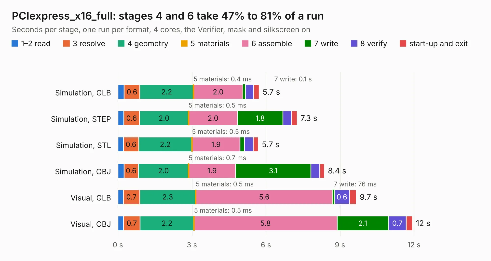

# 2067. PCIexpress_x16_full

Board 2,067 of the 3,107 of [Corpus Testing](../Corpus-Testing.md), on [Corpus Page 20](../CorpusTestingPages/Corpus-Testing-20.md#2067-pciexpress_x16_full).

| Mode and format | 1–2 read | 3 resolve | 4 geometry | 5 materials | 6 assemble | 7 write | 8 verify | start-up and exit | Total |
|---|---:|---:|---:|---:|---:|---:|---:|---:|---:|
| Simulation, GLB | 0.3 | 0.6 | 2.2 | 0.4&nbsp;ms | 2.0 | 0.1 | 0.3 | 0.2 | 5.7 |
| Simulation, STEP | 0.2 | 0.6 | 2.0 | 0.5&nbsp;ms | 2.0 | 1.8 | 0.3 | 0.2 | 7.3 |
| Simulation, STL | 0.2 | 0.6 | 2.2 | 0.5&nbsp;ms | 1.9 | 0.2 | 0.4 | 0.2 | 5.7 |
| Simulation, OBJ | 0.2 | 0.6 | 2.0 | 0.7&nbsp;ms | 1.9 | 3.1 | 0.4 | 0.2 | 8.4 |
| Visual, GLB | 0.2 | 0.7 | 2.3 | 0.5&nbsp;ms | 5.6 | 76&nbsp;ms | 0.6 | 0.3 | 9.7 |
| Visual, OBJ | 0.2 | 0.7 | 2.2 | 0.5&nbsp;ms | 5.8 | 2.1 | 0.7 | 0.3 | 11.9 |

<table align="center"><tr><td valign="top">

| Board | Repo: [open-ephys/PCIexpress-KiCad](https://github.com/open-ephys/PCIexpress-KiCad) Board: `PCIexpress_x16_full.kicad_pcb` |
|---|---|
| Folder | PCIexpress_x16_full |
| Complexity | 239&nbsp;/&nbsp;1000 (size&nbsp;184, features&nbsp;55) |
| KESE&nbsp;features | through vias, rounded, trapezoid or chamfered pads, filled zones, curved board outline |
| Tested | 9th November 2026 |
| Copper&nbsp;layers | 4 |
| File&nbsp;format | KiCad 6 (20211014) |
| Parts,&nbsp;tracks,&nbsp;vias | 65, 323, 102 |
| Triangles,&nbsp;simulation | 613,568 in 134 parts |
| Verifier | PASS in all six runs |

</td><td valign="top">

<table>
<tr><th>File type</th><th>File size</th><th>Peak memory used</th></tr>
<tr><th colspan="3" align="left">Simulation</th></tr>
<tr><td>GLB</td><td align="right">21&nbsp;MB</td><td align="right">375&nbsp;MB</td></tr>
<tr><td>STEP</td><td align="right">102&nbsp;MB</td><td align="right">394&nbsp;MB</td></tr>
<tr><td>STL</td><td align="right">31&nbsp;MB</td><td align="right">373&nbsp;MB</td></tr>
<tr><td>OBJ</td><td align="right">64&nbsp;MB</td><td align="right">452&nbsp;MB</td></tr>
<tr><th colspan="3" align="left">Visual</th></tr>
<tr><td>GLB</td><td align="right">15&nbsp;MB</td><td align="right">388&nbsp;MB</td></tr>
<tr><td>OBJ</td><td align="right">45&nbsp;MB</td><td align="right">389&nbsp;MB</td></tr>
</table>

</td></tr></table>

| Previous | Next |
|:---|---:|
| [2066. test-board](b2066b_onix-headstage-rhs2116_test-board.md) | [2068. PCIexpress_x16_half](b2068b_PCIexpress-KiCad_PCIexpress-x16-half.md) |
