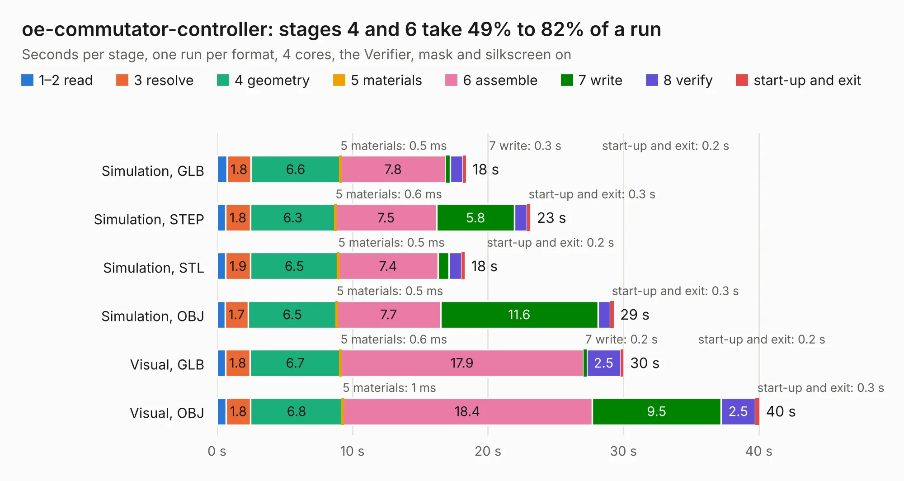

# 2067. oe-commutator-controller

Board 2,067 of the 3,129 of [Corpus Testing](../Corpus-Testing.md), on [Corpus Page 20](../CorpusTestingPages/Corpus-Testing-20.md#2067-oe-commutator-controller).

| Mode and format | 1–2 read | 3 resolve | 4 geometry | 5 materials | 6 assemble | 7 write | 8 verify | start-up and exit | Total |
|---|---:|---:|---:|---:|---:|---:|---:|---:|---:|
| Simulation, GLB | 0.7 | 1.8 | 6.6 | 0.5&nbsp;ms | 7.8 | 0.3 | 0.9 | 0.2 | 18.4 |
| Simulation, STEP | 0.6 | 1.8 | 6.3 | 0.6&nbsp;ms | 7.5 | 5.8 | 0.9 | 0.3 | 23.1 |
| Simulation, STL | 0.6 | 1.9 | 6.5 | 0.5&nbsp;ms | 7.4 | 0.8 | 0.9 | 0.2 | 18.3 |
| Simulation, OBJ | 0.6 | 1.7 | 6.5 | 0.5&nbsp;ms | 7.7 | 11.6 | 0.9 | 0.3 | 29.3 |
| Visual, GLB | 0.6 | 1.8 | 6.7 | 0.6&nbsp;ms | 17.9 | 0.2 | 2.5 | 0.2 | 30.0 |
| Visual, OBJ | 0.7 | 1.8 | 6.8 | 1&nbsp;ms | 18.4 | 9.5 | 2.5 | 0.3 | 40.0 |

<table align="center"><tr><td valign="top">

| Board | Repo: [open-ephys/commutators](https://github.com/open-ephys/commutators) Board: `oe-commutator-controller.kicad_pcb` |
|---|---|
| Folder | pcb |
| Complexity | 331&nbsp;/&nbsp;1000 (size&nbsp;251, features&nbsp;80) |
| KESE&nbsp;features | through vias, rounded, trapezoid or chamfered pads, filled zones, stack-up, dielectric εr and tanδ, mask and silkscreen colours |
| Tested | 9th November 2026 |
| Copper&nbsp;layers | 4 |
| File&nbsp;format | KiCad 8 (20240108) |
| Parts,&nbsp;tracks,&nbsp;vias | 76, 752, 391 |
| Triangles,&nbsp;simulation | 2,022,238 in 101 parts |
| Verifier | PASS in all six runs |

</td><td valign="top">

<table>
<tr><th>File type</th><th>File size</th><th>Peak memory used</th></tr>
<tr><th colspan="3" align="left">Simulation</th></tr>
<tr><td>GLB</td><td align="right">69&nbsp;MB</td><td align="right">863&nbsp;MB</td></tr>
<tr><td>STEP</td><td align="right">316&nbsp;MB</td><td align="right">990&nbsp;MB</td></tr>
<tr><td>STL</td><td align="right">101&nbsp;MB</td><td align="right">870&nbsp;MB</td></tr>
<tr><td>OBJ</td><td align="right">209&nbsp;MB</td><td align="right">1.4&nbsp;GB</td></tr>
<tr><th colspan="3" align="left">Visual</th></tr>
<tr><td>GLB</td><td align="right">53&nbsp;MB</td><td align="right">980&nbsp;MB</td></tr>
<tr><td>OBJ</td><td align="right">163&nbsp;MB</td><td align="right">1.1&nbsp;GB</td></tr>
</table>

</td></tr></table>

| Previous | Next |
|:---|---:|
| [2066. acquisition-board](b2066b_acquisition-board_acquisition-board.md) | [2068. ecp5u85-bse-usb](b2068b_ECP5U85-BSE-USB_ecp5u85-bse-usb.md) |
