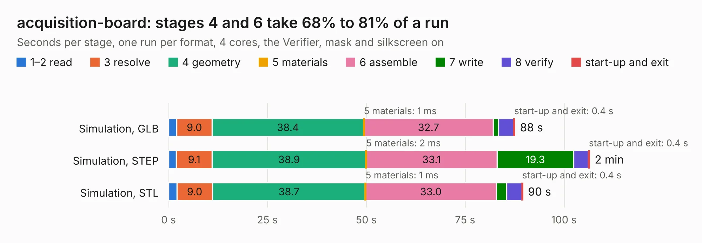

# 2068. acquisition-board

Board 2,068 of the 3,122 of [Corpus Testing](../Corpus-Testing.md), on [Corpus Page 20](../CorpusTestingPages/Corpus-Testing-20.md#2068-acquisition-board).

| Mode and format | 1–2 read | 3 resolve | 4 geometry | 5 materials | 6 assemble | 7 write | 8 verify | start-up and exit | Total |
|---|---:|---:|---:|---:|---:|---:|---:|---:|---:|
| Simulation, GLB | 2.0 | 9.0 | 38.4 | 1&nbsp;ms | 32.7 | 1.4 | 3.8 | 0.4 | 87.6 |
| Simulation, STEP | 2.0 | 9.1 | 38.9 | 2&nbsp;ms | 33.1 | 19.3 | 3.7 | 0.4 | 106.5 |
| Simulation, STL | 2.1 | 9.0 | 38.7 | 1&nbsp;ms | 33.0 | 2.6 | 3.8 | 0.4 | 89.6 |
| Simulation, OBJ | 2.1 | 9.1 | 37.7 | 1&nbsp;ms | 33.0 | 47.5 | 3.8 | 0.4 | 133.6 |
| Visual, GLB | 2.1 | 9.2 | 39.3 | 1&nbsp;ms | 71.4 | 0.7 | 6.4 | 0.3 | 129.4 |
| Visual, OBJ | 2.1 | 9.0 | 38.5 | 1&nbsp;ms | 71.8 | 26.4 | 6.0 | 0.3 | 154.1 |

<table align="center"><tr><td valign="top">

| Board | Repo: [open-ephys/oe-acquisition-board-gen3](https://github.com/open-ephys/oe-acquisition-board-gen3) Board: `acquisition-board.kicad_pcb` |
|---|---|
| Folder | Hardware / PCB |
| Complexity | 332&nbsp;/&nbsp;1000 (size&nbsp;242, features&nbsp;90) |
| KESE&nbsp;features | through vias, rounded, trapezoid or chamfered pads, filled zones, copper drawings, stack-up, dielectric εr and tanδ, mask and silkscreen colours |
| Tested | 9th November 2026 |
| Copper&nbsp;layers | 4 |
| File&nbsp;format | KiCad 8 (20240108) |
| Parts,&nbsp;tracks,&nbsp;vias | 309, 3,692, 1,292 |
| Triangles,&nbsp;simulation | 8,571,000 in 342 parts |
| Verifier | PASS in all six runs |

</td><td valign="top">

<table>
<tr><th>File type</th><th>File size</th><th>Peak memory used</th></tr>
<tr><th colspan="3" align="left">Simulation</th></tr>
<tr><td>GLB</td><td align="right">295&nbsp;MB</td><td align="right">2.1&nbsp;GB</td></tr>
<tr><td>STEP</td><td align="right">1.2&nbsp;GB</td><td align="right">2.7&nbsp;GB</td></tr>
<tr><td>STL</td><td align="right">429&nbsp;MB</td><td align="right">2.1&nbsp;GB</td></tr>
<tr><td>OBJ</td><td align="right">924&nbsp;MB</td><td align="right">5.5&nbsp;GB</td></tr>
<tr><th colspan="3" align="left">Visual</th></tr>
<tr><td>GLB</td><td align="right">164&nbsp;MB</td><td align="right">2.8&nbsp;GB</td></tr>
<tr><td>OBJ</td><td align="right">529&nbsp;MB</td><td align="right">3.5&nbsp;GB</td></tr>
</table>

</td></tr></table>

| Previous | Next |
|:---|---:|
| [2067. low-profile-headstage-64ch-3d](b2067b_low-profile-headstage-64ch-3d_low-profile-headstage-64ch-3d.md) | [2069. bracket-led-panel-tight](b2069b_onix-fmc-host_bracket-led-panel-tight.md) |
