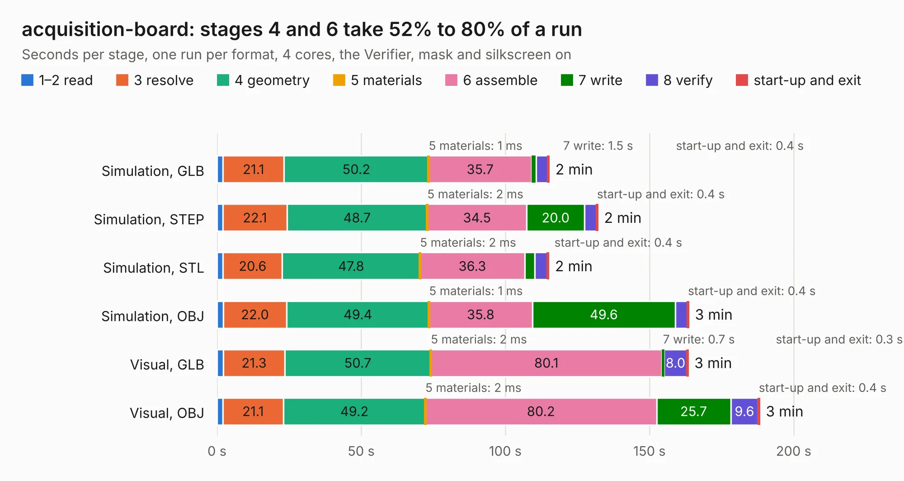

# 2069. acquisition-board

Board 2,069 of the 3,132 of [Corpus Testing](../Corpus-Testing.md), on [Corpus Page 20](../CorpusTestingPages/Corpus-Testing-20.md#2069-acquisition-board).

| Mode and format | 1–2 read | 3 resolve | 4 geometry | 5 materials | 6 assemble | 7 write | 8 verify | start-up and exit | Total |
|---|---:|---:|---:|---:|---:|---:|---:|---:|---:|
| Simulation, GLB | 2.1 | 21.1 | 50.2 | 1&nbsp;ms | 35.7 | 1.5 | 4.1 | 0.4 | 115.1 |
| Simulation, STEP | 2.1 | 22.1 | 48.7 | 2&nbsp;ms | 34.5 | 20.0 | 4.1 | 0.4 | 132.0 |
| Simulation, STL | 2.1 | 20.6 | 47.8 | 2&nbsp;ms | 36.3 | 3.5 | 4.3 | 0.4 | 115.0 |
| Simulation, OBJ | 2.2 | 22.0 | 49.4 | 1&nbsp;ms | 35.8 | 49.6 | 4.2 | 0.4 | 163.5 |
| Visual, GLB | 2.2 | 21.3 | 50.7 | 2&nbsp;ms | 80.1 | 0.7 | 8.0 | 0.3 | 163.3 |
| Visual, OBJ | 2.0 | 21.1 | 49.2 | 2&nbsp;ms | 80.2 | 25.7 | 9.6 | 0.4 | 188.1 |

<table align="center"><tr><td valign="top">

| Board | Repo: [open-ephys/acquisition-board](https://github.com/open-ephys/acquisition-board) Board: `acquisition-board.kicad_pcb` |
|---|---|
| Folder | kicad_converted |
| Complexity | 251&nbsp;/&nbsp;1000 (size&nbsp;236, features&nbsp;15) |
| KESE&nbsp;features | through vias |
| Tested | 9th November 2026 |
| Copper&nbsp;layers | 4 |
| File&nbsp;format | KiCad 4 (4) |
| Parts,&nbsp;tracks,&nbsp;vias | 263, 4,474, 514 |
| Triangles,&nbsp;simulation | 8,923,122 in 309 parts |
| Verifier | PASS in all six runs |

</td><td valign="top">

<table>
<tr><th>File type</th><th>File size</th><th>Peak memory used</th></tr>
<tr><th colspan="3" align="left">Simulation</th></tr>
<tr><td>GLB</td><td align="right">312&nbsp;MB</td><td align="right">2.5&nbsp;GB</td></tr>
<tr><td>STEP</td><td align="right">1.4&nbsp;GB</td><td align="right">3.0&nbsp;GB</td></tr>
<tr><td>STL</td><td align="right">446&nbsp;MB</td><td align="right">2.6&nbsp;GB</td></tr>
<tr><td>OBJ</td><td align="right">975&nbsp;MB</td><td align="right">5.8&nbsp;GB</td></tr>
<tr><th colspan="3" align="left">Visual</th></tr>
<tr><td>GLB</td><td align="right">177&nbsp;MB</td><td align="right">2.8&nbsp;GB</td></tr>
<tr><td>OBJ</td><td align="right">564&nbsp;MB</td><td align="right">3.7&nbsp;GB</td></tr>
</table>

</td></tr></table>

| Previous | Next |
|:---|---:|
| [2068. CM4_2](b2068b_CM4-NAS-MiniPCIE_CM4-2.md) | [2070. oe-commutator-controller](b2070b_commutators_oe-commutator-controller.md) |
