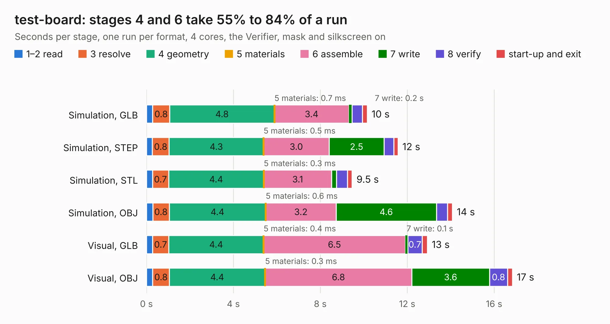

# 2069. test-board

Board 2,069 of the 3,110 of [Corpus Testing](../Corpus-Testing.md), on [Corpus Page 20](../CorpusTestingPages/Corpus-Testing-20.md#2069-test-board).

| Mode and format | 1–2 read | 3 resolve | 4 geometry | 5 materials | 6 assemble | 7 write | 8 verify | start-up and exit | Total |
|---|---:|---:|---:|---:|---:|---:|---:|---:|---:|
| Simulation, GLB | 0.3 | 0.8 | 4.8 | 0.7&nbsp;ms | 3.4 | 0.2 | 0.5 | 0.2 | 10.2 |
| Simulation, STEP | 0.3 | 0.8 | 4.3 | 0.5&nbsp;ms | 3.0 | 2.5 | 0.4 | 0.2 | 11.6 |
| Simulation, STL | 0.3 | 0.7 | 4.4 | 0.3&nbsp;ms | 3.1 | 0.2 | 0.5 | 0.2 | 9.5 |
| Simulation, OBJ | 0.3 | 0.8 | 4.4 | 0.6&nbsp;ms | 3.2 | 4.6 | 0.5 | 0.2 | 14.1 |
| Visual, GLB | 0.3 | 0.7 | 4.4 | 0.4&nbsp;ms | 6.5 | 0.1 | 0.7 | 0.2 | 12.9 |
| Visual, OBJ | 0.3 | 0.8 | 4.4 | 0.3&nbsp;ms | 6.8 | 3.6 | 0.8 | 0.2 | 16.8 |

<table align="center"><tr><td valign="top">

| Board | Repo: [open-ephys/onix-headstage-rhs2116](https://github.com/open-ephys/onix-headstage-rhs2116) Board: `test-board.kicad_pcb` |
|---|---|
| Folder | test-board |
| Complexity | 229&nbsp;/&nbsp;1000 (size&nbsp;144, features&nbsp;85) |
| KESE&nbsp;features | through vias, rounded, trapezoid or chamfered pads, filled zones, curved board outline, stack-up, dielectric εr and tanδ |
| Tested | 9th November 2026 |
| Copper&nbsp;layers | 2 |
| File&nbsp;format | KiCad 7 (20221018) |
| Parts,&nbsp;tracks,&nbsp;vias | 26, 219, 13 |
| Triangles,&nbsp;simulation | 820,550 in 57 parts |
| Verifier | PASS in all six runs |

</td><td valign="top">

<table>
<tr><th>File type</th><th>File size</th><th>Peak memory used</th></tr>
<tr><th colspan="3" align="left">Simulation</th></tr>
<tr><td>GLB</td><td align="right">28&nbsp;MB</td><td align="right">402&nbsp;MB</td></tr>
<tr><td>STEP</td><td align="right">144&nbsp;MB</td><td align="right">492&nbsp;MB</td></tr>
<tr><td>STL</td><td align="right">41&nbsp;MB</td><td align="right">393&nbsp;MB</td></tr>
<tr><td>OBJ</td><td align="right">83&nbsp;MB</td><td align="right">590&nbsp;MB</td></tr>
<tr><th colspan="3" align="left">Visual</th></tr>
<tr><td>GLB</td><td align="right">21&nbsp;MB</td><td align="right">558&nbsp;MB</td></tr>
<tr><td>OBJ</td><td align="right">61&nbsp;MB</td><td align="right">540&nbsp;MB</td></tr>
</table>

</td></tr></table>

| Previous | Next |
|:---|---:|
| [2068. headstage-rhs2116](b2068b_onix-headstage-rhs2116_headstage-rhs2116.md) | [2070. PCIexpress_x16_full](b2070b_PCIexpress-KiCad_PCIexpress-x16-full.md) |
