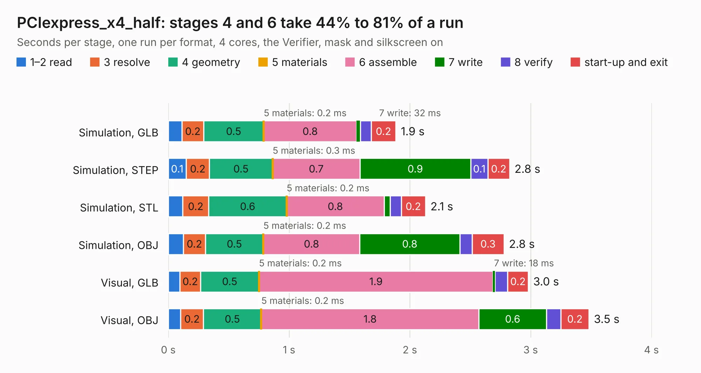

# 2070. PCIexpress_x4_half

Board 2,070 of the 3,103 of [Corpus Testing](../Corpus-Testing.md), on [Corpus Page 20](../CorpusTestingPages/Corpus-Testing-20.md#2070-pciexpress_x4_half).

| Mode and format | 1–2 read | 3 resolve | 4 geometry | 5 materials | 6 assemble | 7 write | 8 verify | start-up and exit | Total |
|---|---:|---:|---:|---:|---:|---:|---:|---:|---:|
| Simulation, GLB | 0.1 | 0.2 | 0.5 | 0.2&nbsp;ms | 0.8 | 32&nbsp;ms | 89&nbsp;ms | 0.2 | 1.9 |
| Simulation, STEP | 0.1 | 0.2 | 0.5 | 0.3&nbsp;ms | 0.7 | 0.9 | 0.1 | 0.2 | 2.8 |
| Simulation, STL | 0.1 | 0.2 | 0.6 | 0.2&nbsp;ms | 0.8 | 49&nbsp;ms | 93&nbsp;ms | 0.2 | 2.1 |
| Simulation, OBJ | 0.1 | 0.2 | 0.5 | 0.2&nbsp;ms | 0.8 | 0.8 | 0.1 | 0.3 | 2.8 |
| Visual, GLB | 97&nbsp;ms | 0.2 | 0.5 | 0.2&nbsp;ms | 1.9 | 18&nbsp;ms | 0.1 | 0.2 | 3.0 |
| Visual, OBJ | 0.1 | 0.2 | 0.5 | 0.2&nbsp;ms | 1.8 | 0.6 | 0.1 | 0.2 | 3.5 |

<table align="center"><tr><td valign="top">

| Board | Repo: [open-ephys/PCIexpress-KiCad](https://github.com/open-ephys/PCIexpress-KiCad) Board: `PCIexpress_x4_half.kicad_pcb` |
|---|---|
| Folder | PCIexpress_x4_half |
| Complexity | 204&nbsp;/&nbsp;1000 (size&nbsp;149, features&nbsp;55) |
| KESE&nbsp;features | through vias, rounded, trapezoid or chamfered pads, filled zones, curved board outline |
| Tested | 9th November 2026 |
| Copper&nbsp;layers | 4 |
| File&nbsp;format | KiCad 6 (20211014) |
| Parts,&nbsp;tracks,&nbsp;vias | 17, 83, 30 |
| Triangles,&nbsp;simulation | 182,182 in 57 parts |
| Verifier | PASS in all six runs |

</td><td valign="top">

<table>
<tr><th>File type</th><th>File size</th><th>Peak memory used</th></tr>
<tr><th colspan="3" align="left">Simulation</th></tr>
<tr><td>GLB</td><td align="right">6.1&nbsp;MB</td><td align="right">215&nbsp;MB</td></tr>
<tr><td>STEP</td><td align="right">29&nbsp;MB</td><td align="right">220&nbsp;MB</td></tr>
<tr><td>STL</td><td align="right">9.1&nbsp;MB</td><td align="right">211&nbsp;MB</td></tr>
<tr><td>OBJ</td><td align="right">18&nbsp;MB</td><td align="right">215&nbsp;MB</td></tr>
<tr><th colspan="3" align="left">Visual</th></tr>
<tr><td>GLB</td><td align="right">4.4&nbsp;MB</td><td align="right">171&nbsp;MB</td></tr>
<tr><td>OBJ</td><td align="right">13&nbsp;MB</td><td align="right">178&nbsp;MB</td></tr>
</table>

</td></tr></table>

| Previous | Next |
|:---|---:|
| [2069. PCIexpress_x4_full](b2069b_PCIexpress-KiCad_PCIexpress-x4-full.md) | [2071. PCIexpress_x4_low](b2071b_PCIexpress-KiCad_PCIexpress-x4-low.md) |
