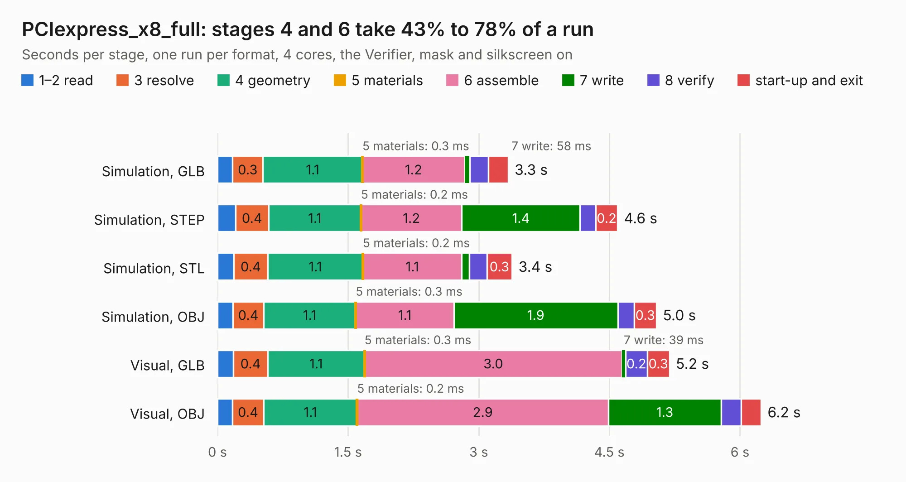

# 2070. PCIexpress_x8_full

Board 2,070 of the 3,101 of [Corpus Testing](../Corpus-Testing.md), on [Corpus Page 20](../CorpusTestingPages/Corpus-Testing-20.md#2070-pciexpress_x8_full).

| Mode and format | 1–2 read | 3 resolve | 4 geometry | 5 materials | 6 assemble | 7 write | 8 verify | start-up and exit | Total |
|---|---:|---:|---:|---:|---:|---:|---:|---:|---:|
| Simulation, GLB | 0.2 | 0.3 | 1.1 | 0.3&nbsp;ms | 1.2 | 58&nbsp;ms | 0.2 | 0.2 | 3.3 |
| Simulation, STEP | 0.2 | 0.4 | 1.1 | 0.2&nbsp;ms | 1.2 | 1.4 | 0.2 | 0.2 | 4.6 |
| Simulation, STL | 0.2 | 0.4 | 1.1 | 0.2&nbsp;ms | 1.1 | 88&nbsp;ms | 0.2 | 0.3 | 3.4 |
| Simulation, OBJ | 0.2 | 0.4 | 1.1 | 0.3&nbsp;ms | 1.1 | 1.9 | 0.2 | 0.3 | 5.0 |
| Visual, GLB | 0.2 | 0.4 | 1.1 | 0.3&nbsp;ms | 3.0 | 39&nbsp;ms | 0.2 | 0.3 | 5.2 |
| Visual, OBJ | 0.2 | 0.4 | 1.1 | 0.2&nbsp;ms | 2.9 | 1.3 | 0.2 | 0.2 | 6.2 |

<table align="center"><tr><td valign="top">

| Board | Repo: [open-ephys/PCIexpress-KiCad](https://github.com/open-ephys/PCIexpress-KiCad) Board: `PCIexpress_x8_full.kicad_pcb` |
|---|---|
| Folder | PCIexpress_x8_full |
| Complexity | 221&nbsp;/&nbsp;1000 (size&nbsp;166, features&nbsp;55) |
| KESE&nbsp;features | through vias, rounded, trapezoid or chamfered pads, filled zones, curved board outline |
| Tested | 9th November 2026 |
| Copper&nbsp;layers | 4 |
| File&nbsp;format | KiCad 6 (20211014) |
| Parts,&nbsp;tracks,&nbsp;vias | 33, 163, 54 |
| Triangles,&nbsp;simulation | 326,948 in 83 parts |
| Verifier | PASS in all six runs |

</td><td valign="top">

<table>
<tr><th>File type</th><th>File size</th><th>Peak memory used</th></tr>
<tr><th colspan="3" align="left">Simulation</th></tr>
<tr><td>GLB</td><td align="right">11&nbsp;MB</td><td align="right">275&nbsp;MB</td></tr>
<tr><td>STEP</td><td align="right">52&nbsp;MB</td><td align="right">282&nbsp;MB</td></tr>
<tr><td>STL</td><td align="right">16&nbsp;MB</td><td align="right">278&nbsp;MB</td></tr>
<tr><td>OBJ</td><td align="right">34&nbsp;MB</td><td align="right">281&nbsp;MB</td></tr>
<tr><th colspan="3" align="left">Visual</th></tr>
<tr><td>GLB</td><td align="right">8.0&nbsp;MB</td><td align="right">239&nbsp;MB</td></tr>
<tr><td>OBJ</td><td align="right">24&nbsp;MB</td><td align="right">245&nbsp;MB</td></tr>
</table>

</td></tr></table>

| Previous | Next |
|:---|---:|
| [2069. PCIexpress_x4_low](b2069b_PCIexpress-KiCad_PCIexpress-x4-low.md) | [2071. PCIexpress_x8_half](b2071b_PCIexpress-KiCad_PCIexpress-x8-half.md) |
