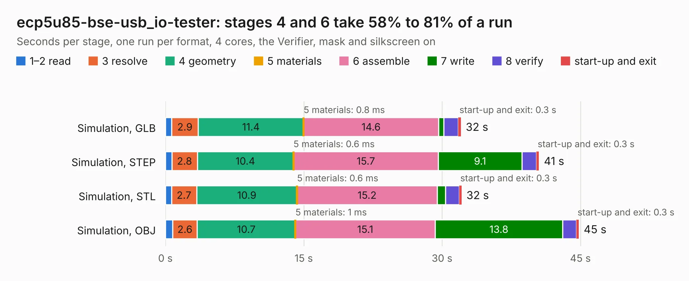

# 2071. ecp5u85-bse-usb_io-tester

Board 2,071 of the 3,131 of [Corpus Testing](../Corpus-Testing.md), on [Corpus Page 20](../CorpusTestingPages/Corpus-Testing-20.md#2071-ecp5u85-bse-usb_io-tester).

| Mode and format | 1–2 read | 3 resolve | 4 geometry | 5 materials | 6 assemble | 7 write | 8 verify | start-up and exit | Total |
|---|---:|---:|---:|---:|---:|---:|---:|---:|---:|
| Simulation, GLB | 0.7 | 2.9 | 11.4 | 0.8&nbsp;ms | 14.6 | 0.6 | 1.6 | 0.3 | 32.0 |
| Simulation, STEP | 0.7 | 2.8 | 10.4 | 0.6&nbsp;ms | 15.7 | 9.1 | 1.6 | 0.3 | 40.5 |
| Simulation, STL | 0.7 | 2.7 | 10.9 | 0.6&nbsp;ms | 15.2 | 0.9 | 1.5 | 0.3 | 32.1 |
| Simulation, OBJ | 0.8 | 2.6 | 10.7 | 1&nbsp;ms | 15.1 | 13.8 | 1.5 | 0.3 | 44.8 |
| Visual, GLB | 0.7 | 2.5 | 10.8 | 1.0&nbsp;ms | 26.9 | 0.3 | 3.7 | 0.3 | 45.2 |
| Visual, OBJ | 0.7 | 2.5 | 10.3 | 1&nbsp;ms | 25.0 | 9.8 | 3.7 | 0.2 | 52.1 |

<table align="center"><tr><td valign="top">

| Board | Repo: [open-ephys/ECP5U85-BSE-USB-IO-Tester](https://github.com/open-ephys/ECP5U85-BSE-USB-IO-Tester) Board: `ecp5u85-bse-usb_io-tester.kicad_pcb` |
|---|---|
| Folder | pcb |
| Complexity | 340&nbsp;/&nbsp;1000 (size&nbsp;255, features&nbsp;85) |
| KESE&nbsp;features | through vias, rounded, trapezoid or chamfered pads, filled zones, curved board outline, stack-up, dielectric εr and tanδ |
| Tested | 9th November 2026 |
| Copper&nbsp;layers | 4 |
| File&nbsp;format | KiCad 6 (20211014) |
| Parts,&nbsp;tracks,&nbsp;vias | 89, 2,051, 414 |
| Triangles,&nbsp;simulation | 3,290,346 in 243 parts |
| Verifier | PASS in all six runs |

</td><td valign="top">

<table>
<tr><th>File type</th><th>File size</th><th>Peak memory used</th></tr>
<tr><th colspan="3" align="left">Simulation</th></tr>
<tr><td>GLB</td><td align="right">111&nbsp;MB</td><td align="right">1.2&nbsp;GB</td></tr>
<tr><td>STEP</td><td align="right">530&nbsp;MB</td><td align="right">1.4&nbsp;GB</td></tr>
<tr><td>STL</td><td align="right">165&nbsp;MB</td><td align="right">1.2&nbsp;GB</td></tr>
<tr><td>OBJ</td><td align="right">346&nbsp;MB</td><td align="right">2.2&nbsp;GB</td></tr>
<tr><th colspan="3" align="left">Visual</th></tr>
<tr><td>GLB</td><td align="right">77&nbsp;MB</td><td align="right">1.3&nbsp;GB</td></tr>
<tr><td>OBJ</td><td align="right">243&nbsp;MB</td><td align="right">1.6&nbsp;GB</td></tr>
</table>

</td></tr></table>

| Previous | Next |
|:---|---:|
| [2070. ecp5u85-bse-usb](b2070b_ECP5U85-BSE-USB_ecp5u85-bse-usb.md) | [2072. ephys-test-board](b2072b_ephys-test-board_ephys-test-board.md) |
