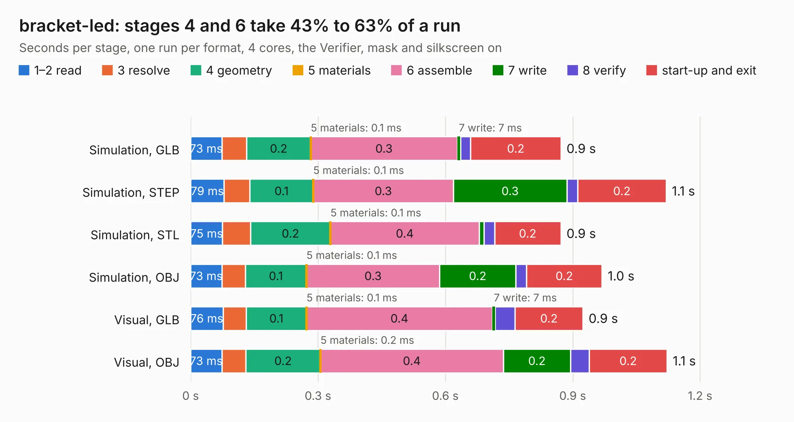

# 2071. bracket-led

Board 2,071 of the 3,122 of [Corpus Testing](../Corpus-Testing.md), on [Corpus Page 20](../CorpusTestingPages/Corpus-Testing-20.md#2071-bracket-led).

| Mode and format | 1–2 read | 3 resolve | 4 geometry | 5 materials | 6 assemble | 7 write | 8 verify | start-up and exit | Total |
|---|---:|---:|---:|---:|---:|---:|---:|---:|---:|
| Simulation, GLB | 73&nbsp;ms | 58&nbsp;ms | 0.2 | 0.1&nbsp;ms | 0.3 | 7&nbsp;ms | 24&nbsp;ms | 0.2 | 0.9 |
| Simulation, STEP | 79&nbsp;ms | 61&nbsp;ms | 0.1 | 0.1&nbsp;ms | 0.3 | 0.3 | 26&nbsp;ms | 0.2 | 1.1 |
| Simulation, STL | 75&nbsp;ms | 66&nbsp;ms | 0.2 | 0.1&nbsp;ms | 0.4 | 11&nbsp;ms | 25&nbsp;ms | 0.2 | 0.9 |
| Simulation, OBJ | 73&nbsp;ms | 56&nbsp;ms | 0.1 | 0.1&nbsp;ms | 0.3 | 0.2 | 26&nbsp;ms | 0.2 | 1.0 |
| Visual, GLB | 76&nbsp;ms | 55&nbsp;ms | 0.1 | 0.1&nbsp;ms | 0.4 | 7&nbsp;ms | 47&nbsp;ms | 0.2 | 0.9 |
| Visual, OBJ | 73&nbsp;ms | 57&nbsp;ms | 0.2 | 0.2&nbsp;ms | 0.4 | 0.2 | 44&nbsp;ms | 0.2 | 1.1 |

<table align="center"><tr><td valign="top">

| Board | Repo: [open-ephys/onix-fmc-host](https://github.com/open-ephys/onix-fmc-host) Board: `bracket-led.kicad_pcb` |
|---|---|
| Folder | bracket-led / source |
| Complexity | 181&nbsp;/&nbsp;1000 (size&nbsp;106, features&nbsp;75) |
| KESE&nbsp;features | through vias, rounded, trapezoid or chamfered pads, filled zones, stack-up, dielectric εr and tanδ |
| Tested | 9th November 2026 |
| Copper&nbsp;layers | 2 |
| File&nbsp;format | KiCad 7 (20221018) |
| Parts,&nbsp;tracks,&nbsp;vias | 5, 34, 12 |
| Triangles,&nbsp;simulation | 47,834 in 14 parts |
| Verifier | PASS in all six runs |

</td><td valign="top">

<table>
<tr><th>File type</th><th>File size</th><th>Peak memory used</th></tr>
<tr><th colspan="3" align="left">Simulation</th></tr>
<tr><td>GLB</td><td align="right">1.7&nbsp;MB</td><td align="right">73&nbsp;MB</td></tr>
<tr><td>STEP</td><td align="right">8.0&nbsp;MB</td><td align="right">80&nbsp;MB</td></tr>
<tr><td>STL</td><td align="right">2.4&nbsp;MB</td><td align="right">73&nbsp;MB</td></tr>
<tr><td>OBJ</td><td align="right">4.6&nbsp;MB</td><td align="right">82&nbsp;MB</td></tr>
<tr><th colspan="3" align="left">Visual</th></tr>
<tr><td>GLB</td><td align="right">1.4&nbsp;MB</td><td align="right">111&nbsp;MB</td></tr>
<tr><td>OBJ</td><td align="right">3.9&nbsp;MB</td><td align="right">103&nbsp;MB</td></tr>
</table>

</td></tr></table>

| Previous | Next |
|:---|---:|
| [2070. bracket-led-panel](b2070b_onix-fmc-host_bracket-led-panel.md) | [2072. bracket-led](b2072b_onix-fmc-host_mechanical-pcie-bracket-metal-bracket-led-pcb_bracket-led.md) |
