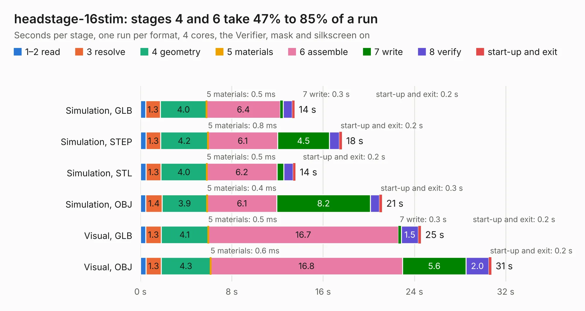

# 2075. headstage-16stim

Board 2,075 of the 3,123 of [Corpus Testing](../Corpus-Testing.md), on [Corpus Page 20](../CorpusTestingPages/Corpus-Testing-20.md#2075-headstage-16stim).

| Mode and format | 1–2 read | 3 resolve | 4 geometry | 5 materials | 6 assemble | 7 write | 8 verify | start-up and exit | Total |
|---|---:|---:|---:|---:|---:|---:|---:|---:|---:|
| Simulation, GLB | 0.5 | 1.3 | 4.0 | 0.5&nbsp;ms | 6.4 | 0.3 | 0.8 | 0.2 | 13.5 |
| Simulation, STEP | 0.5 | 1.3 | 4.2 | 0.8&nbsp;ms | 6.1 | 4.5 | 0.9 | 0.2 | 17.7 |
| Simulation, STL | 0.5 | 1.3 | 4.0 | 0.5&nbsp;ms | 6.2 | 0.6 | 0.8 | 0.2 | 13.6 |
| Simulation, OBJ | 0.5 | 1.4 | 3.9 | 0.4&nbsp;ms | 6.1 | 8.2 | 0.8 | 0.3 | 21.2 |
| Visual, GLB | 0.5 | 1.3 | 4.1 | 0.5&nbsp;ms | 16.7 | 0.3 | 1.5 | 0.2 | 24.6 |
| Visual, OBJ | 0.5 | 1.3 | 4.3 | 0.6&nbsp;ms | 16.8 | 5.6 | 2.0 | 0.2 | 30.8 |

<table align="center"><tr><td valign="top">

| Board | Repo: [open-ephys/onix-headstage-16stim](https://github.com/open-ephys/onix-headstage-16stim) Board: `headstage-16stim.kicad_pcb` |
|---|---|
| Folder | pcb |
| Complexity | 427&nbsp;/&nbsp;1000 (size&nbsp;282, features&nbsp;145) |
| KESE&nbsp;features | through vias, custom pads, rounded, trapezoid or chamfered pads, arc tracks, filled zones, copper drawings, curved board outline, stack-up, dielectric εr and tanδ, copper finish, mask and silkscreen colours |
| Tested | 9th November 2026 |
| Copper&nbsp;layers | 6 |
| File&nbsp;format | KiCad 8 (20240108) |
| Parts,&nbsp;tracks,&nbsp;vias | 125, 1,686, 247 |
| Triangles,&nbsp;simulation | 1,993,214 in 224 parts |
| Verifier | PASS in all six runs |

</td><td valign="top">

<table>
<tr><th>File type</th><th>File size</th><th>Peak memory used</th></tr>
<tr><th colspan="3" align="left">Simulation</th></tr>
<tr><td>GLB</td><td align="right">68&nbsp;MB</td><td align="right">676&nbsp;MB</td></tr>
<tr><td>STEP</td><td align="right">329&nbsp;MB</td><td align="right">864&nbsp;MB</td></tr>
<tr><td>STL</td><td align="right">100&nbsp;MB</td><td align="right">756&nbsp;MB</td></tr>
<tr><td>OBJ</td><td align="right">212&nbsp;MB</td><td align="right">1.3&nbsp;GB</td></tr>
<tr><th colspan="3" align="left">Visual</th></tr>
<tr><td>GLB</td><td align="right">46&nbsp;MB</td><td align="right">870&nbsp;MB</td></tr>
<tr><td>OBJ</td><td align="right">144&nbsp;MB</td><td align="right">1.1&nbsp;GB</td></tr>
</table>

</td></tr></table>

| Previous | Next |
|:---|---:|
| [2074. fmc-host](b2074b_onix-fmc-host_fmc-host.md) | [2076. headstage-64s](b2076b_onix-headstage-64s_headstage-64s.md) |
