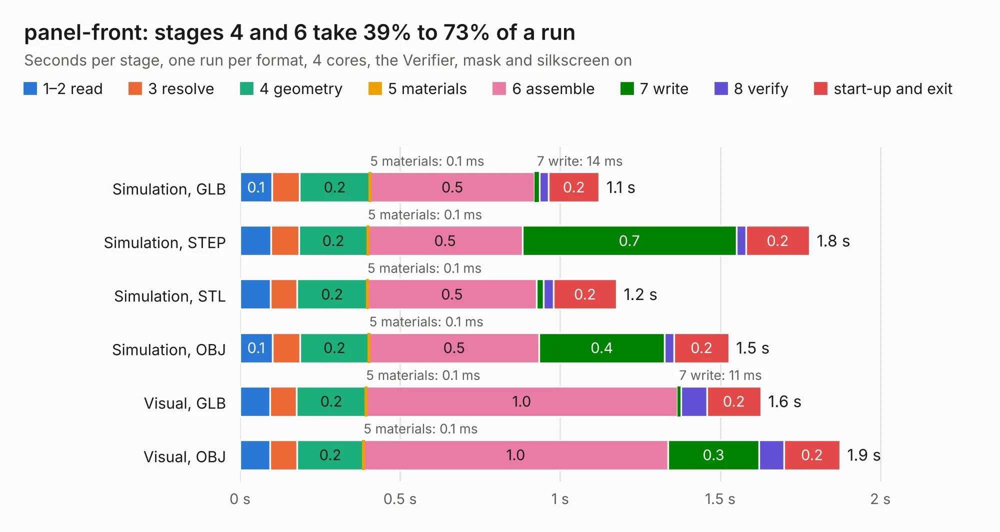

# 2076. panel-front

Board 2,076 of the 3,103 of [Corpus Testing](../Corpus-Testing.md), on [Corpus Page 20](../CorpusTestingPages/Corpus-Testing-20.md#2076-panel-front).

| Mode and format | 1–2 read | 3 resolve | 4 geometry | 5 materials | 6 assemble | 7 write | 8 verify | start-up and exit | Total |
|---|---:|---:|---:|---:|---:|---:|---:|---:|---:|
| Simulation, GLB | 0.1 | 86&nbsp;ms | 0.2 | 0.1&nbsp;ms | 0.5 | 14&nbsp;ms | 29&nbsp;ms | 0.2 | 1.1 |
| Simulation, STEP | 96&nbsp;ms | 87&nbsp;ms | 0.2 | 0.1&nbsp;ms | 0.5 | 0.7 | 29&nbsp;ms | 0.2 | 1.8 |
| Simulation, STL | 95&nbsp;ms | 83&nbsp;ms | 0.2 | 0.1&nbsp;ms | 0.5 | 22&nbsp;ms | 30&nbsp;ms | 0.2 | 1.2 |
| Simulation, OBJ | 0.1 | 86&nbsp;ms | 0.2 | 0.1&nbsp;ms | 0.5 | 0.4 | 30&nbsp;ms | 0.2 | 1.5 |
| Visual, GLB | 93&nbsp;ms | 84&nbsp;ms | 0.2 | 0.1&nbsp;ms | 1.0 | 11&nbsp;ms | 81&nbsp;ms | 0.2 | 1.6 |
| Visual, OBJ | 94&nbsp;ms | 84&nbsp;ms | 0.2 | 0.1&nbsp;ms | 1.0 | 0.3 | 77&nbsp;ms | 0.2 | 1.9 |

<table align="center"><tr><td valign="top">

| Board | Repo: [open-ephys/stimjim](https://github.com/open-ephys/stimjim) Board: `panel-front.kicad_pcb` |
|---|---|
| Folder | PCB / panels |
| Complexity | 129&nbsp;/&nbsp;1000 (size&nbsp;34, features&nbsp;95) |
| KESE&nbsp;features | arc tracks, filled zones, curved board outline, TrueType text, stack-up, dielectric εr and tanδ, mask and silkscreen colours |
| Tested | 9th November 2026 |
| Copper&nbsp;layers | 2 |
| File&nbsp;format | KiCad 10 (20260206) |
| Parts,&nbsp;tracks,&nbsp;vias | 4, 0, 0 |
| Triangles,&nbsp;simulation | 98,478 in 12 parts |
| Note | panel |
| Verifier | PASS in all six runs |

</td><td valign="top">

<table>
<tr><th>File type</th><th>File size</th><th>Peak memory used</th></tr>
<tr><th colspan="3" align="left">Simulation</th></tr>
<tr><td>GLB</td><td align="right">3.4&nbsp;MB</td><td align="right">185&nbsp;MB</td></tr>
<tr><td>STEP</td><td align="right">18&nbsp;MB</td><td align="right">194&nbsp;MB</td></tr>
<tr><td>STL</td><td align="right">4.9&nbsp;MB</td><td align="right">181&nbsp;MB</td></tr>
<tr><td>OBJ</td><td align="right">9.6&nbsp;MB</td><td align="right">185&nbsp;MB</td></tr>
<tr><th colspan="3" align="left">Visual</th></tr>
<tr><td>GLB</td><td align="right">2.7&nbsp;MB</td><td align="right">153&nbsp;MB</td></tr>
<tr><td>OBJ</td><td align="right">7.4&nbsp;MB</td><td align="right">151&nbsp;MB</td></tr>
</table>

</td></tr></table>

| Previous | Next |
|:---|---:|
| [2075. panel-back](b2075b_stimjim_panel-back.md) | [2077. stimjim](b2077b_stimjim_stimjim.md) |
