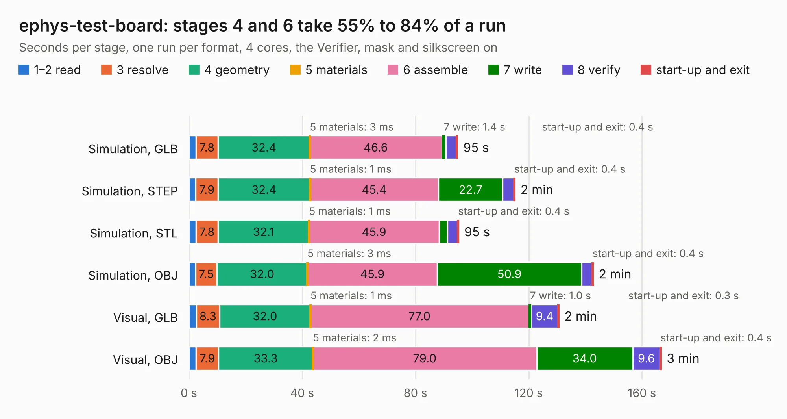

# 2077. ephys-test-board

Board 2,077 of the 3,139 of [Corpus Testing](../Corpus-Testing.md), on [Corpus Page 20](../CorpusTestingPages/Corpus-Testing-20.md#2077-ephys-test-board).

| Mode and format | 1–2 read | 3 resolve | 4 geometry | 5 materials | 6 assemble | 7 write | 8 verify | start-up and exit | Total |
|---|---:|---:|---:|---:|---:|---:|---:|---:|---:|
| Simulation, GLB | 2.5 | 7.8 | 32.4 | 3&nbsp;ms | 46.6 | 1.4 | 3.8 | 0.4 | 94.9 |
| Simulation, STEP | 2.4 | 7.9 | 32.4 | 1&nbsp;ms | 45.4 | 22.7 | 3.9 | 0.4 | 115.1 |
| Simulation, STL | 2.5 | 7.8 | 32.1 | 1&nbsp;ms | 45.9 | 2.9 | 3.6 | 0.4 | 95.3 |
| Simulation, OBJ | 2.4 | 7.5 | 32.0 | 3&nbsp;ms | 45.9 | 50.9 | 3.7 | 0.4 | 142.7 |
| Visual, GLB | 2.6 | 8.3 | 32.0 | 1&nbsp;ms | 77.0 | 1.0 | 9.4 | 0.3 | 130.6 |
| Visual, OBJ | 2.5 | 7.9 | 33.3 | 2&nbsp;ms | 79.0 | 34.0 | 9.6 | 0.4 | 166.8 |

<table align="center"><tr><td valign="top">

| Board | Repo: [open-ephys/ephys-test-board](https://github.com/open-ephys/ephys-test-board) Board: `ephys-test-board.kicad_pcb` |
|---|---|
| Folder | pcb |
| Complexity | 390&nbsp;/&nbsp;1000 (size&nbsp;290, features&nbsp;100) |
| KESE&nbsp;features | through vias, slotted holes, rounded, trapezoid or chamfered pads, filled zones, curved board outline, stack-up, dielectric εr and tanδ, mask and silkscreen colours |
| Tested | 9th November 2026 |
| Copper&nbsp;layers | 4 |
| File&nbsp;format | KiCad 10 (20260206) |
| Parts,&nbsp;tracks,&nbsp;vias | 542, 4,979, 1,145 |
| Triangles,&nbsp;simulation | 7,522,154 in 522 parts |
| Verifier | PASS in all six runs |

</td><td valign="top">

<table>
<tr><th>File type</th><th>File size</th><th>Peak memory used</th></tr>
<tr><th colspan="3" align="left">Simulation</th></tr>
<tr><td>GLB</td><td align="right">255&nbsp;MB</td><td align="right">2.1&nbsp;GB</td></tr>
<tr><td>STEP</td><td align="right">1.2&nbsp;GB</td><td align="right">3.0&nbsp;GB</td></tr>
<tr><td>STL</td><td align="right">376&nbsp;MB</td><td align="right">2.1&nbsp;GB</td></tr>
<tr><td>OBJ</td><td align="right">818&nbsp;MB</td><td align="right">4.9&nbsp;GB</td></tr>
<tr><th colspan="3" align="left">Visual</th></tr>
<tr><td>GLB</td><td align="right">180&nbsp;MB</td><td align="right">2.9&nbsp;GB</td></tr>
<tr><td>OBJ</td><td align="right">591&nbsp;MB</td><td align="right">3.8&nbsp;GB</td></tr>
</table>

</td></tr></table>

| Previous | Next |
|:---|---:|
| [2076. ecp5u85-bse-usb_io-tester](b2076b_ECP5U85-BSE-USB-IO-Tester_ecp5u85-bse-usb-io-tester.md) | [2078. low-profile-headstage-64ch-3d](b2078b_low-profile-headstage-64ch-3d_low-profile-headstage-64ch-3d.md) |
