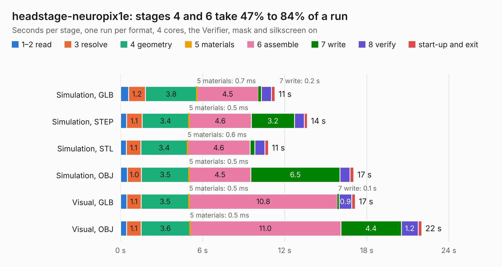

# 2078. headstage-neuropix1e

Board 2,078 of the 3,125 of [Corpus Testing](../Corpus-Testing.md), on [Corpus Page 20](../CorpusTestingPages/Corpus-Testing-20.md#2078-headstage-neuropix1e).

| Mode and format | 1–2 read | 3 resolve | 4 geometry | 5 materials | 6 assemble | 7 write | 8 verify | start-up and exit | Total |
|---|---:|---:|---:|---:|---:|---:|---:|---:|---:|
| Simulation, GLB | 0.6 | 1.2 | 3.8 | 0.7&nbsp;ms | 4.5 | 0.2 | 0.7 | 0.3 | 11.3 |
| Simulation, STEP | 0.4 | 1.1 | 3.4 | 0.5&nbsp;ms | 4.6 | 3.2 | 0.7 | 0.2 | 13.7 |
| Simulation, STL | 0.4 | 1.1 | 3.4 | 0.6&nbsp;ms | 4.6 | 0.3 | 0.7 | 0.3 | 10.8 |
| Simulation, OBJ | 0.5 | 1.0 | 3.5 | 0.5&nbsp;ms | 4.5 | 6.5 | 0.7 | 0.3 | 17.1 |
| Visual, GLB | 0.4 | 1.1 | 3.5 | 0.5&nbsp;ms | 10.8 | 0.1 | 0.9 | 0.3 | 17.2 |
| Visual, OBJ | 0.4 | 1.1 | 3.6 | 0.5&nbsp;ms | 11.0 | 4.4 | 1.2 | 0.3 | 22.0 |

<table align="center"><tr><td valign="top">

| Board | Repo: [open-ephys/onix-headstage-neuropix1e](https://github.com/open-ephys/onix-headstage-neuropix1e) Board: `headstage-neuropix1e.kicad_pcb` |
|---|---|
| Folder | pcb-hirose |
| Complexity | 360&nbsp;/&nbsp;1000 (size&nbsp;245, features&nbsp;115) |
| KESE&nbsp;features | through vias, custom pads, rounded, trapezoid or chamfered pads, filled zones, copper drawings, curved board outline, stack-up, dielectric εr and tanδ, mask and silkscreen colours |
| Tested | 9th November 2026 |
| Copper&nbsp;layers | 4 |
| File&nbsp;format | KiCad 7 (20221018) |
| Parts,&nbsp;tracks,&nbsp;vias | 72, 672, 177 |
| Triangles,&nbsp;simulation | 1,134,360 in 78 parts |
| Verifier | PASS in all six runs |

</td><td valign="top">

<table>
<tr><th>File type</th><th>File size</th><th>Peak memory used</th></tr>
<tr><th colspan="3" align="left">Simulation</th></tr>
<tr><td>GLB</td><td align="right">39&nbsp;MB</td><td align="right">519&nbsp;MB</td></tr>
<tr><td>STEP</td><td align="right">168&nbsp;MB</td><td align="right">616&nbsp;MB</td></tr>
<tr><td>STL</td><td align="right">57&nbsp;MB</td><td align="right">524&nbsp;MB</td></tr>
<tr><td>OBJ</td><td align="right">117&nbsp;MB</td><td align="right">802&nbsp;MB</td></tr>
<tr><th colspan="3" align="left">Visual</th></tr>
<tr><td>GLB</td><td align="right">25&nbsp;MB</td><td align="right">618&nbsp;MB</td></tr>
<tr><td>OBJ</td><td align="right">77&nbsp;MB</td><td align="right">654&nbsp;MB</td></tr>
</table>

</td></tr></table>

| Previous | Next |
|:---|---:|
| [2077. headstage-64s](b2077b_onix-headstage-64s_headstage-64s.md) | [2079. headstage-neuropix1e](b2079b_onix-headstage-neuropix1e_pcb-te_headstage-neuropix1e.md) |
