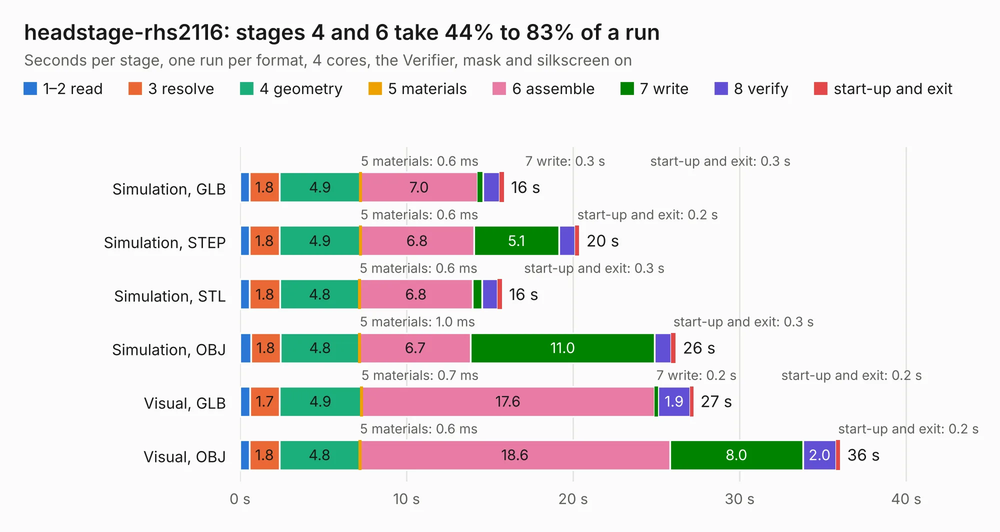

# 2078. headstage-rhs2116

Board 2,078 of the 3,120 of [Corpus Testing](../Corpus-Testing.md), on [Corpus Page 20](../CorpusTestingPages/Corpus-Testing-20.md#2078-headstage-rhs2116).

| Mode and format | 1–2 read | 3 resolve | 4 geometry | 5 materials | 6 assemble | 7 write | 8 verify | start-up and exit | Total |
|---|---:|---:|---:|---:|---:|---:|---:|---:|---:|
| Simulation, GLB | 0.6 | 1.8 | 4.9 | 0.6&nbsp;ms | 7.0 | 0.3 | 1.0 | 0.3 | 15.8 |
| Simulation, STEP | 0.6 | 1.8 | 4.9 | 0.6&nbsp;ms | 6.8 | 5.1 | 1.0 | 0.2 | 20.4 |
| Simulation, STL | 0.6 | 1.8 | 4.8 | 0.6&nbsp;ms | 6.8 | 0.6 | 1.0 | 0.3 | 15.7 |
| Simulation, OBJ | 0.7 | 1.8 | 4.8 | 1.0&nbsp;ms | 6.7 | 11.0 | 1.0 | 0.3 | 26.2 |
| Visual, GLB | 0.6 | 1.7 | 4.9 | 0.7&nbsp;ms | 17.6 | 0.2 | 1.9 | 0.2 | 27.2 |
| Visual, OBJ | 0.6 | 1.8 | 4.8 | 0.6&nbsp;ms | 18.6 | 8.0 | 2.0 | 0.2 | 36.0 |

<table align="center"><tr><td valign="top">

| Board | Repo: [open-ephys/onix-headstage-rhs2116](https://github.com/open-ephys/onix-headstage-rhs2116) Board: `headstage-rhs2116.kicad_pcb` |
|---|---|
| Folder | pcb |
| Complexity | 425&nbsp;/&nbsp;1000 (size&nbsp;280, features&nbsp;145) |
| KESE&nbsp;features | through vias, custom pads, rounded, trapezoid or chamfered pads, arc tracks, filled zones, copper drawings, curved board outline, stack-up, dielectric εr and tanδ, copper finish, mask and silkscreen colours |
| Tested | 9th November 2026 |
| Copper&nbsp;layers | 6 |
| File&nbsp;format | KiCad 8 (20240108) |
| Parts,&nbsp;tracks,&nbsp;vias | 131, 1,462, 313 |
| Triangles,&nbsp;simulation | 2,183,078 in 178 parts |
| Verifier | PASS in all six runs |

</td><td valign="top">

<table>
<tr><th>File type</th><th>File size</th><th>Peak memory used</th></tr>
<tr><th colspan="3" align="left">Simulation</th></tr>
<tr><td>GLB</td><td align="right">74&nbsp;MB</td><td align="right">841&nbsp;MB</td></tr>
<tr><td>STEP</td><td align="right">318&nbsp;MB</td><td align="right">952&nbsp;MB</td></tr>
<tr><td>STL</td><td align="right">109&nbsp;MB</td><td align="right">824&nbsp;MB</td></tr>
<tr><td>OBJ</td><td align="right">231&nbsp;MB</td><td align="right">1.5&nbsp;GB</td></tr>
<tr><th colspan="3" align="left">Visual</th></tr>
<tr><td>GLB</td><td align="right">49&nbsp;MB</td><td align="right">919&nbsp;MB</td></tr>
<tr><td>OBJ</td><td align="right">154&nbsp;MB</td><td align="right">1.1&nbsp;GB</td></tr>
</table>

</td></tr></table>

| Previous | Next |
|:---|---:|
| [2077. headstage-neuropix2e](b2077b_onix-headstage-neuropix2e-beta_headstage-neuropix2e.md) | [2079. test-board](b2079b_onix-headstage-rhs2116_test-board.md) |
