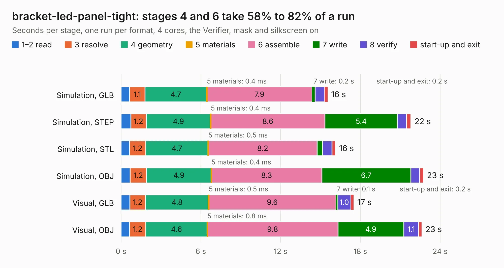

# 2080 bracket-led-panel-tight

Board 2,080 of the 3,138 of [Corpus Testing](../Corpus-Testing.md), on [Corpus Page 20](../CorpusTestingPages/Corpus-Testing-20.md#2080-bracket-led-panel-tight).

| Mode and format | 1–2 read | 3 resolve | 4 geometry | 5 materials | 6 assemble | 7 write | 8 verify | start-up and exit | Total |
|---|---:|---:|---:|---:|---:|---:|---:|---:|---:|
| Simulation, GLB | 0.7 | 1.1 | 4.7 | 0.4&nbsp;ms | 7.9 | 0.2 | 0.7 | 0.2 | 15.5 |
| Simulation, STEP | 0.7 | 1.2 | 4.9 | 0.4&nbsp;ms | 8.6 | 5.4 | 0.7 | 0.3 | 21.8 |
| Simulation, STL | 0.6 | 1.2 | 4.7 | 0.5&nbsp;ms | 8.2 | 0.4 | 0.7 | 0.3 | 16.1 |
| Simulation, OBJ | 0.7 | 1.2 | 4.9 | 0.4&nbsp;ms | 8.3 | 6.7 | 0.7 | 0.3 | 22.7 |
| Visual, GLB | 0.7 | 1.2 | 4.8 | 0.5&nbsp;ms | 9.6 | 0.1 | 1.0 | 0.2 | 17.5 |
| Visual, OBJ | 0.6 | 1.2 | 4.6 | 0.8&nbsp;ms | 9.8 | 4.9 | 1.1 | 0.2 | 22.6 |

<table align="center"><tr><td valign="top">

| Board | Repo: [open-ephys/onix-fmc-host](https://github.com/open-ephys/onix-fmc-host) Board: `bracket-led-panel-tight.kicad_pcb` |
|---|---|
| Folder | bracket-led / source |
| Complexity | 250&nbsp;/&nbsp;1000 (size&nbsp;175, features&nbsp;75) |
| KESE&nbsp;features | through vias, rounded, trapezoid or chamfered pads, filled zones, stack-up, dielectric εr and tanδ |
| Tested | 9th November 2026 |
| Copper&nbsp;layers | 2 |
| File&nbsp;format | KiCad 7 (20221018) |
| Parts,&nbsp;tracks,&nbsp;vias | 75, 630, 90 |
| Triangles,&nbsp;simulation | 1,090,228 in 114 parts |
| Note | panel |
| Verifier | PASS in all six runs |

</td><td valign="top">

<table>
<tr><th>File type</th><th>File size</th><th>Peak memory used</th></tr>
<tr><th colspan="3" align="left">Simulation</th></tr>
<tr><td>GLB</td><td align="right">40&nbsp;MB</td><td align="right">558&nbsp;MB</td></tr>
<tr><td>STEP</td><td align="right">253&nbsp;MB</td><td align="right">662&nbsp;MB</td></tr>
<tr><td>STL</td><td align="right">55&nbsp;MB</td><td align="right">551&nbsp;MB</td></tr>
<tr><td>OBJ</td><td align="right">119&nbsp;MB</td><td align="right">831&nbsp;MB</td></tr>
<tr><th colspan="3" align="left">Visual</th></tr>
<tr><td>GLB</td><td align="right">29&nbsp;MB</td><td align="right">662&nbsp;MB</td></tr>
<tr><td>OBJ</td><td align="right">87&nbsp;MB</td><td align="right">669&nbsp;MB</td></tr>
</table>

</td></tr></table>

| Previous | Next |
|:---|---:|
| [2079 acquisition-board](b2079b_oe-acquisition-board-gen3_acquisition-board.md) | [2081 bracket-led-panel](b2081b_onix-fmc-host_bracket-led-panel.md) |
