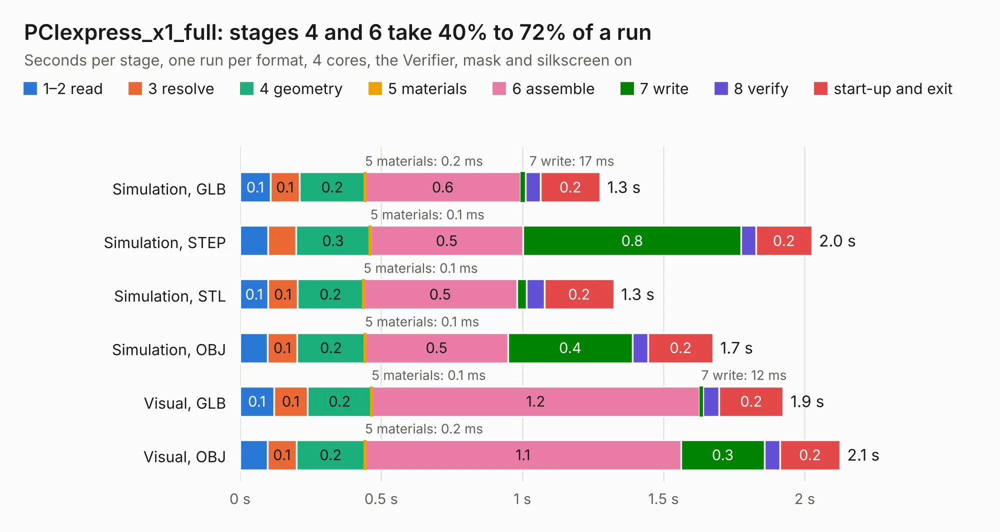

# 2083. PCIexpress_x1_full

Board 2,083 of the 3,120 of [Corpus Testing](../Corpus-Testing.md), on [Corpus Page 20](../CorpusTestingPages/Corpus-Testing-20.md#2083-pciexpress_x1_full).

| Mode and format | 1–2 read | 3 resolve | 4 geometry | 5 materials | 6 assemble | 7 write | 8 verify | start-up and exit | Total |
|---|---:|---:|---:|---:|---:|---:|---:|---:|---:|
| Simulation, GLB | 0.1 | 0.1 | 0.2 | 0.2&nbsp;ms | 0.6 | 17&nbsp;ms | 54&nbsp;ms | 0.2 | 1.3 |
| Simulation, STEP | 99&nbsp;ms | 98&nbsp;ms | 0.3 | 0.1&nbsp;ms | 0.5 | 0.8 | 53&nbsp;ms | 0.2 | 2.0 |
| Simulation, STL | 0.1 | 0.1 | 0.2 | 0.1&nbsp;ms | 0.5 | 35&nbsp;ms | 63&nbsp;ms | 0.2 | 1.3 |
| Simulation, OBJ | 98&nbsp;ms | 0.1 | 0.2 | 0.1&nbsp;ms | 0.5 | 0.4 | 56&nbsp;ms | 0.2 | 1.7 |
| Visual, GLB | 0.1 | 0.1 | 0.2 | 0.1&nbsp;ms | 1.2 | 12&nbsp;ms | 57&nbsp;ms | 0.2 | 1.9 |
| Visual, OBJ | 98&nbsp;ms | 0.1 | 0.2 | 0.2&nbsp;ms | 1.1 | 0.3 | 55&nbsp;ms | 0.2 | 2.1 |

<table align="center"><tr><td valign="top">

| Board | Repo: [open-ephys/PCIexpress-KiCad](https://github.com/open-ephys/PCIexpress-KiCad) Board: `PCIexpress_x1_full.kicad_pcb` |
|---|---|
| Folder | PCIexpress_x1_full |
| Complexity | 175&nbsp;/&nbsp;1000 (size&nbsp;120, features&nbsp;55) |
| KESE&nbsp;features | through vias, rounded, trapezoid or chamfered pads, filled zones, curved board outline |
| Tested | 9th November 2026 |
| Copper&nbsp;layers | 4 |
| File&nbsp;format | KiCad 6 (20211014) |
| Parts,&nbsp;tracks,&nbsp;vias | 5, 23, 12 |
| Triangles,&nbsp;simulation | 83,072 in 35 parts |
| Verifier | PASS in all six runs |

</td><td valign="top">

<table>
<tr><th>File type</th><th>File size</th><th>Peak memory used</th></tr>
<tr><th colspan="3" align="left">Simulation</th></tr>
<tr><td>GLB</td><td align="right">2.8&nbsp;MB</td><td align="right">182&nbsp;MB</td></tr>
<tr><td>STEP</td><td align="right">12&nbsp;MB</td><td align="right">181&nbsp;MB</td></tr>
<tr><td>STL</td><td align="right">4.2&nbsp;MB</td><td align="right">179&nbsp;MB</td></tr>
<tr><td>OBJ</td><td align="right">8.1&nbsp;MB</td><td align="right">180&nbsp;MB</td></tr>
<tr><th colspan="3" align="left">Visual</th></tr>
<tr><td>GLB</td><td align="right">1.9&nbsp;MB</td><td align="right">154&nbsp;MB</td></tr>
<tr><td>OBJ</td><td align="right">5.4&nbsp;MB</td><td align="right">154&nbsp;MB</td></tr>
</table>

</td></tr></table>

| Previous | Next |
|:---|---:|
| [2082. PCIexpress_x16_low](b2082b_PCIexpress-KiCad_PCIexpress-x16-low.md) | [2084. PCIexpress_x1_half](b2084b_PCIexpress-KiCad_PCIexpress-x1-half.md) |
