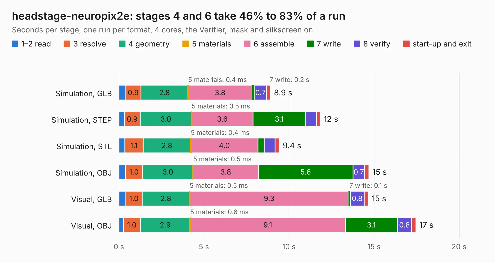

# 2083. headstage-neuropix2e

Board 2,083 of the 3,130 of [Corpus Testing](../Corpus-Testing.md), on [Corpus Page 20](../CorpusTestingPages/Corpus-Testing-20.md#2083-headstage-neuropix2e).

| Mode and format | 1–2 read | 3 resolve | 4 geometry | 5 materials | 6 assemble | 7 write | 8 verify | start-up and exit | Total |
|---|---:|---:|---:|---:|---:|---:|---:|---:|---:|
| Simulation, GLB | 0.4 | 0.9 | 2.8 | 0.4&nbsp;ms | 3.8 | 0.2 | 0.7 | 0.2 | 8.9 |
| Simulation, STEP | 0.3 | 0.9 | 3.0 | 0.5&nbsp;ms | 3.6 | 3.1 | 0.7 | 0.2 | 11.8 |
| Simulation, STL | 0.3 | 1.1 | 2.8 | 0.4&nbsp;ms | 4.0 | 0.4 | 0.6 | 0.2 | 9.4 |
| Simulation, OBJ | 0.4 | 1.0 | 3.0 | 0.5&nbsp;ms | 3.8 | 5.6 | 0.7 | 0.2 | 14.7 |
| Visual, GLB | 0.4 | 1.0 | 2.8 | 0.5&nbsp;ms | 9.3 | 0.1 | 0.8 | 0.2 | 14.7 |
| Visual, OBJ | 0.3 | 1.0 | 2.9 | 0.6&nbsp;ms | 9.1 | 3.1 | 0.8 | 0.2 | 17.5 |

<table align="center"><tr><td valign="top">

| Board | Repo: [open-ephys/onix-headstage-neuropix2e](https://github.com/open-ephys/onix-headstage-neuropix2e) Board: `headstage-neuropix2e.kicad_pcb` |
|---|---|
| Folder | pcb |
| Complexity | 381&nbsp;/&nbsp;1000 (size&nbsp;241, features&nbsp;140) |
| KESE&nbsp;features | through vias, slotted holes, custom pads, rounded, trapezoid or chamfered pads, arc tracks, filled zones, copper drawings, curved board outline, stack-up, dielectric εr and tanδ, mask and silkscreen colours |
| Tested | 9th November 2026 |
| Copper&nbsp;layers | 4 |
| File&nbsp;format | KiCad 7 (20221018) |
| Parts,&nbsp;tracks,&nbsp;vias | 58, 661, 155 |
| Triangles,&nbsp;simulation | 1,030,874 in 73 parts |
| Verifier | PASS in all six runs |

</td><td valign="top">

<table>
<tr><th>File type</th><th>File size</th><th>Peak memory used</th></tr>
<tr><th colspan="3" align="left">Simulation</th></tr>
<tr><td>GLB</td><td align="right">35&nbsp;MB</td><td align="right">502&nbsp;MB</td></tr>
<tr><td>STEP</td><td align="right">148&nbsp;MB</td><td align="right">516&nbsp;MB</td></tr>
<tr><td>STL</td><td align="right">52&nbsp;MB</td><td align="right">499&nbsp;MB</td></tr>
<tr><td>OBJ</td><td align="right">105&nbsp;MB</td><td align="right">730&nbsp;MB</td></tr>
<tr><th colspan="3" align="left">Visual</th></tr>
<tr><td>GLB</td><td align="right">22&nbsp;MB</td><td align="right">555&nbsp;MB</td></tr>
<tr><td>OBJ</td><td align="right">67&nbsp;MB</td><td align="right">555&nbsp;MB</td></tr>
</table>

</td></tr></table>

| Previous | Next |
|:---|---:|
| [2082. headstage-neuropix1e](b2082b_onix-headstage-neuropix1e_pcb-te_headstage-neuropix1e.md) | [2084. headstage-neuropix2e](b2084b_onix-headstage-neuropix2e-beta_headstage-neuropix2e.md) |
