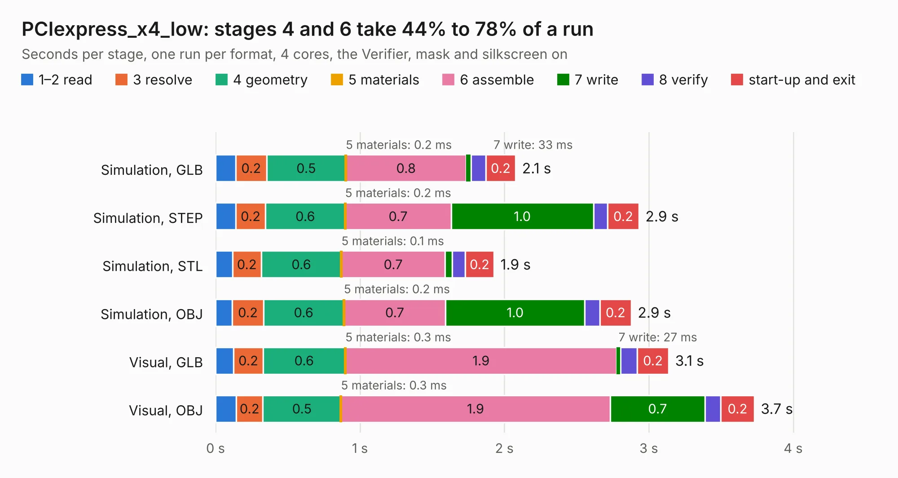

# 2086. PCIexpress_x4_low

Board 2,086 of the 3,118 of [Corpus Testing](../Corpus-Testing.md), on [Corpus Page 20](../CorpusTestingPages/Corpus-Testing-20.md#2086-pciexpress_x4_low).

| Mode and format | 1–2 read | 3 resolve | 4 geometry | 5 materials | 6 assemble | 7 write | 8 verify | start-up and exit | Total |
|---|---:|---:|---:|---:|---:|---:|---:|---:|---:|
| Simulation, GLB | 0.1 | 0.2 | 0.5 | 0.2&nbsp;ms | 0.8 | 33&nbsp;ms | 0.1 | 0.2 | 2.1 |
| Simulation, STEP | 0.1 | 0.2 | 0.6 | 0.2&nbsp;ms | 0.7 | 1.0 | 97&nbsp;ms | 0.2 | 2.9 |
| Simulation, STL | 0.1 | 0.2 | 0.6 | 0.1&nbsp;ms | 0.7 | 49&nbsp;ms | 91&nbsp;ms | 0.2 | 1.9 |
| Simulation, OBJ | 0.1 | 0.2 | 0.6 | 0.2&nbsp;ms | 0.7 | 1.0 | 0.1 | 0.2 | 2.9 |
| Visual, GLB | 0.1 | 0.2 | 0.6 | 0.3&nbsp;ms | 1.9 | 27&nbsp;ms | 0.1 | 0.2 | 3.1 |
| Visual, OBJ | 0.1 | 0.2 | 0.5 | 0.3&nbsp;ms | 1.9 | 0.7 | 0.1 | 0.2 | 3.7 |

<table align="center"><tr><td valign="top">

| Board | Repo: [open-ephys/PCIexpress-KiCad](https://github.com/open-ephys/PCIexpress-KiCad) Board: `PCIexpress_x4_low.kicad_pcb` |
|---|---|
| Folder | PCIexpress_x4_low |
| Complexity | 204&nbsp;/&nbsp;1000 (size&nbsp;149, features&nbsp;55) |
| KESE&nbsp;features | through vias, rounded, trapezoid or chamfered pads, filled zones, curved board outline |
| Tested | 9th November 2026 |
| Copper&nbsp;layers | 4 |
| File&nbsp;format | KiCad 6 (20211014) |
| Parts,&nbsp;tracks,&nbsp;vias | 17, 83, 30 |
| Triangles,&nbsp;simulation | 182,178 in 57 parts |
| Verifier | PASS in all six runs |

</td><td valign="top">

<table>
<tr><th>File type</th><th>File size</th><th>Peak memory used</th></tr>
<tr><th colspan="3" align="left">Simulation</th></tr>
<tr><td>GLB</td><td align="right">6.1&nbsp;MB</td><td align="right">206&nbsp;MB</td></tr>
<tr><td>STEP</td><td align="right">29&nbsp;MB</td><td align="right">217&nbsp;MB</td></tr>
<tr><td>STL</td><td align="right">9.1&nbsp;MB</td><td align="right">214&nbsp;MB</td></tr>
<tr><td>OBJ</td><td align="right">18&nbsp;MB</td><td align="right">213&nbsp;MB</td></tr>
<tr><th colspan="3" align="left">Visual</th></tr>
<tr><td>GLB</td><td align="right">4.4&nbsp;MB</td><td align="right">175&nbsp;MB</td></tr>
<tr><td>OBJ</td><td align="right">13&nbsp;MB</td><td align="right">179&nbsp;MB</td></tr>
</table>

</td></tr></table>

| Previous | Next |
|:---|---:|
| [2085. PCIexpress_x4_half](b2085b_PCIexpress-KiCad_PCIexpress-x4-half.md) | [2087. PCIexpress_x8_full](b2087b_PCIexpress-KiCad_PCIexpress-x8-full.md) |
