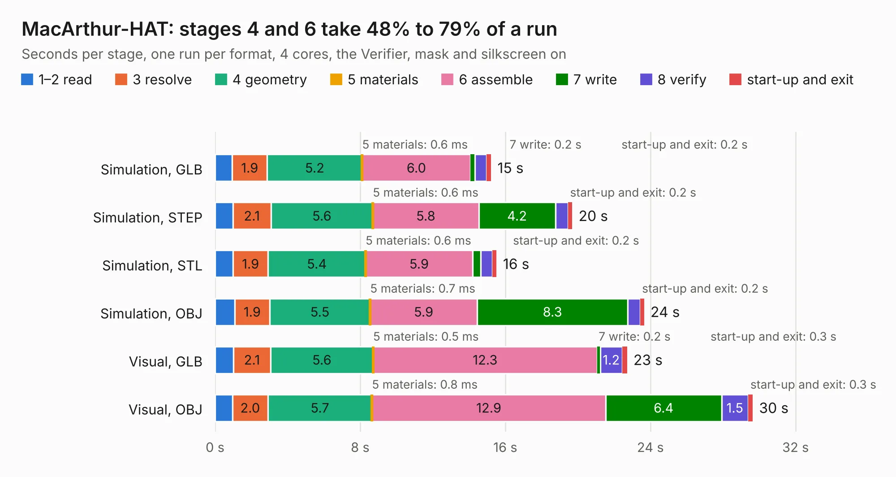

# 2087. MacArthur-HAT

Board 2,087 of the 3,107 of [Corpus Testing](../Corpus-Testing.md), on [Corpus Page 20](../CorpusTestingPages/Corpus-Testing-20.md#2087-macarthur-hat).

| Mode and format | 1–2 read | 3 resolve | 4 geometry | 5 materials | 6 assemble | 7 write | 8 verify | start-up and exit | Total |
|---|---:|---:|---:|---:|---:|---:|---:|---:|---:|
| Simulation, GLB | 0.9 | 1.9 | 5.2 | 0.6&nbsp;ms | 6.0 | 0.2 | 0.6 | 0.2 | 15.2 |
| Simulation, STEP | 1.0 | 2.1 | 5.6 | 0.6&nbsp;ms | 5.8 | 4.2 | 0.7 | 0.2 | 19.7 |
| Simulation, STL | 1.0 | 1.9 | 5.4 | 0.6&nbsp;ms | 5.9 | 0.5 | 0.6 | 0.2 | 15.5 |
| Simulation, OBJ | 1.1 | 1.9 | 5.5 | 0.7&nbsp;ms | 5.9 | 8.3 | 0.7 | 0.2 | 23.6 |
| Visual, GLB | 1.0 | 2.1 | 5.6 | 0.5&nbsp;ms | 12.3 | 0.2 | 1.2 | 0.3 | 22.7 |
| Visual, OBJ | 1.0 | 2.0 | 5.7 | 0.8&nbsp;ms | 12.9 | 6.4 | 1.5 | 0.3 | 29.6 |

<table align="center"><tr><td valign="top">

| Board | Repo: [OpenMarine/MacArthur-HAT](https://github.com/OpenMarine/MacArthur-HAT) Board: `MacArthur-HAT.kicad_pcb` |
|---|---|
| Folder | KiCad |
| Complexity | 312&nbsp;/&nbsp;1000 (size&nbsp;207, features&nbsp;105) |
| KESE&nbsp;features | through vias, rounded, trapezoid or chamfered pads, filled zones, curved board outline, stack-up, dielectric εr and tanδ, copper finish, mask and silkscreen colours |
| Tested | 9th November 2026 |
| Copper&nbsp;layers | 4 |
| File&nbsp;format | KiCad 8 (20240108) |
| Parts,&nbsp;tracks,&nbsp;vias | 102, 1,085, 240 |
| Triangles,&nbsp;simulation | 1,613,902 in 109 parts |
| Verifier | PASS in all six runs |

</td><td valign="top">

<table>
<tr><th>File type</th><th>File size</th><th>Peak memory used</th></tr>
<tr><th colspan="3" align="left">Simulation</th></tr>
<tr><td>GLB</td><td align="right">54&nbsp;MB</td><td align="right">598&nbsp;MB</td></tr>
<tr><td>STEP</td><td align="right">226&nbsp;MB</td><td align="right">782&nbsp;MB</td></tr>
<tr><td>STL</td><td align="right">81&nbsp;MB</td><td align="right">629&nbsp;MB</td></tr>
<tr><td>OBJ</td><td align="right">167&nbsp;MB</td><td align="right">1.1&nbsp;GB</td></tr>
<tr><th colspan="3" align="left">Visual</th></tr>
<tr><td>GLB</td><td align="right">40&nbsp;MB</td><td align="right">803&nbsp;MB</td></tr>
<tr><td>OBJ</td><td align="right">120&nbsp;MB</td><td align="right">881&nbsp;MB</td></tr>
</table>

</td></tr></table>

| Previous | Next |
|:---|---:|
| [2086. OpenHW DevKit](b2086b_core-v-mcu-devkit_OpenHW-DevKit.md) | [2088. blade12](b2088b_lumenpnp_blade12.md) |
