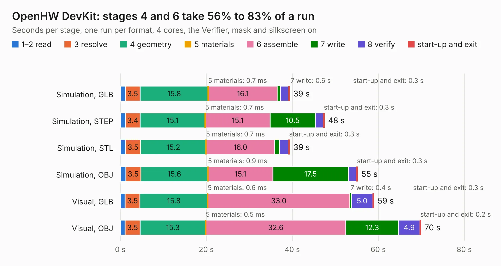

# 2088. OpenHW DevKit

Board 2,088 of the 3,109 of [Corpus Testing](../Corpus-Testing.md), on [Corpus Page 20](../CorpusTestingPages/Corpus-Testing-20.md#2088-openhw-devkit).

| Mode and format | 1–2 read | 3 resolve | 4 geometry | 5 materials | 6 assemble | 7 write | 8 verify | start-up and exit | Total |
|---|---:|---:|---:|---:|---:|---:|---:|---:|---:|
| Simulation, GLB | 1.1 | 3.5 | 15.8 | 0.7&nbsp;ms | 16.1 | 0.6 | 1.9 | 0.3 | 39.4 |
| Simulation, STEP | 1.2 | 3.4 | 15.1 | 0.7&nbsp;ms | 15.1 | 10.5 | 1.8 | 0.3 | 47.5 |
| Simulation, STL | 1.2 | 3.5 | 15.2 | 0.7&nbsp;ms | 16.0 | 1.1 | 2.1 | 0.3 | 39.4 |
| Simulation, OBJ | 1.3 | 3.5 | 15.6 | 0.9&nbsp;ms | 15.1 | 17.5 | 1.9 | 0.3 | 55.2 |
| Visual, GLB | 1.1 | 3.5 | 15.8 | 0.6&nbsp;ms | 33.0 | 0.4 | 5.0 | 0.3 | 59.0 |
| Visual, OBJ | 1.1 | 3.5 | 15.3 | 0.5&nbsp;ms | 32.6 | 12.3 | 4.9 | 0.2 | 69.9 |

<table align="center"><tr><td valign="top">

| Board | Repo: [openhwgroup/core-v-mcu-devkit](https://github.com/openhwgroup/core-v-mcu-devkit) Board: `OpenHW DevKit.kicad_pcb` |
|---|---|
| Folder | kicad |
| Complexity | 411&nbsp;/&nbsp;1000 (size&nbsp;271, features&nbsp;140) |
| KESE&nbsp;features | through vias, slotted holes, custom pads, rounded, trapezoid or chamfered pads, filled zones, copper drawings, curved board outline, stack-up, dielectric εr and tanδ, copper finish, mask and silkscreen colours |
| Tested | 9th November 2026 |
| Copper&nbsp;layers | 4 |
| File&nbsp;format | KiCad 7 (20221018) |
| Parts,&nbsp;tracks,&nbsp;vias | 158, 1,714, 286 |
| Triangles,&nbsp;simulation | 3,646,834 in 231 parts |
| Verifier | PASS in all six runs |

</td><td valign="top">

<table>
<tr><th>File type</th><th>File size</th><th>Peak memory used</th></tr>
<tr><th colspan="3" align="left">Simulation</th></tr>
<tr><td>GLB</td><td align="right">126&nbsp;MB</td><td align="right">1.2&nbsp;GB</td></tr>
<tr><td>STEP</td><td align="right">648&nbsp;MB</td><td align="right">1.5&nbsp;GB</td></tr>
<tr><td>STL</td><td align="right">182&nbsp;MB</td><td align="right">1.2&nbsp;GB</td></tr>
<tr><td>OBJ</td><td align="right">392&nbsp;MB</td><td align="right">2.4&nbsp;GB</td></tr>
<tr><th colspan="3" align="left">Visual</th></tr>
<tr><td>GLB</td><td align="right">88&nbsp;MB</td><td align="right">1.5&nbsp;GB</td></tr>
<tr><td>OBJ</td><td align="right">278&nbsp;MB</td><td align="right">1.9&nbsp;GB</td></tr>
</table>

</td></tr></table>

| Previous | Next |
|:---|---:|
| [2087. emonPi3](b2087b_emon32_emonPi3.md) | [2089. MacArthur-HAT](b2089b_MacArthur-HAT_MacArthur-HAT.md) |
