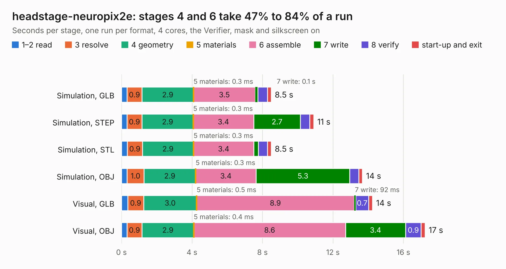

# 2090. headstage-neuropix2e

Board 2,090 of the 3,139 of [Corpus Testing](../Corpus-Testing.md), on [Corpus Page 20](../CorpusTestingPages/Corpus-Testing-20.md#2090-headstage-neuropix2e).

| Mode and format | 1–2 read | 3 resolve | 4 geometry | 5 materials | 6 assemble | 7 write | 8 verify | start-up and exit | Total |
|---|---:|---:|---:|---:|---:|---:|---:|---:|---:|
| Simulation, GLB | 0.3 | 0.9 | 2.9 | 0.3&nbsp;ms | 3.5 | 0.1 | 0.6 | 0.2 | 8.5 |
| Simulation, STEP | 0.3 | 0.9 | 2.9 | 0.3&nbsp;ms | 3.4 | 2.7 | 0.5 | 0.2 | 10.9 |
| Simulation, STL | 0.3 | 0.9 | 2.9 | 0.3&nbsp;ms | 3.4 | 0.3 | 0.5 | 0.2 | 8.5 |
| Simulation, OBJ | 0.3 | 1.0 | 2.9 | 0.3&nbsp;ms | 3.4 | 5.3 | 0.5 | 0.2 | 13.7 |
| Visual, GLB | 0.4 | 0.9 | 3.0 | 0.5&nbsp;ms | 8.9 | 92&nbsp;ms | 0.7 | 0.2 | 14.2 |
| Visual, OBJ | 0.3 | 0.9 | 2.9 | 0.4&nbsp;ms | 8.6 | 3.4 | 0.9 | 0.2 | 17.2 |

<table align="center"><tr><td valign="top">

| Board | Repo: [open-ephys/onix-headstage-neuropix2e-beta](https://github.com/open-ephys/onix-headstage-neuropix2e-beta) Board: `headstage-neuropix2e.kicad_pcb` |
|---|---|
| Folder | pcb |
| Complexity | 366&nbsp;/&nbsp;1000 (size&nbsp;241, features&nbsp;125) |
| KESE&nbsp;features | through vias, slotted holes, custom pads, rounded, trapezoid or chamfered pads, filled zones, copper drawings, curved board outline, stack-up, dielectric εr and tanδ, mask and silkscreen colours |
| Tested | 9th November 2026 |
| Copper&nbsp;layers | 4 |
| File&nbsp;format | KiCad 7 (20221018) |
| Parts,&nbsp;tracks,&nbsp;vias | 57, 582, 167 |
| Triangles,&nbsp;simulation | 1,091,444 in 70 parts |
| Verifier | PASS in all six runs |

</td><td valign="top">

<table>
<tr><th>File type</th><th>File size</th><th>Peak memory used</th></tr>
<tr><th colspan="3" align="left">Simulation</th></tr>
<tr><td>GLB</td><td align="right">37&nbsp;MB</td><td align="right">520&nbsp;MB</td></tr>
<tr><td>STEP</td><td align="right">159&nbsp;MB</td><td align="right">555&nbsp;MB</td></tr>
<tr><td>STL</td><td align="right">55&nbsp;MB</td><td align="right">519&nbsp;MB</td></tr>
<tr><td>OBJ</td><td align="right">111&nbsp;MB</td><td align="right">748&nbsp;MB</td></tr>
<tr><th colspan="3" align="left">Visual</th></tr>
<tr><td>GLB</td><td align="right">22&nbsp;MB</td><td align="right">619&nbsp;MB</td></tr>
<tr><td>OBJ</td><td align="right">69&nbsp;MB</td><td align="right">573&nbsp;MB</td></tr>
</table>

</td></tr></table>

| Previous | Next |
|:---|---:|
| [2089. headstage-neuropix2e](b2089b_onix-headstage-neuropix2e_headstage-neuropix2e.md) | [2091. headstage-rhs2116](b2091b_onix-headstage-rhs2116_headstage-rhs2116.md) |
