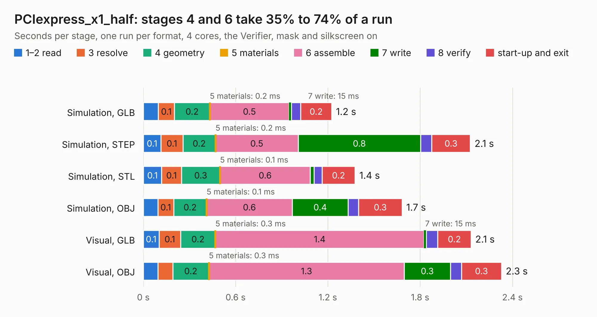

# 2093. PCIexpress_x1_half

Board 2,093 of the 3,132 of [Corpus Testing](../Corpus-Testing.md), on [Corpus Page 20](../CorpusTestingPages/Corpus-Testing-20.md#2093-pciexpress_x1_half).

| Mode and format | 1–2 read | 3 resolve | 4 geometry | 5 materials | 6 assemble | 7 write | 8 verify | start-up and exit | Total |
|---|---:|---:|---:|---:|---:|---:|---:|---:|---:|
| Simulation, GLB | 97&nbsp;ms | 0.1 | 0.2 | 0.2&nbsp;ms | 0.5 | 15&nbsp;ms | 60&nbsp;ms | 0.2 | 1.2 |
| Simulation, STEP | 0.1 | 0.1 | 0.2 | 0.2&nbsp;ms | 0.5 | 0.8 | 73&nbsp;ms | 0.3 | 2.1 |
| Simulation, STL | 0.1 | 0.1 | 0.3 | 0.1&nbsp;ms | 0.6 | 23&nbsp;ms | 53&nbsp;ms | 0.2 | 1.4 |
| Simulation, OBJ | 94&nbsp;ms | 0.1 | 0.2 | 0.1&nbsp;ms | 0.6 | 0.4 | 69&nbsp;ms | 0.3 | 1.7 |
| Visual, GLB | 0.1 | 0.1 | 0.2 | 0.3&nbsp;ms | 1.4 | 15&nbsp;ms | 74&nbsp;ms | 0.2 | 2.1 |
| Visual, OBJ | 95&nbsp;ms | 96&nbsp;ms | 0.2 | 0.3&nbsp;ms | 1.3 | 0.3 | 72&nbsp;ms | 0.3 | 2.3 |

<table align="center"><tr><td valign="top">

| Board | Repo: [open-ephys/PCIexpress-KiCad](https://github.com/open-ephys/PCIexpress-KiCad) Board: `PCIexpress_x1_half.kicad_pcb` |
|---|---|
| Folder | PCIexpress_x1_half |
| Complexity | 175&nbsp;/&nbsp;1000 (size&nbsp;120, features&nbsp;55) |
| KESE&nbsp;features | through vias, rounded, trapezoid or chamfered pads, filled zones, curved board outline |
| Tested | 9th November 2026 |
| Copper&nbsp;layers | 4 |
| File&nbsp;format | KiCad 6 (20211014) |
| Parts,&nbsp;tracks,&nbsp;vias | 5, 23, 12 |
| Triangles,&nbsp;simulation | 79,200 in 35 parts |
| Verifier | PASS in all six runs |

</td><td valign="top">

<table>
<tr><th>File type</th><th>File size</th><th>Peak memory used</th></tr>
<tr><th colspan="3" align="left">Simulation</th></tr>
<tr><td>GLB</td><td align="right">2.7&nbsp;MB</td><td align="right">175&nbsp;MB</td></tr>
<tr><td>STEP</td><td align="right">12&nbsp;MB</td><td align="right">176&nbsp;MB</td></tr>
<tr><td>STL</td><td align="right">4.0&nbsp;MB</td><td align="right">176&nbsp;MB</td></tr>
<tr><td>OBJ</td><td align="right">7.8&nbsp;MB</td><td align="right">177&nbsp;MB</td></tr>
<tr><th colspan="3" align="left">Visual</th></tr>
<tr><td>GLB</td><td align="right">1.8&nbsp;MB</td><td align="right">154&nbsp;MB</td></tr>
<tr><td>OBJ</td><td align="right">5.1&nbsp;MB</td><td align="right">153&nbsp;MB</td></tr>
</table>

</td></tr></table>

| Previous | Next |
|:---|---:|
| [2092. PCIexpress_x1_full](b2092b_PCIexpress-KiCad_PCIexpress-x1-full.md) | [2094. PCIexpress_x1_low](b2094b_PCIexpress-KiCad_PCIexpress-x1-low.md) |
