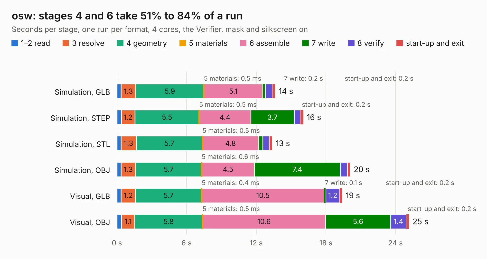

# 2093. osw

Board 2,093 of the 3,118 of [Corpus Testing](../Corpus-Testing.md), on [Corpus Page 20](../CorpusTestingPages/Corpus-Testing-20.md#2093-osw).

| Mode and format | 1–2 read | 3 resolve | 4 geometry | 5 materials | 6 assemble | 7 write | 8 verify | start-up and exit | Total |
|---|---:|---:|---:|---:|---:|---:|---:|---:|---:|
| Simulation, GLB | 0.4 | 1.3 | 5.9 | 0.5&nbsp;ms | 5.1 | 0.2 | 0.6 | 0.2 | 13.6 |
| Simulation, STEP | 0.4 | 1.2 | 5.5 | 0.5&nbsp;ms | 4.4 | 3.7 | 0.5 | 0.2 | 16.1 |
| Simulation, STL | 0.4 | 1.3 | 5.7 | 0.5&nbsp;ms | 4.8 | 0.3 | 0.5 | 0.3 | 13.4 |
| Simulation, OBJ | 0.3 | 1.3 | 5.7 | 0.6&nbsp;ms | 4.5 | 7.4 | 0.6 | 0.3 | 20.1 |
| Visual, GLB | 0.4 | 1.2 | 5.7 | 0.4&nbsp;ms | 10.5 | 0.1 | 1.2 | 0.2 | 19.4 |
| Visual, OBJ | 0.4 | 1.1 | 5.8 | 0.5&nbsp;ms | 10.6 | 5.6 | 1.4 | 0.2 | 25.2 |

<table align="center"><tr><td valign="top">

| Board | Repo: [Open-Smartwatch/kicad-project](https://github.com/Open-Smartwatch/kicad-project) Board: `osw.kicad_pcb` |
|---|---|
| Complexity | 261&nbsp;/&nbsp;1000 (size&nbsp;196, features&nbsp;65) |
| KESE&nbsp;features | through vias, slotted holes, rounded, trapezoid or chamfered pads, filled zones, curved board outline |
| Tested | 9th November 2026 |
| Copper&nbsp;layers | 4 |
| File&nbsp;format | KiCad 5 (20171130) |
| Parts,&nbsp;tracks,&nbsp;vias | 67, 707, 193 |
| Triangles,&nbsp;simulation | 1,331,232 in 92 parts |
| Verifier | PASS in all six runs |

</td><td valign="top">

<table>
<tr><th>File type</th><th>File size</th><th>Peak memory used</th></tr>
<tr><th colspan="3" align="left">Simulation</th></tr>
<tr><td>GLB</td><td align="right">46&nbsp;MB</td><td align="right">525&nbsp;MB</td></tr>
<tr><td>STEP</td><td align="right">193&nbsp;MB</td><td align="right">670&nbsp;MB</td></tr>
<tr><td>STL</td><td align="right">67&nbsp;MB</td><td align="right">528&nbsp;MB</td></tr>
<tr><td>OBJ</td><td align="right">138&nbsp;MB</td><td align="right">910&nbsp;MB</td></tr>
<tr><th colspan="3" align="left">Visual</th></tr>
<tr><td>GLB</td><td align="right">32&nbsp;MB</td><td align="right">668&nbsp;MB</td></tr>
<tr><td>OBJ</td><td align="right">96&nbsp;MB</td><td align="right">764&nbsp;MB</td></tr>
</table>

</td></tr></table>

| Previous | Next |
|:---|---:|
| [2092. stimjim](b2092b_stimjim_stimjim.md) | [2094. osw-light](b2094b_open-smartwatch-light_osw-light.md) |
