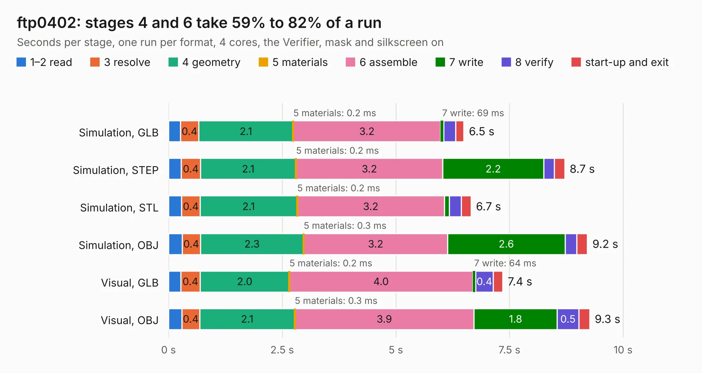

# 2093. ftp0402

Board 2,093 of the 3,107 of [Corpus Testing](../Corpus-Testing.md), on [Corpus Page 20](../CorpusTestingPages/Corpus-Testing-20.md#2093-ftp0402).

| Mode and format | 1–2 read | 3 resolve | 4 geometry | 5 materials | 6 assemble | 7 write | 8 verify | start-up and exit | Total |
|---|---:|---:|---:|---:|---:|---:|---:|---:|---:|
| Simulation, GLB | 0.3 | 0.4 | 2.1 | 0.2&nbsp;ms | 3.2 | 69&nbsp;ms | 0.3 | 0.2 | 6.5 |
| Simulation, STEP | 0.3 | 0.4 | 2.1 | 0.2&nbsp;ms | 3.2 | 2.2 | 0.2 | 0.2 | 8.7 |
| Simulation, STL | 0.3 | 0.4 | 2.1 | 0.2&nbsp;ms | 3.2 | 0.1 | 0.3 | 0.2 | 6.7 |
| Simulation, OBJ | 0.3 | 0.4 | 2.3 | 0.3&nbsp;ms | 3.2 | 2.6 | 0.3 | 0.2 | 9.2 |
| Visual, GLB | 0.3 | 0.4 | 2.0 | 0.2&nbsp;ms | 4.0 | 64&nbsp;ms | 0.4 | 0.2 | 7.4 |
| Visual, OBJ | 0.3 | 0.4 | 2.1 | 0.3&nbsp;ms | 3.9 | 1.8 | 0.5 | 0.2 | 9.3 |

<table align="center"><tr><td valign="top">

| Board | Repo: [opulo-inc/lumenpnp](https://github.com/opulo-inc/lumenpnp) Board: `ftp0402.kicad_pcb` |
|---|---|
| Folder | src / PCB / ftp / ftp0402 |
| Complexity | 199&nbsp;/&nbsp;1000 (size&nbsp;139, features&nbsp;60) |
| KESE&nbsp;features | rounded, trapezoid or chamfered pads, filled zones, stack-up, dielectric εr and tanδ |
| Tested | 9th November 2026 |
| Copper&nbsp;layers | 2 |
| File&nbsp;format | KiCad 9 (20241229) |
| Parts,&nbsp;tracks,&nbsp;vias | 81, 91, 0 |
| Triangles,&nbsp;simulation | 441,218 in 53 parts |
| Verifier | PASS in all six runs |

</td><td valign="top">

<table>
<tr><th>File type</th><th>File size</th><th>Peak memory used</th></tr>
<tr><th colspan="3" align="left">Simulation</th></tr>
<tr><td>GLB</td><td align="right">15&nbsp;MB</td><td align="right">339&nbsp;MB</td></tr>
<tr><td>STEP</td><td align="right">89&nbsp;MB</td><td align="right">387&nbsp;MB</td></tr>
<tr><td>STL</td><td align="right">22&nbsp;MB</td><td align="right">335&nbsp;MB</td></tr>
<tr><td>OBJ</td><td align="right">45&nbsp;MB</td><td align="right">362&nbsp;MB</td></tr>
<tr><th colspan="3" align="left">Visual</th></tr>
<tr><td>GLB</td><td align="right">13&nbsp;MB</td><td align="right">417&nbsp;MB</td></tr>
<tr><td>OBJ</td><td align="right">37&nbsp;MB</td><td align="right">335&nbsp;MB</td></tr>
</table>

</td></tr></table>

| Previous | Next |
|:---|---:|
| [2092. ftp](b2092b_lumenpnp_ftp.md) | [2094. mobo](b2094b_lumenpnp_mobo.md) |
