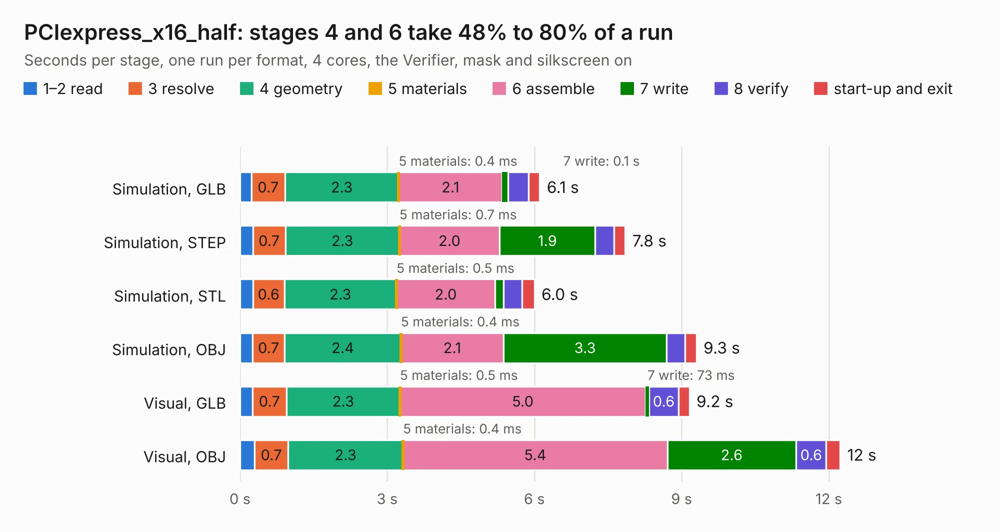

# 2094 PCIexpress_x16_half

Board 2,094 of the 3,138 of [Corpus Testing](../Corpus-Testing.md), on [Corpus Page 20](../CorpusTestingPages/Corpus-Testing-20.md#2094-pciexpress_x16_half).

| Mode and format | 1–2 read | 3 resolve | 4 geometry | 5 materials | 6 assemble | 7 write | 8 verify | start-up and exit | Total |
|---|---:|---:|---:|---:|---:|---:|---:|---:|---:|
| Simulation, GLB | 0.2 | 0.7 | 2.3 | 0.4&nbsp;ms | 2.1 | 0.1 | 0.4 | 0.2 | 6.1 |
| Simulation, STEP | 0.3 | 0.7 | 2.3 | 0.7&nbsp;ms | 2.0 | 1.9 | 0.4 | 0.2 | 7.8 |
| Simulation, STL | 0.3 | 0.6 | 2.3 | 0.5&nbsp;ms | 2.0 | 0.2 | 0.4 | 0.3 | 6.0 |
| Simulation, OBJ | 0.3 | 0.7 | 2.4 | 0.4&nbsp;ms | 2.1 | 3.3 | 0.4 | 0.2 | 9.3 |
| Visual, GLB | 0.2 | 0.7 | 2.3 | 0.5&nbsp;ms | 5.0 | 73&nbsp;ms | 0.6 | 0.2 | 9.2 |
| Visual, OBJ | 0.3 | 0.7 | 2.3 | 0.4&nbsp;ms | 5.4 | 2.6 | 0.6 | 0.3 | 12.2 |

<table align="center"><tr><td valign="top">

| Board | Repo: [open-ephys/PCIexpress-KiCad](https://github.com/open-ephys/PCIexpress-KiCad) Board: `PCIexpress_x16_half.kicad_pcb` |
|---|---|
| Folder | PCIexpress_x16_half |
| Complexity | 239&nbsp;/&nbsp;1000 (size&nbsp;184, features&nbsp;55) |
| KESE&nbsp;features | through vias, rounded, trapezoid or chamfered pads, filled zones, curved board outline |
| Tested | 9th November 2026 |
| Copper&nbsp;layers | 4 |
| File&nbsp;format | KiCad 6 (20211014) |
| Parts,&nbsp;tracks,&nbsp;vias | 65, 323, 102 |
| Triangles,&nbsp;simulation | 607,864 in 134 parts |
| Verifier | PASS in all six runs |

</td><td valign="top">

<table>
<tr><th>File type</th><th>File size</th><th>Peak memory used</th></tr>
<tr><th colspan="3" align="left">Simulation</th></tr>
<tr><td>GLB</td><td align="right">20&nbsp;MB</td><td align="right">364&nbsp;MB</td></tr>
<tr><td>STEP</td><td align="right">102&nbsp;MB</td><td align="right">386&nbsp;MB</td></tr>
<tr><td>STL</td><td align="right">30&nbsp;MB</td><td align="right">360&nbsp;MB</td></tr>
<tr><td>OBJ</td><td align="right">63&nbsp;MB</td><td align="right">448&nbsp;MB</td></tr>
<tr><th colspan="3" align="left">Visual</th></tr>
<tr><td>GLB</td><td align="right">15&nbsp;MB</td><td align="right">380&nbsp;MB</td></tr>
<tr><td>OBJ</td><td align="right">45&nbsp;MB</td><td align="right">398&nbsp;MB</td></tr>
</table>

</td></tr></table>

| Previous | Next |
|:---|---:|
| [2093 PCIexpress_x16_full](b2093b_PCIexpress-KiCad_PCIexpress-x16-full.md) | [2095 PCIexpress_x16_low](b2095b_PCIexpress-KiCad_PCIexpress-x16-low.md) |
