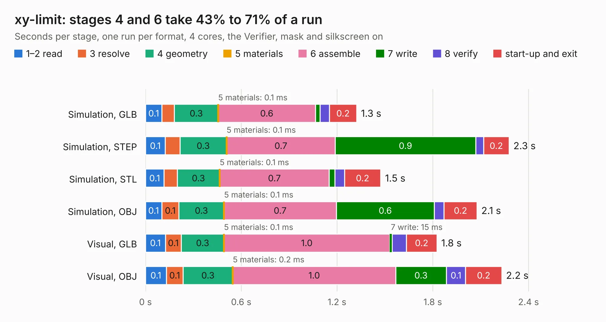

# 2097. xy-limit

Board 2,097 of the 3,106 of [Corpus Testing](../Corpus-Testing.md), on [Corpus Page 20](../CorpusTestingPages/Corpus-Testing-20.md#2097-xy-limit).

| Mode and format | 1–2 read | 3 resolve | 4 geometry | 5 materials | 6 assemble | 7 write | 8 verify | start-up and exit | Total |
|---|---:|---:|---:|---:|---:|---:|---:|---:|---:|
| Simulation, GLB | 0.1 | 78&nbsp;ms | 0.3 | 0.1&nbsp;ms | 0.6 | 28&nbsp;ms | 60&nbsp;ms | 0.2 | 1.3 |
| Simulation, STEP | 0.1 | 92&nbsp;ms | 0.3 | 0.1&nbsp;ms | 0.7 | 0.9 | 49&nbsp;ms | 0.2 | 2.3 |
| Simulation, STL | 0.1 | 83&nbsp;ms | 0.3 | 0.1&nbsp;ms | 0.7 | 35&nbsp;ms | 61&nbsp;ms | 0.2 | 1.5 |
| Simulation, OBJ | 0.1 | 0.1 | 0.3 | 0.1&nbsp;ms | 0.7 | 0.6 | 61&nbsp;ms | 0.2 | 2.1 |
| Visual, GLB | 0.1 | 0.1 | 0.3 | 0.1&nbsp;ms | 1.0 | 15&nbsp;ms | 90&nbsp;ms | 0.2 | 1.8 |
| Visual, OBJ | 0.1 | 0.1 | 0.3 | 0.2&nbsp;ms | 1.0 | 0.3 | 0.1 | 0.2 | 2.2 |

<table align="center"><tr><td valign="top">

| Board | Repo: [opulo-inc/lumenpnp](https://github.com/opulo-inc/lumenpnp) Board: `xy-limit.kicad_pcb` |
|---|---|
| Folder | src / PCB / xy-limit |
| Complexity | 173&nbsp;/&nbsp;1000 (size&nbsp;103, features&nbsp;70) |
| KESE&nbsp;features | through vias, rounded, trapezoid or chamfered pads, filled zones, curved board outline, TrueType text |
| Tested | 9th November 2026 |
| Copper&nbsp;layers | 2 |
| File&nbsp;format | KiCad 8 (20240108) |
| Parts,&nbsp;tracks,&nbsp;vias | 3, 42, 11 |
| Triangles,&nbsp;simulation | 129,766 in 15 parts |
| Verifier | PASS in all six runs |

</td><td valign="top">

<table>
<tr><th>File type</th><th>File size</th><th>Peak memory used</th></tr>
<tr><th colspan="3" align="left">Simulation</th></tr>
<tr><td>GLB</td><td align="right">4.8&nbsp;MB</td><td align="right">194&nbsp;MB</td></tr>
<tr><td>STEP</td><td align="right">25&nbsp;MB</td><td align="right">212&nbsp;MB</td></tr>
<tr><td>STL</td><td align="right">6.5&nbsp;MB</td><td align="right">192&nbsp;MB</td></tr>
<tr><td>OBJ</td><td align="right">14&nbsp;MB</td><td align="right">192&nbsp;MB</td></tr>
<tr><th colspan="3" align="left">Visual</th></tr>
<tr><td>GLB</td><td align="right">2.5&nbsp;MB</td><td align="right">154&nbsp;MB</td></tr>
<tr><td>OBJ</td><td align="right">6.8&nbsp;MB</td><td align="right">155&nbsp;MB</td></tr>
</table>

</td></tr></table>

| Previous | Next |
|:---|---:|
| [2096. x-cable-chain-support](b2096b_lumenpnp_x-cable-chain-support.md) | [2098. z-limit](b2098b_lumenpnp_z-limit.md) |
