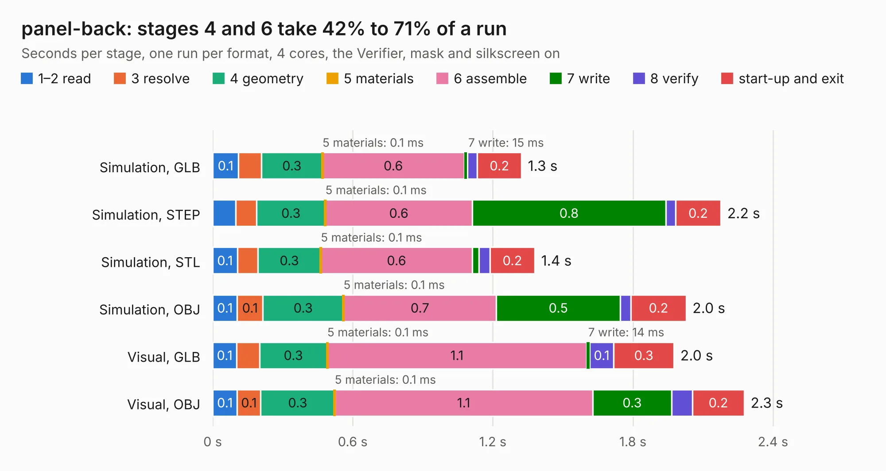

# 2097. panel-back

Board 2,097 of the 3,127 of [Corpus Testing](../Corpus-Testing.md), on [Corpus Page 20](../CorpusTestingPages/Corpus-Testing-20.md#2097-panel-back).

| Mode and format | 1–2 read | 3 resolve | 4 geometry | 5 materials | 6 assemble | 7 write | 8 verify | start-up and exit | Total |
|---|---:|---:|---:|---:|---:|---:|---:|---:|---:|
| Simulation, GLB | 0.1 | 97&nbsp;ms | 0.3 | 0.1&nbsp;ms | 0.6 | 15&nbsp;ms | 42&nbsp;ms | 0.2 | 1.3 |
| Simulation, STEP | 98&nbsp;ms | 89&nbsp;ms | 0.3 | 0.1&nbsp;ms | 0.6 | 0.8 | 41&nbsp;ms | 0.2 | 2.2 |
| Simulation, STL | 0.1 | 88&nbsp;ms | 0.3 | 0.1&nbsp;ms | 0.6 | 29&nbsp;ms | 46&nbsp;ms | 0.2 | 1.4 |
| Simulation, OBJ | 0.1 | 0.1 | 0.3 | 0.1&nbsp;ms | 0.7 | 0.5 | 46&nbsp;ms | 0.2 | 2.0 |
| Visual, GLB | 0.1 | 97&nbsp;ms | 0.3 | 0.1&nbsp;ms | 1.1 | 14&nbsp;ms | 0.1 | 0.3 | 2.0 |
| Visual, OBJ | 0.1 | 0.1 | 0.3 | 0.1&nbsp;ms | 1.1 | 0.3 | 89&nbsp;ms | 0.2 | 2.3 |

<table align="center"><tr><td valign="top">

| Board | Repo: [open-ephys/stimjim](https://github.com/open-ephys/stimjim) Board: `panel-back.kicad_pcb` |
|---|---|
| Folder | PCB / panels |
| Complexity | 101&nbsp;/&nbsp;1000 (size&nbsp;36, features&nbsp;65) |
| KESE&nbsp;features | filled zones, curved board outline, stack-up, dielectric εr and tanδ, mask and silkscreen colours |
| Tested | 9th November 2026 |
| Copper&nbsp;layers | 2 |
| File&nbsp;format | KiCad 10 (20260206) |
| Parts,&nbsp;tracks,&nbsp;vias | 5, 0, 0 |
| Triangles,&nbsp;simulation | 118,094 in 12 parts |
| Note | panel |
| Verifier | PASS in all six runs |

</td><td valign="top">

<table>
<tr><th>File type</th><th>File size</th><th>Peak memory used</th></tr>
<tr><th colspan="3" align="left">Simulation</th></tr>
<tr><td>GLB</td><td align="right">4.2&nbsp;MB</td><td align="right">190&nbsp;MB</td></tr>
<tr><td>STEP</td><td align="right">23&nbsp;MB</td><td align="right">204&nbsp;MB</td></tr>
<tr><td>STL</td><td align="right">5.9&nbsp;MB</td><td align="right">190&nbsp;MB</td></tr>
<tr><td>OBJ</td><td align="right">12&nbsp;MB</td><td align="right">188&nbsp;MB</td></tr>
<tr><th colspan="3" align="left">Visual</th></tr>
<tr><td>GLB</td><td align="right">2.7&nbsp;MB</td><td align="right">155&nbsp;MB</td></tr>
<tr><td>OBJ</td><td align="right">7.5&nbsp;MB</td><td align="right">156&nbsp;MB</td></tr>
</table>

</td></tr></table>

| Previous | Next |
|:---|---:|
| [2096. PCIexpress_x8_low](b2096b_PCIexpress-KiCad_PCIexpress-x8-low.md) | [2098. panel-front](b2098b_stimjim_panel-front.md) |
