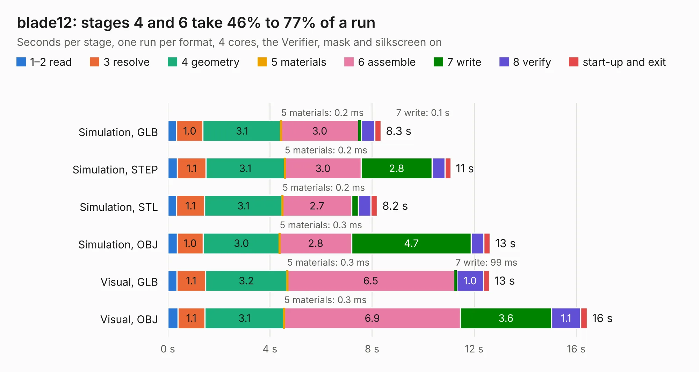

# 2099. blade12

Board 2,099 of the 3,118 of [Corpus Testing](../Corpus-Testing.md), on [Corpus Page 20](../CorpusTestingPages/Corpus-Testing-20.md#2099-blade12).

| Mode and format | 1–2 read | 3 resolve | 4 geometry | 5 materials | 6 assemble | 7 write | 8 verify | start-up and exit | Total |
|---|---:|---:|---:|---:|---:|---:|---:|---:|---:|
| Simulation, GLB | 0.3 | 1.0 | 3.1 | 0.2&nbsp;ms | 3.0 | 0.1 | 0.5 | 0.2 | 8.3 |
| Simulation, STEP | 0.4 | 1.1 | 3.1 | 0.2&nbsp;ms | 3.0 | 2.8 | 0.5 | 0.2 | 11.1 |
| Simulation, STL | 0.3 | 1.1 | 3.1 | 0.2&nbsp;ms | 2.7 | 0.3 | 0.5 | 0.3 | 8.2 |
| Simulation, OBJ | 0.4 | 1.0 | 3.0 | 0.3&nbsp;ms | 2.8 | 4.7 | 0.5 | 0.3 | 12.6 |
| Visual, GLB | 0.4 | 1.1 | 3.2 | 0.3&nbsp;ms | 6.5 | 99&nbsp;ms | 1.0 | 0.2 | 12.6 |
| Visual, OBJ | 0.4 | 1.1 | 3.1 | 0.3&nbsp;ms | 6.9 | 3.6 | 1.1 | 0.3 | 16.4 |

<table align="center"><tr><td valign="top">

| Board | Repo: [opulo-inc/lumenpnp](https://github.com/opulo-inc/lumenpnp) Board: `blade12.kicad_pcb` |
|---|---|
| Folder | src / PCB / blade12 |
| Complexity | 285&nbsp;/&nbsp;1000 (size&nbsp;170, features&nbsp;115) |
| KESE&nbsp;features | through vias, custom pads, rounded, trapezoid or chamfered pads, filled zones, copper drawings, TrueType text, stack-up, dielectric εr and tanδ |
| Tested | 9th November 2026 |
| Copper&nbsp;layers | 2 |
| File&nbsp;format | KiCad 8 (20240108) |
| Parts,&nbsp;tracks,&nbsp;vias | 38, 391, 206 |
| Triangles,&nbsp;simulation | 724,098 in 26 parts |
| Verifier | PASS in all six runs |

</td><td valign="top">

<table>
<tr><th>File type</th><th>File size</th><th>Peak memory used</th></tr>
<tr><th colspan="3" align="left">Simulation</th></tr>
<tr><td>GLB</td><td align="right">25&nbsp;MB</td><td align="right">421&nbsp;MB</td></tr>
<tr><td>STEP</td><td align="right">129&nbsp;MB</td><td align="right">473&nbsp;MB</td></tr>
<tr><td>STL</td><td align="right">36&nbsp;MB</td><td align="right">403&nbsp;MB</td></tr>
<tr><td>OBJ</td><td align="right">74&nbsp;MB</td><td align="right">562&nbsp;MB</td></tr>
<tr><th colspan="3" align="left">Visual</th></tr>
<tr><td>GLB</td><td align="right">20&nbsp;MB</td><td align="right">503&nbsp;MB</td></tr>
<tr><td>OBJ</td><td align="right">61&nbsp;MB</td><td align="right">503&nbsp;MB</td></tr>
</table>

</td></tr></table>

| Previous | Next |
|:---|---:|
| [2098. MacArthur-HAT](b2098b_MacArthur-HAT_MacArthur-HAT.md) | [2100. blade13](b2100b_lumenpnp_blade13.md) |
