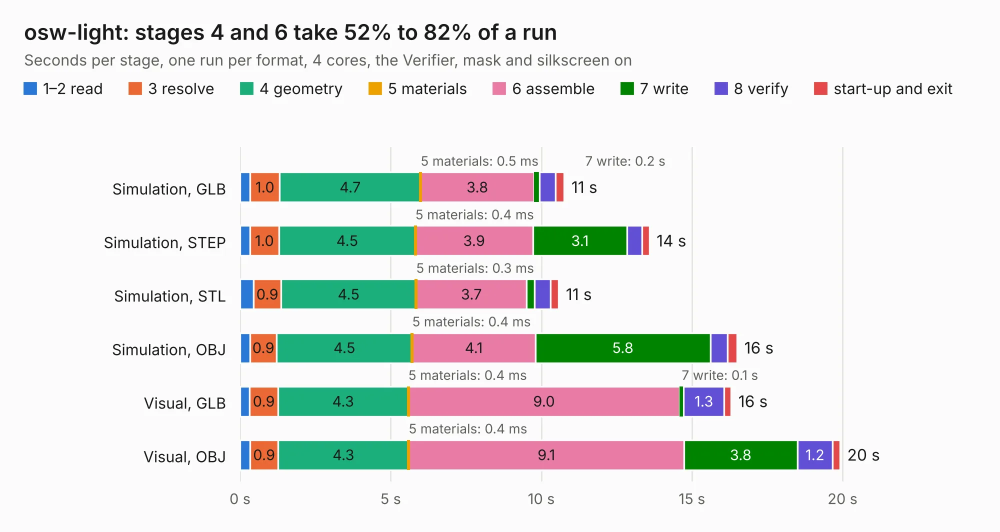

# 2100. osw-light

Board 2,100 of the 3,125 of [Corpus Testing](../Corpus-Testing.md), on [Corpus Page 20](../CorpusTestingPages/Corpus-Testing-20.md#2100-osw-light).

| Mode and format | 1–2 read | 3 resolve | 4 geometry | 5 materials | 6 assemble | 7 write | 8 verify | start-up and exit | Total |
|---|---:|---:|---:|---:|---:|---:|---:|---:|---:|
| Simulation, GLB | 0.3 | 1.0 | 4.7 | 0.5&nbsp;ms | 3.8 | 0.2 | 0.5 | 0.3 | 10.8 |
| Simulation, STEP | 0.3 | 1.0 | 4.5 | 0.4&nbsp;ms | 3.9 | 3.1 | 0.5 | 0.2 | 13.6 |
| Simulation, STL | 0.5 | 0.9 | 4.5 | 0.3&nbsp;ms | 3.7 | 0.3 | 0.5 | 0.3 | 10.6 |
| Simulation, OBJ | 0.3 | 0.9 | 4.5 | 0.4&nbsp;ms | 4.1 | 5.8 | 0.6 | 0.3 | 16.5 |
| Visual, GLB | 0.3 | 0.9 | 4.3 | 0.4&nbsp;ms | 9.0 | 0.1 | 1.3 | 0.2 | 16.3 |
| Visual, OBJ | 0.3 | 0.9 | 4.3 | 0.4&nbsp;ms | 9.1 | 3.8 | 1.2 | 0.2 | 19.9 |

<table align="center"><tr><td valign="top">

| Board | Repo: [Open-Smartwatch/open-smartwatch-light](https://github.com/Open-Smartwatch/open-smartwatch-light) Board: `osw-light.kicad_pcb` |
|---|---|
| Complexity | 253&nbsp;/&nbsp;1000 (size&nbsp;188, features&nbsp;65) |
| KESE&nbsp;features | through vias, slotted holes, rounded, trapezoid or chamfered pads, filled zones, curved board outline |
| Tested | 9th November 2026 |
| Copper&nbsp;layers | 4 |
| File&nbsp;format | KiCad 5 (20171130) |
| Parts,&nbsp;tracks,&nbsp;vias | 51, 524, 126 |
| Triangles,&nbsp;simulation | 972,290 in 74 parts |
| Verifier | PASS in all six runs |

</td><td valign="top">

<table>
<tr><th>File type</th><th>File size</th><th>Peak memory used</th></tr>
<tr><th colspan="3" align="left">Simulation</th></tr>
<tr><td>GLB</td><td align="right">34&nbsp;MB</td><td align="right">436&nbsp;MB</td></tr>
<tr><td>STEP</td><td align="right">149&nbsp;MB</td><td align="right">516&nbsp;MB</td></tr>
<tr><td>STL</td><td align="right">49&nbsp;MB</td><td align="right">458&nbsp;MB</td></tr>
<tr><td>OBJ</td><td align="right">99&nbsp;MB</td><td align="right">684&nbsp;MB</td></tr>
<tr><th colspan="3" align="left">Visual</th></tr>
<tr><td>GLB</td><td align="right">24&nbsp;MB</td><td align="right">517&nbsp;MB</td></tr>
<tr><td>OBJ</td><td align="right">71&nbsp;MB</td><td align="right">572&nbsp;MB</td></tr>
</table>

</td></tr></table>

| Previous | Next |
|:---|---:|
| [2099. osw](b2099b_kicad-project_osw.md) | [2101. 6ct-expander](b2101b_emon32_6ct-expander.md) |
