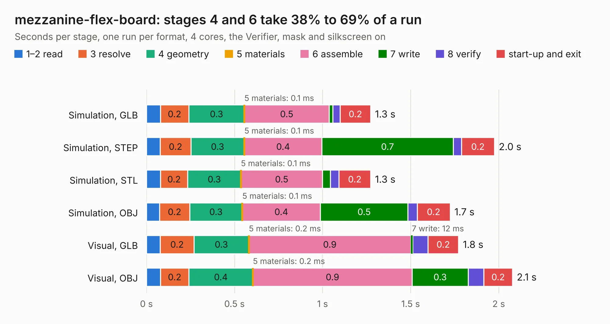

# 2102. mezzanine-flex-board

Board 2,102 of the 3,105 of [Corpus Testing](../Corpus-Testing.md), on [Corpus Page 20](../CorpusTestingPages/Corpus-Testing-20.md#2102-mezzanine-flex-board).

| Mode and format | 1–2 read | 3 resolve | 4 geometry | 5 materials | 6 assemble | 7 write | 8 verify | start-up and exit | Total |
|---|---:|---:|---:|---:|---:|---:|---:|---:|---:|
| Simulation, GLB | 79&nbsp;ms | 0.2 | 0.3 | 0.1&nbsp;ms | 0.5 | 21&nbsp;ms | 42&nbsp;ms | 0.2 | 1.3 |
| Simulation, STEP | 78&nbsp;ms | 0.2 | 0.3 | 0.1&nbsp;ms | 0.4 | 0.7 | 47&nbsp;ms | 0.2 | 2.0 |
| Simulation, STL | 80&nbsp;ms | 0.2 | 0.3 | 0.1&nbsp;ms | 0.5 | 45&nbsp;ms | 48&nbsp;ms | 0.2 | 1.3 |
| Simulation, OBJ | 74&nbsp;ms | 0.2 | 0.3 | 0.1&nbsp;ms | 0.4 | 0.5 | 52&nbsp;ms | 0.2 | 1.7 |
| Visual, GLB | 78&nbsp;ms | 0.2 | 0.3 | 0.2&nbsp;ms | 0.9 | 12&nbsp;ms | 86&nbsp;ms | 0.2 | 1.8 |
| Visual, OBJ | 79&nbsp;ms | 0.2 | 0.4 | 0.2&nbsp;ms | 0.9 | 0.3 | 89&nbsp;ms | 0.2 | 2.1 |

<table align="center"><tr><td valign="top">

| Board | Repo: [oresat/oresat-adcs-hardware](https://github.com/oresat/oresat-adcs-hardware) Board: `mezzanine-flex-board.kicad_pcb` |
|---|---|
| Folder | mezzanine-flex-board |
| Complexity | 204&nbsp;/&nbsp;1000 (size&nbsp;109, features&nbsp;95) |
| KESE&nbsp;features | through vias, rounded, trapezoid or chamfered pads, filled zones, stack-up, dielectric εr and tanδ, copper finish, mask and silkscreen colours |
| Tested | 9th November 2026 |
| Copper&nbsp;layers | 2 |
| File&nbsp;format | KiCad 10 (20260206) |
| Parts,&nbsp;tracks,&nbsp;vias | 2, 16, 40 |
| Triangles,&nbsp;simulation | 118,972 in 22 parts |
| Verifier | PASS in all six runs |

</td><td valign="top">

<table>
<tr><th>File type</th><th>File size</th><th>Peak memory used</th></tr>
<tr><th colspan="3" align="left">Simulation</th></tr>
<tr><td>GLB</td><td align="right">4.2&nbsp;MB</td><td align="right">199&nbsp;MB</td></tr>
<tr><td>STEP</td><td align="right">22&nbsp;MB</td><td align="right">208&nbsp;MB</td></tr>
<tr><td>STL</td><td align="right">6.0&nbsp;MB</td><td align="right">195&nbsp;MB</td></tr>
<tr><td>OBJ</td><td align="right">12&nbsp;MB</td><td align="right">199&nbsp;MB</td></tr>
<tr><th colspan="3" align="left">Visual</th></tr>
<tr><td>GLB</td><td align="right">2.6&nbsp;MB</td><td align="right">162&nbsp;MB</td></tr>
<tr><td>OBJ</td><td align="right">7.4&nbsp;MB</td><td align="right">164&nbsp;MB</td></tr>
</table>

</td></tr></table>

| Previous | Next |
|:---|---:|
| [2101. mezzanine-breakout-board](b2101b_oresat-adcs-hardware_mezzanine-breakout-board.md) | [2103. oresat-adcs-card](b2103b_oresat-adcs-hardware_oresat-adcs-card.md) |
