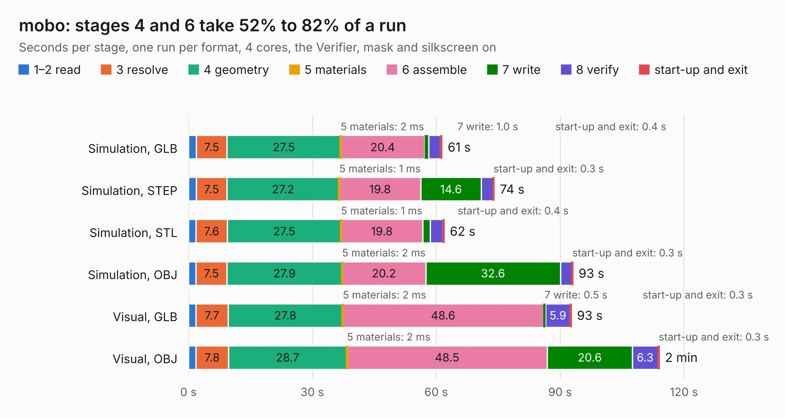

# 2104. mobo

Board 2,104 of the 3,117 of [Corpus Testing](../Corpus-Testing.md), on [Corpus Page 20](../CorpusTestingPages/Corpus-Testing-20.md#2104-mobo).

| Mode and format | 1–2 read | 3 resolve | 4 geometry | 5 materials | 6 assemble | 7 write | 8 verify | start-up and exit | Total |
|---|---:|---:|---:|---:|---:|---:|---:|---:|---:|
| Simulation, GLB | 1.9 | 7.5 | 27.5 | 2&nbsp;ms | 20.4 | 1.0 | 2.9 | 0.4 | 61.4 |
| Simulation, STEP | 1.9 | 7.5 | 27.2 | 1&nbsp;ms | 19.8 | 14.6 | 2.9 | 0.3 | 74.1 |
| Simulation, STL | 1.8 | 7.6 | 27.5 | 1&nbsp;ms | 19.8 | 1.8 | 3.0 | 0.4 | 62.0 |
| Simulation, OBJ | 1.8 | 7.5 | 27.9 | 2&nbsp;ms | 20.2 | 32.6 | 2.8 | 0.3 | 93.1 |
| Visual, GLB | 1.9 | 7.7 | 27.8 | 2&nbsp;ms | 48.6 | 0.5 | 5.9 | 0.3 | 92.7 |
| Visual, OBJ | 1.8 | 7.8 | 28.7 | 2&nbsp;ms | 48.5 | 20.6 | 6.3 | 0.3 | 114.1 |

<table align="center"><tr><td valign="top">

| Board | Repo: [opulo-inc/lumenpnp](https://github.com/opulo-inc/lumenpnp) Board: `mobo.kicad_pcb` |
|---|---|
| Folder | src / PCB / mobo |
| Complexity | 454&nbsp;/&nbsp;1000 (size&nbsp;294, features&nbsp;160) |
| KESE&nbsp;features | through vias, slotted holes, custom pads, rounded, trapezoid or chamfered pads, arc tracks, filled zones, copper drawings, copper text, curved board outline, TrueType text, stack-up, dielectric εr and tanδ |
| Tested | 9th November 2026 |
| Copper&nbsp;layers | 4 |
| File&nbsp;format | KiCad 9 (20241229) |
| Parts,&nbsp;tracks,&nbsp;vias | 296, 2,176, 1,010 |
| Triangles,&nbsp;simulation | 5,290,772 in 276 parts |
| Verifier | PASS in all six runs |

</td><td valign="top">

<table>
<tr><th>File type</th><th>File size</th><th>Peak memory used</th></tr>
<tr><th colspan="3" align="left">Simulation</th></tr>
<tr><td>GLB</td><td align="right">177&nbsp;MB</td><td align="right">1.8&nbsp;GB</td></tr>
<tr><td>STEP</td><td align="right">676&nbsp;MB</td><td align="right">2.2&nbsp;GB</td></tr>
<tr><td>STL</td><td align="right">265&nbsp;MB</td><td align="right">1.7&nbsp;GB</td></tr>
<tr><td>OBJ</td><td align="right">563&nbsp;MB</td><td align="right">3.4&nbsp;GB</td></tr>
<tr><th colspan="3" align="left">Visual</th></tr>
<tr><td>GLB</td><td align="right">114&nbsp;MB</td><td align="right">1.8&nbsp;GB</td></tr>
<tr><td>OBJ</td><td align="right">363&nbsp;MB</td><td align="right">2.4&nbsp;GB</td></tr>
</table>

</td></tr></table>

| Previous | Next |
|:---|---:|
| [2103. ftp0402](b2103b_lumenpnp_ftp0402.md) | [2105. pi-interface](b2105b_lumenpnp_pi-interface.md) |
