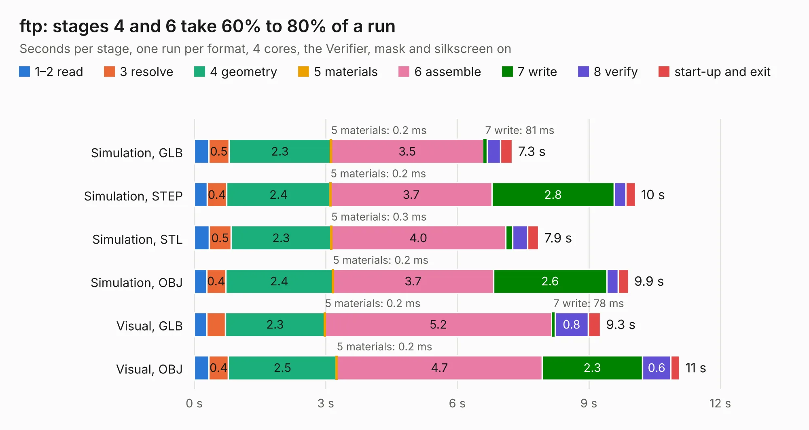

# 2105. ftp

Board 2,105 of the 3,120 of [Corpus Testing](../Corpus-Testing.md), on [Corpus Page 20](../CorpusTestingPages/Corpus-Testing-20.md#2105-ftp).

| Mode and format | 1–2 read | 3 resolve | 4 geometry | 5 materials | 6 assemble | 7 write | 8 verify | start-up and exit | Total |
|---|---:|---:|---:|---:|---:|---:|---:|---:|---:|
| Simulation, GLB | 0.3 | 0.5 | 2.3 | 0.2&nbsp;ms | 3.5 | 81&nbsp;ms | 0.3 | 0.3 | 7.3 |
| Simulation, STEP | 0.3 | 0.4 | 2.4 | 0.2&nbsp;ms | 3.7 | 2.8 | 0.3 | 0.2 | 10.1 |
| Simulation, STL | 0.3 | 0.5 | 2.3 | 0.3&nbsp;ms | 4.0 | 0.2 | 0.3 | 0.3 | 7.9 |
| Simulation, OBJ | 0.3 | 0.4 | 2.4 | 0.2&nbsp;ms | 3.7 | 2.6 | 0.3 | 0.2 | 9.9 |
| Visual, GLB | 0.3 | 0.4 | 2.3 | 0.2&nbsp;ms | 5.2 | 78&nbsp;ms | 0.8 | 0.3 | 9.3 |
| Visual, OBJ | 0.3 | 0.4 | 2.5 | 0.2&nbsp;ms | 4.7 | 2.3 | 0.6 | 0.2 | 11.1 |

<table align="center"><tr><td valign="top">

| Board | Repo: [opulo-inc/lumenpnp](https://github.com/opulo-inc/lumenpnp) Board: `ftp.kicad_pcb` |
|---|---|
| Folder | src / PCB / ftp |
| Complexity | 202&nbsp;/&nbsp;1000 (size&nbsp;142, features&nbsp;60) |
| KESE&nbsp;features | rounded, trapezoid or chamfered pads, filled zones, stack-up, dielectric εr and tanδ |
| Tested | 9th November 2026 |
| Copper&nbsp;layers | 2 |
| File&nbsp;format | KiCad 8 (20240108) |
| Parts,&nbsp;tracks,&nbsp;vias | 81, 115, 0 |
| Triangles,&nbsp;simulation | 499,656 in 53 parts |
| Verifier | PASS in all six runs |

</td><td valign="top">

<table>
<tr><th>File type</th><th>File size</th><th>Peak memory used</th></tr>
<tr><th colspan="3" align="left">Simulation</th></tr>
<tr><td>GLB</td><td align="right">17&nbsp;MB</td><td align="right">378&nbsp;MB</td></tr>
<tr><td>STEP</td><td align="right">109&nbsp;MB</td><td align="right">409&nbsp;MB</td></tr>
<tr><td>STL</td><td align="right">25&nbsp;MB</td><td align="right">384&nbsp;MB</td></tr>
<tr><td>OBJ</td><td align="right">51&nbsp;MB</td><td align="right">400&nbsp;MB</td></tr>
<tr><th colspan="3" align="left">Visual</th></tr>
<tr><td>GLB</td><td align="right">15&nbsp;MB</td><td align="right">461&nbsp;MB</td></tr>
<tr><td>OBJ</td><td align="right">44&nbsp;MB</td><td align="right">459&nbsp;MB</td></tr>
</table>

</td></tr></table>

| Previous | Next |
|:---|---:|
| [2104. datum](b2104b_lumenpnp_datum.md) | [2106. ftp0402](b2106b_lumenpnp_ftp0402.md) |
