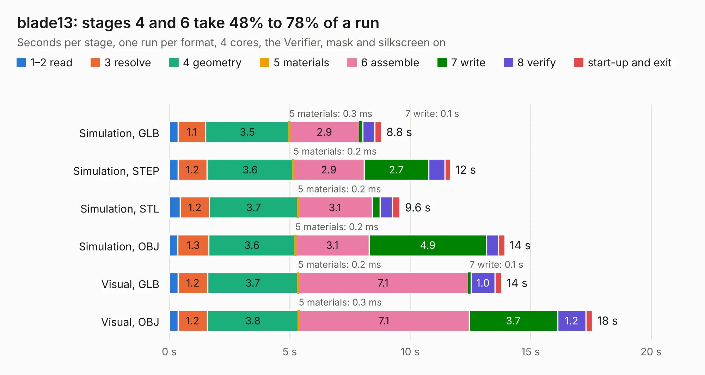

# 2106. blade13

Board 2,106 of the 3,125 of [Corpus Testing](../Corpus-Testing.md), on [Corpus Page 20](../CorpusTestingPages/Corpus-Testing-20.md#2106-blade13).

| Mode and format | 1–2 read | 3 resolve | 4 geometry | 5 materials | 6 assemble | 7 write | 8 verify | start-up and exit | Total |
|---|---:|---:|---:|---:|---:|---:|---:|---:|---:|
| Simulation, GLB | 0.4 | 1.1 | 3.5 | 0.3&nbsp;ms | 2.9 | 0.1 | 0.5 | 0.3 | 8.8 |
| Simulation, STEP | 0.4 | 1.2 | 3.6 | 0.2&nbsp;ms | 2.9 | 2.7 | 0.7 | 0.2 | 11.7 |
| Simulation, STL | 0.4 | 1.2 | 3.7 | 0.2&nbsp;ms | 3.1 | 0.3 | 0.5 | 0.3 | 9.6 |
| Simulation, OBJ | 0.4 | 1.3 | 3.6 | 0.2&nbsp;ms | 3.1 | 4.9 | 0.5 | 0.3 | 13.9 |
| Visual, GLB | 0.4 | 1.2 | 3.7 | 0.2&nbsp;ms | 7.1 | 0.1 | 1.0 | 0.3 | 13.8 |
| Visual, OBJ | 0.4 | 1.2 | 3.8 | 0.3&nbsp;ms | 7.1 | 3.7 | 1.2 | 0.3 | 17.6 |

<table align="center"><tr><td valign="top">

| Board | Repo: [opulo-inc/lumenpnp](https://github.com/opulo-inc/lumenpnp) Board: `blade13.kicad_pcb` |
|---|---|
| Folder | src / PCB / blade13 |
| Complexity | 287&nbsp;/&nbsp;1000 (size&nbsp;172, features&nbsp;115) |
| KESE&nbsp;features | through vias, custom pads, rounded, trapezoid or chamfered pads, filled zones, copper drawings, TrueType text, stack-up, dielectric εr and tanδ |
| Tested | 9th November 2026 |
| Copper&nbsp;layers | 2 |
| File&nbsp;format | KiCad 8 (20240108) |
| Parts,&nbsp;tracks,&nbsp;vias | 42, 373, 237 |
| Triangles,&nbsp;simulation | 789,616 in 27 parts |
| Verifier | PASS in all six runs |

</td><td valign="top">

<table>
<tr><th>File type</th><th>File size</th><th>Peak memory used</th></tr>
<tr><th colspan="3" align="left">Simulation</th></tr>
<tr><td>GLB</td><td align="right">27&nbsp;MB</td><td align="right">431&nbsp;MB</td></tr>
<tr><td>STEP</td><td align="right">140&nbsp;MB</td><td align="right">503&nbsp;MB</td></tr>
<tr><td>STL</td><td align="right">39&nbsp;MB</td><td align="right">408&nbsp;MB</td></tr>
<tr><td>OBJ</td><td align="right">81&nbsp;MB</td><td align="right">571&nbsp;MB</td></tr>
<tr><th colspan="3" align="left">Visual</th></tr>
<tr><td>GLB</td><td align="right">22&nbsp;MB</td><td align="right">495&nbsp;MB</td></tr>
<tr><td>OBJ</td><td align="right">66&nbsp;MB</td><td align="right">549&nbsp;MB</td></tr>
</table>

</td></tr></table>

| Previous | Next |
|:---|---:|
| [2105. blade12](b2105b_lumenpnp_blade12.md) | [2107. cal-fid](b2107b_lumenpnp_cal-fid.md) |
