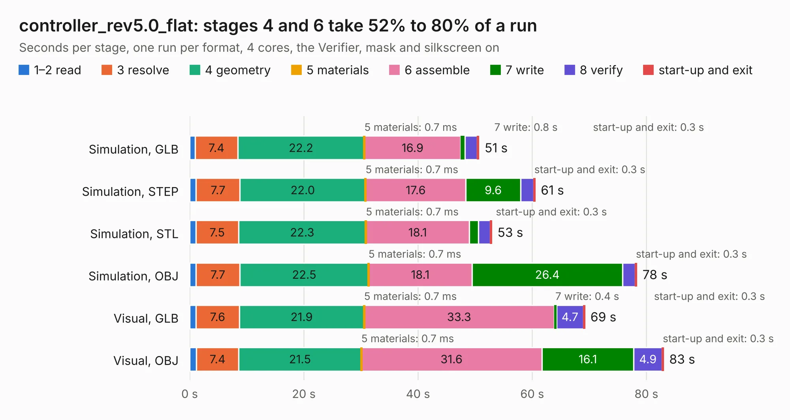

# 2106. controller_rev5.0_flat

Board 2,106 of the 3,104 of [Corpus Testing](../Corpus-Testing.md), on [Corpus Page 20](../CorpusTestingPages/Corpus-Testing-20.md#2106-controller_rev50_flat).

| Mode and format | 1–2 read | 3 resolve | 4 geometry | 5 materials | 6 assemble | 7 write | 8 verify | start-up and exit | Total |
|---|---:|---:|---:|---:|---:|---:|---:|---:|---:|
| Simulation, GLB | 1.0 | 7.4 | 22.2 | 0.7&nbsp;ms | 16.9 | 0.8 | 2.1 | 0.3 | 50.7 |
| Simulation, STEP | 1.1 | 7.7 | 22.0 | 0.7&nbsp;ms | 17.6 | 9.6 | 2.3 | 0.3 | 60.5 |
| Simulation, STL | 1.1 | 7.5 | 22.3 | 0.7&nbsp;ms | 18.1 | 1.6 | 2.1 | 0.3 | 52.9 |
| Simulation, OBJ | 1.1 | 7.7 | 22.5 | 0.7&nbsp;ms | 18.1 | 26.4 | 2.2 | 0.3 | 78.3 |
| Visual, GLB | 1.1 | 7.6 | 21.9 | 0.7&nbsp;ms | 33.3 | 0.4 | 4.7 | 0.3 | 69.2 |
| Visual, OBJ | 1.2 | 7.4 | 21.5 | 0.7&nbsp;ms | 31.6 | 16.1 | 4.9 | 0.3 | 83.0 |

<table align="center"><tr><td valign="top">

| Board | Repo: [oresat/oresat-adcs-hardware](https://github.com/oresat/oresat-adcs-hardware) Board: `controller_rev5.0_flat.kicad_pcb` |
|---|---|
| Folder | oresat-rw-board-rev5-flat |
| Complexity | 362&nbsp;/&nbsp;1000 (size&nbsp;272, features&nbsp;90) |
| KESE&nbsp;features | through vias, rounded, trapezoid or chamfered pads, drill offsets, filled zones, stack-up, dielectric εr and tanδ, mask and silkscreen colours |
| Tested | 9th November 2026 |
| Copper&nbsp;layers | 4 |
| File&nbsp;format | KiCad 7 (20211228) |
| Parts,&nbsp;tracks,&nbsp;vias | 149, 2,162, 1,552 |
| Triangles,&nbsp;simulation | 4,833,650 in 201 parts |
| Verifier | PASS in all six runs |

</td><td valign="top">

<table>
<tr><th>File type</th><th>File size</th><th>Peak memory used</th></tr>
<tr><th colspan="3" align="left">Simulation</th></tr>
<tr><td>GLB</td><td align="right">157&nbsp;MB</td><td align="right">1.7&nbsp;GB</td></tr>
<tr><td>STEP</td><td align="right">482&nbsp;MB</td><td align="right">2.0&nbsp;GB</td></tr>
<tr><td>STL</td><td align="right">242&nbsp;MB</td><td align="right">1.8&nbsp;GB</td></tr>
<tr><td>OBJ</td><td align="right">507&nbsp;MB</td><td align="right">3.0&nbsp;GB</td></tr>
<tr><th colspan="3" align="left">Visual</th></tr>
<tr><td>GLB</td><td align="right">99&nbsp;MB</td><td align="right">1.7&nbsp;GB</td></tr>
<tr><td>OBJ</td><td align="right">315&nbsp;MB</td><td align="right">2.1&nbsp;GB</td></tr>
</table>

</td></tr></table>

| Previous | Next |
|:---|---:|
| [2105. power-stage-rev8](b2105b_oresat-adcs-hardware_power-stage-rev8.md) | [2107. rev6.0_flat_controlstage](b2107b_oresat-adcs-hardware_rev6-0-flat-controlstage.md) |
