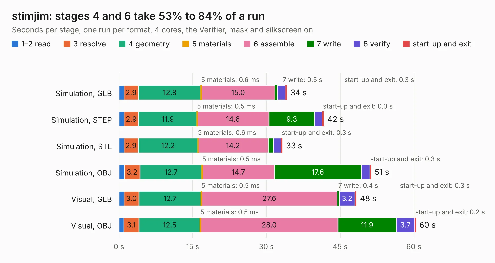

# 2107. stimjim

Board 2,107 of the 3,139 of [Corpus Testing](../Corpus-Testing.md), on [Corpus Page 20](../CorpusTestingPages/Corpus-Testing-20.md#2107-stimjim).

| Mode and format | 1–2 read | 3 resolve | 4 geometry | 5 materials | 6 assemble | 7 write | 8 verify | start-up and exit | Total |
|---|---:|---:|---:|---:|---:|---:|---:|---:|---:|
| Simulation, GLB | 1.1 | 2.9 | 12.8 | 0.6&nbsp;ms | 15.0 | 0.5 | 1.6 | 0.3 | 34.2 |
| Simulation, STEP | 1.1 | 2.9 | 11.9 | 0.5&nbsp;ms | 14.6 | 9.3 | 1.6 | 0.3 | 41.7 |
| Simulation, STL | 1.0 | 2.9 | 12.2 | 0.6&nbsp;ms | 14.2 | 1.1 | 1.5 | 0.3 | 33.3 |
| Simulation, OBJ | 1.1 | 3.2 | 12.7 | 0.5&nbsp;ms | 14.7 | 17.6 | 1.7 | 0.3 | 51.3 |
| Visual, GLB | 1.1 | 3.0 | 12.7 | 0.5&nbsp;ms | 27.6 | 0.4 | 3.2 | 0.3 | 48.3 |
| Visual, OBJ | 1.0 | 3.1 | 12.5 | 0.5&nbsp;ms | 28.0 | 11.9 | 3.7 | 0.2 | 60.4 |

<table align="center"><tr><td valign="top">

| Board | Repo: [open-ephys/stimjim](https://github.com/open-ephys/stimjim) Board: `stimjim.kicad_pcb` |
|---|---|
| Folder | PCB |
| Complexity | 359&nbsp;/&nbsp;1000 (size&nbsp;259, features&nbsp;100) |
| KESE&nbsp;features | through vias, slotted holes, rounded, trapezoid or chamfered pads, arc tracks, filled zones, stack-up, dielectric εr and tanδ |
| Tested | 9th November 2026 |
| Copper&nbsp;layers | 4 |
| File&nbsp;format | KiCad 10 (20260206) |
| Parts,&nbsp;tracks,&nbsp;vias | 193, 1,526, 371 |
| Triangles,&nbsp;simulation | 3,557,586 in 188 parts |
| Verifier | PASS in all six runs |

</td><td valign="top">

<table>
<tr><th>File type</th><th>File size</th><th>Peak memory used</th></tr>
<tr><th colspan="3" align="left">Simulation</th></tr>
<tr><td>GLB</td><td align="right">121&nbsp;MB</td><td align="right">1.1&nbsp;GB</td></tr>
<tr><td>STEP</td><td align="right">564&nbsp;MB</td><td align="right">1.5&nbsp;GB</td></tr>
<tr><td>STL</td><td align="right">178&nbsp;MB</td><td align="right">1.2&nbsp;GB</td></tr>
<tr><td>OBJ</td><td align="right">381&nbsp;MB</td><td align="right">2.4&nbsp;GB</td></tr>
<tr><th colspan="3" align="left">Visual</th></tr>
<tr><td>GLB</td><td align="right">83&nbsp;MB</td><td align="right">1.7&nbsp;GB</td></tr>
<tr><td>OBJ</td><td align="right">265&nbsp;MB</td><td align="right">1.7&nbsp;GB</td></tr>
</table>

</td></tr></table>

| Previous | Next |
|:---|---:|
| [2106. panel-front](b2106b_stimjim_panel-front.md) | [2108. osw](b2108b_kicad-project_osw.md) |
