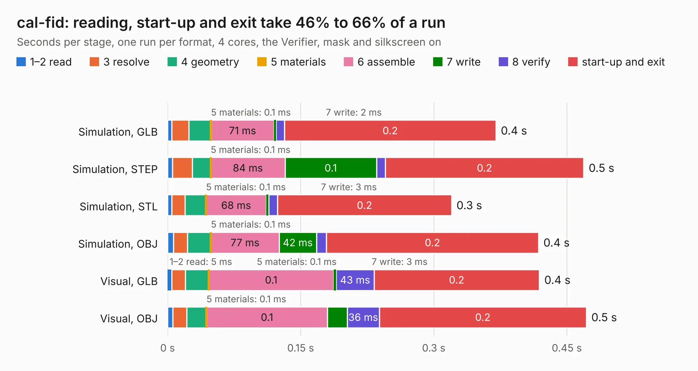

# 2108. cal-fid

Board 2,108 of the 3,126 of [Corpus Testing](../Corpus-Testing.md), on [Corpus Page 20](../CorpusTestingPages/Corpus-Testing-20.md#2108-cal-fid).

| Mode and format | 1–2 read | 3 resolve | 4 geometry | 5 materials | 6 assemble | 7 write | 8 verify | start-up and exit | Total |
|---|---:|---:|---:|---:|---:|---:|---:|---:|---:|
| Simulation, GLB | 5&nbsp;ms | 19&nbsp;ms | 25&nbsp;ms | 0.1&nbsp;ms | 71&nbsp;ms | 2&nbsp;ms | 10&nbsp;ms | 0.2 | 0.4 |
| Simulation, STEP | 6&nbsp;ms | 22&nbsp;ms | 21&nbsp;ms | 0.1&nbsp;ms | 84&nbsp;ms | 0.1 | 10&nbsp;ms | 0.2 | 0.5 |
| Simulation, STL | 5&nbsp;ms | 15&nbsp;ms | 24&nbsp;ms | 0.1&nbsp;ms | 68&nbsp;ms | 3&nbsp;ms | 10&nbsp;ms | 0.2 | 0.3 |
| Simulation, OBJ | 7&nbsp;ms | 15&nbsp;ms | 27&nbsp;ms | 0.1&nbsp;ms | 77&nbsp;ms | 42&nbsp;ms | 11&nbsp;ms | 0.2 | 0.4 |
| Visual, GLB | 5&nbsp;ms | 16&nbsp;ms | 26&nbsp;ms | 0.1&nbsp;ms | 0.1 | 3&nbsp;ms | 43&nbsp;ms | 0.2 | 0.4 |
| Visual, OBJ | 6&nbsp;ms | 16&nbsp;ms | 22&nbsp;ms | 0.1&nbsp;ms | 0.1 | 22&nbsp;ms | 36&nbsp;ms | 0.2 | 0.5 |

<table align="center"><tr><td valign="top">

| Board | Repo: [opulo-inc/lumenpnp](https://github.com/opulo-inc/lumenpnp) Board: `cal-fid.kicad_pcb` |
|---|---|
| Folder | src / PCB / cal-fid |
| Complexity | 52&nbsp;/&nbsp;1000 (size&nbsp;17, features&nbsp;35) |
| KESE&nbsp;features | filled zones, TrueType text |
| Tested | 9th November 2026 |
| Copper&nbsp;layers | 2 |
| File&nbsp;format | KiCad 10 (20260206) |
| Parts,&nbsp;tracks,&nbsp;vias | 0, 0, 0 |
| Triangles,&nbsp;simulation | 5,528 in 8 parts |
| Note | no components |
| Verifier | PASS in all six runs |

</td><td valign="top">

<table>
<tr><th>File type</th><th>File size</th><th>Peak memory used</th></tr>
<tr><th colspan="3" align="left">Simulation</th></tr>
<tr><td>GLB</td><td align="right">199&nbsp;kB</td><td align="right">39&nbsp;MB</td></tr>
<tr><td>STEP</td><td align="right">1.1&nbsp;MB</td><td align="right">40&nbsp;MB</td></tr>
<tr><td>STL</td><td align="right">277&nbsp;kB</td><td align="right">39&nbsp;MB</td></tr>
<tr><td>OBJ</td><td align="right">517&nbsp;kB</td><td align="right">41&nbsp;MB</td></tr>
<tr><th colspan="3" align="left">Visual</th></tr>
<tr><td>GLB</td><td align="right">103&nbsp;kB</td><td align="right">54&nbsp;MB</td></tr>
<tr><td>OBJ</td><td align="right">247&nbsp;kB</td><td align="right">54&nbsp;MB</td></tr>
</table>

</td></tr></table>

| Previous | Next |
|:---|---:|
| [2107. blade13](b2107b_lumenpnp_blade13.md) | [2109. datum](b2109b_lumenpnp_datum.md) |
