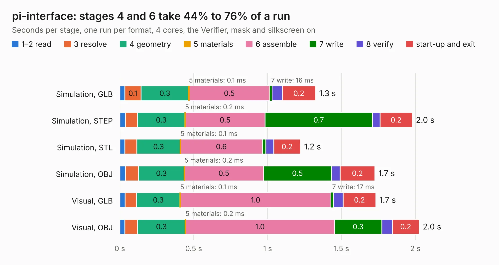

# 2108. pi-interface

Board 2,108 of the 3,120 of [Corpus Testing](../Corpus-Testing.md), on [Corpus Page 20](../CorpusTestingPages/Corpus-Testing-20.md#2108-pi-interface).

| Mode and format | 1–2 read | 3 resolve | 4 geometry | 5 materials | 6 assemble | 7 write | 8 verify | start-up and exit | Total |
|---|---:|---:|---:|---:|---:|---:|---:|---:|---:|
| Simulation, GLB | 34&nbsp;ms | 0.1 | 0.3 | 0.1&nbsp;ms | 0.5 | 16&nbsp;ms | 68&nbsp;ms | 0.2 | 1.3 |
| Simulation, STEP | 37&nbsp;ms | 83&nbsp;ms | 0.3 | 0.2&nbsp;ms | 0.5 | 0.7 | 52&nbsp;ms | 0.2 | 2.0 |
| Simulation, STL | 33&nbsp;ms | 81&nbsp;ms | 0.3 | 0.1&nbsp;ms | 0.6 | 25&nbsp;ms | 53&nbsp;ms | 0.2 | 1.2 |
| Simulation, OBJ | 37&nbsp;ms | 90&nbsp;ms | 0.3 | 0.2&nbsp;ms | 0.5 | 0.5 | 57&nbsp;ms | 0.2 | 1.7 |
| Visual, GLB | 35&nbsp;ms | 78&nbsp;ms | 0.3 | 0.1&nbsp;ms | 1.0 | 17&nbsp;ms | 66&nbsp;ms | 0.2 | 1.7 |
| Visual, OBJ | 34&nbsp;ms | 85&nbsp;ms | 0.3 | 0.2&nbsp;ms | 1.0 | 0.3 | 71&nbsp;ms | 0.2 | 2.0 |

<table align="center"><tr><td valign="top">

| Board | Repo: [opulo-inc/lumenpnp](https://github.com/opulo-inc/lumenpnp) Board: `pi-interface.kicad_pcb` |
|---|---|
| Folder | src / PCB / pi-interface |
| Complexity | 157&nbsp;/&nbsp;1000 (size&nbsp;102, features&nbsp;55) |
| KESE&nbsp;features | through vias, rounded, trapezoid or chamfered pads, filled zones, curved board outline |
| Tested | 9th November 2026 |
| Copper&nbsp;layers | 2 |
| File&nbsp;format | KiCad 10 (20260206) |
| Parts,&nbsp;tracks,&nbsp;vias | 3, 49, 7 |
| Triangles,&nbsp;simulation | 85,092 in 19 parts |
| Verifier | PASS in all six runs |

</td><td valign="top">

<table>
<tr><th>File type</th><th>File size</th><th>Peak memory used</th></tr>
<tr><th colspan="3" align="left">Simulation</th></tr>
<tr><td>GLB</td><td align="right">2.9&nbsp;MB</td><td align="right">156&nbsp;MB</td></tr>
<tr><td>STEP</td><td align="right">12&nbsp;MB</td><td align="right">157&nbsp;MB</td></tr>
<tr><td>STL</td><td align="right">4.3&nbsp;MB</td><td align="right">158&nbsp;MB</td></tr>
<tr><td>OBJ</td><td align="right">8.0&nbsp;MB</td><td align="right">159&nbsp;MB</td></tr>
<tr><th colspan="3" align="left">Visual</th></tr>
<tr><td>GLB</td><td align="right">2.0&nbsp;MB</td><td align="right">130&nbsp;MB</td></tr>
<tr><td>OBJ</td><td align="right">5.6&nbsp;MB</td><td align="right">128&nbsp;MB</td></tr>
</table>

</td></tr></table>

| Previous | Next |
|:---|---:|
| [2107. mobo](b2107b_lumenpnp_mobo.md) | [2109. ringLight](b2109b_lumenpnp_ringLight.md) |
