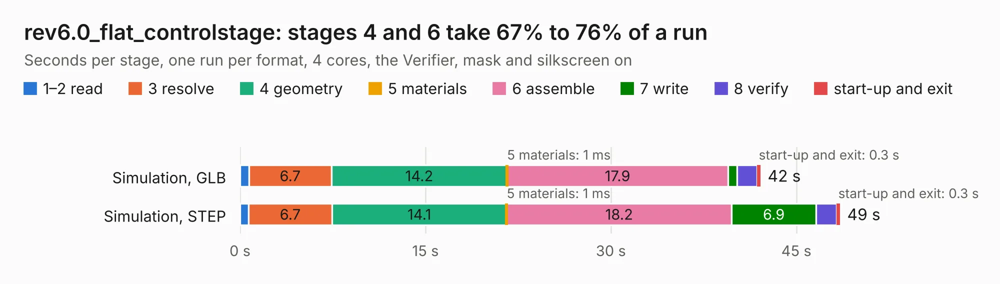

# 2108. rev6.0_flat_controlstage

Board 2,108 of the 3,105 of [Corpus Testing](../Corpus-Testing.md), on [Corpus Page 20](../CorpusTestingPages/Corpus-Testing-20.md#2108-rev60_flat_controlstage).

| Mode and format | 1–2 read | 3 resolve | 4 geometry | 5 materials | 6 assemble | 7 write | 8 verify | start-up and exit | Total |
|---|---:|---:|---:|---:|---:|---:|---:|---:|---:|
| Simulation, GLB | 0.7 | 6.7 | 14.2 | 1&nbsp;ms | 17.9 | 0.7 | 1.6 | 0.3 | 42.1 |
| Simulation, STEP | 0.7 | 6.7 | 14.1 | 1&nbsp;ms | 18.2 | 6.9 | 1.6 | 0.3 | 48.5 |
| Simulation, STL | 0.7 | 6.8 | 15.0 | 1&nbsp;ms | 18.6 | 1.5 | 1.7 | 0.3 | 44.6 |
| Simulation, OBJ | 0.8 | 7.0 | 14.7 | 1&nbsp;ms | 18.3 | 23.9 | 1.6 | 0.3 | 66.7 |
| Visual, GLB | 0.8 | 7.4 | 15.8 | 1&nbsp;ms | 33.1 | 0.4 | 3.1 | 0.3 | 61.0 |
| Visual, OBJ | 0.7 | 7.0 | 15.2 | 1&nbsp;ms | 32.9 | 13.9 | 2.9 | 0.3 | 73.0 |

<table align="center"><tr><td valign="top">

| Board | Repo: [oresat/oresat-adcs-hardware](https://github.com/oresat/oresat-adcs-hardware) Board: `rev6.0_flat_controlstage.kicad_pcb` |
|---|---|
| Folder | oresat-rw-board-rev6 / rev6.0_flat_controlstage |
| Complexity | 342&nbsp;/&nbsp;1000 (size&nbsp;267, features&nbsp;75) |
| KESE&nbsp;features | through vias, rounded, trapezoid or chamfered pads, filled zones, stack-up, dielectric εr and tanδ |
| Tested | 9th November 2026 |
| Copper&nbsp;layers | 4 |
| File&nbsp;format | KiCad 6 (20211014) |
| Parts,&nbsp;tracks,&nbsp;vias | 104, 948, 1,776 |
| Triangles,&nbsp;simulation | 4,214,950 in 107 parts |
| Verifier | PASS in all six runs |

</td><td valign="top">

<table>
<tr><th>File type</th><th>File size</th><th>Peak memory used</th></tr>
<tr><th colspan="3" align="left">Simulation</th></tr>
<tr><td>GLB</td><td align="right">134&nbsp;MB</td><td align="right">1.4&nbsp;GB</td></tr>
<tr><td>STEP</td><td align="right">292&nbsp;MB</td><td align="right">1.9&nbsp;GB</td></tr>
<tr><td>STL</td><td align="right">211&nbsp;MB</td><td align="right">1.4&nbsp;GB</td></tr>
<tr><td>OBJ</td><td align="right">438&nbsp;MB</td><td align="right">2.7&nbsp;GB</td></tr>
<tr><th colspan="3" align="left">Visual</th></tr>
<tr><td>GLB</td><td align="right">86&nbsp;MB</td><td align="right">1.5&nbsp;GB</td></tr>
<tr><td>OBJ</td><td align="right">274&nbsp;MB</td><td align="right">1.8&nbsp;GB</td></tr>
</table>

</td></tr></table>

| Previous | Next |
|:---|---:|
| [2107. controller_rev5.0_flat](b2107b_oresat-adcs-hardware_controller-rev5-0-flat.md) | [2109. rev6.0_flat_powerstage](b2109b_oresat-adcs-hardware_rev6-0-flat-powerstage.md) |
