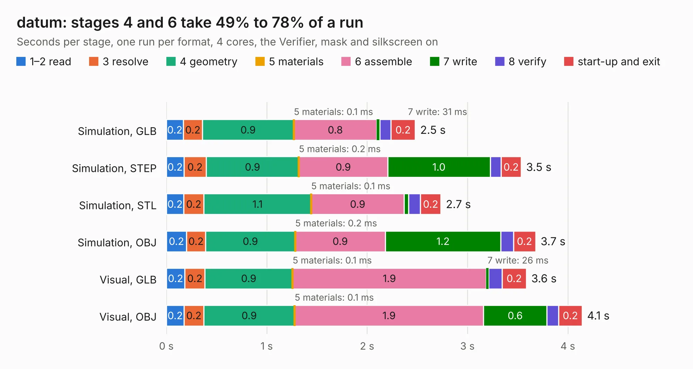

# 2109. datum

Board 2,109 of the 3,127 of [Corpus Testing](../Corpus-Testing.md), on [Corpus Page 20](../CorpusTestingPages/Corpus-Testing-20.md#2109-datum).

| Mode and format | 1–2 read | 3 resolve | 4 geometry | 5 materials | 6 assemble | 7 write | 8 verify | start-up and exit | Total |
|---|---:|---:|---:|---:|---:|---:|---:|---:|---:|
| Simulation, GLB | 0.2 | 0.2 | 0.9 | 0.1&nbsp;ms | 0.8 | 31&nbsp;ms | 0.1 | 0.2 | 2.5 |
| Simulation, STEP | 0.2 | 0.2 | 0.9 | 0.2&nbsp;ms | 0.9 | 1.0 | 0.1 | 0.2 | 3.5 |
| Simulation, STL | 0.2 | 0.2 | 1.1 | 0.1&nbsp;ms | 0.9 | 46&nbsp;ms | 0.1 | 0.2 | 2.7 |
| Simulation, OBJ | 0.2 | 0.2 | 0.9 | 0.2&nbsp;ms | 0.9 | 1.2 | 0.1 | 0.2 | 3.7 |
| Visual, GLB | 0.2 | 0.2 | 0.9 | 0.1&nbsp;ms | 1.9 | 26&nbsp;ms | 0.1 | 0.2 | 3.6 |
| Visual, OBJ | 0.2 | 0.2 | 0.9 | 0.1&nbsp;ms | 1.9 | 0.6 | 0.1 | 0.2 | 4.1 |

<table align="center"><tr><td valign="top">

| Board | Repo: [opulo-inc/lumenpnp](https://github.com/opulo-inc/lumenpnp) Board: `datum.kicad_pcb` |
|---|---|
| Folder | src / PCB / datum |
| Complexity | 83&nbsp;/&nbsp;1000 (size&nbsp;63, features&nbsp;20) |
| KESE&nbsp;features | filled zones |
| Tested | 9th November 2026 |
| Copper&nbsp;layers | 2 |
| File&nbsp;format | KiCad 8 (20240108) |
| Parts,&nbsp;tracks,&nbsp;vias | 4, 5, 0 |
| Triangles,&nbsp;simulation | 196,880 in 13 parts |
| Verifier | PASS in all six runs |

</td><td valign="top">

<table>
<tr><th>File type</th><th>File size</th><th>Peak memory used</th></tr>
<tr><th colspan="3" align="left">Simulation</th></tr>
<tr><td>GLB</td><td align="right">6.9&nbsp;MB</td><td align="right">212&nbsp;MB</td></tr>
<tr><td>STEP</td><td align="right">32&nbsp;MB</td><td align="right">229&nbsp;MB</td></tr>
<tr><td>STL</td><td align="right">9.8&nbsp;MB</td><td align="right">210&nbsp;MB</td></tr>
<tr><td>OBJ</td><td align="right">20&nbsp;MB</td><td align="right">215&nbsp;MB</td></tr>
<tr><th colspan="3" align="left">Visual</th></tr>
<tr><td>GLB</td><td align="right">4.1&nbsp;MB</td><td align="right">188&nbsp;MB</td></tr>
<tr><td>OBJ</td><td align="right">12&nbsp;MB</td><td align="right">184&nbsp;MB</td></tr>
</table>

</td></tr></table>

| Previous | Next |
|:---|---:|
| [2108. cal-fid](b2108b_lumenpnp_cal-fid.md) | [2110. ftp](b2110b_lumenpnp_ftp.md) |
